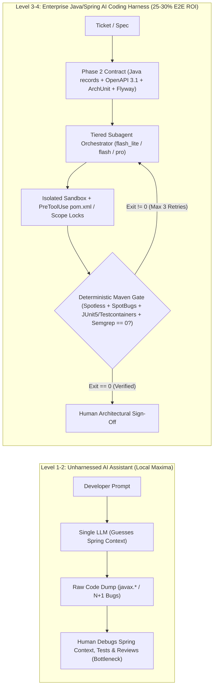
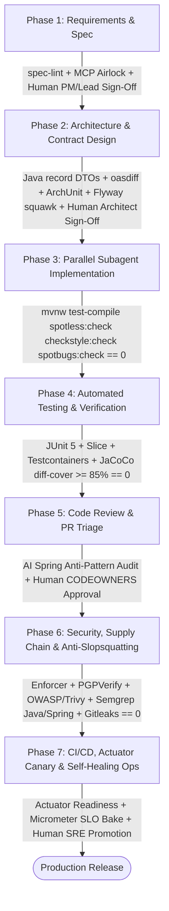

# Enterprise AI-Native SDLC & Coding Harness (Java 21 / Spring Boot 3.x Edition): Master Architectural Blueprint (`00-PLANNER-BLUEPRINT.md`)

> **Document Role**: Master Architectural Blueprint & Specification (Stage 1 of 3: Planner -> Documentor -> Verifier)  
> **Target Audience**: Engineering Director, VP of Engineering, Principal Java Architects, and Platform Engineering Leadership  
> **Target Stack**: **Java 21 LTS (Virtual Threads, Records, Pattern Matching) + Spring Boot 3.x + Maven/Gradle Enterprise Ecosystem**  
> **Strategic Objective**: Transition Java/Spring engineering from ad-hoc "AI Code Assistants" (Gartner Level 1–2 autocomplete / vibe coding) to a governed, high-velocity **Enterprise AI-Native SDLC & Coding Harness** (Gartner Level 3–4+) delivering a **25%–30% end-to-end cycle time reduction** and a **60%–77% reduction in blended LLM token costs** without compromising security, hexagonal/layered architecture, or production stability.

---

## 1. Executive Strategic Thesis & Gartner Alignment

### 1.1 The "Autocomplete Paradox" vs. The AI Coding Harness in Enterprise Java
Most enterprise AI adoption stalls at **Local Maxima**: Java developers use IDE autocomplete or chat assistants ("vibe coding") to generate Spring controllers and boilerplate 30% faster, only to create a **40%+ bottleneck downstream** in PR review, Hibernate `N+1` regressions, `@Transactional` connection pool leaks, ArchUnit boundary violations, and AppSec triage. Faster typing without deterministic verification simply manufactures technical debt at machine speed.

Aligned with **Gartner’s Strategic Research on AI-Native Software Engineering**, sustainable **25%–30% end-to-end SDLC productivity gains** require shifting investment from *unconstrained code generation* to a **Governed AI Coding Harness**:
- **AI Coding Assistant (Legacy Paradigm)**: Human prompts an LLM in a chat window -> LLM guesses Spring repo conventions (often hallucinating deprecated Spring Boot 2.x `javax.*` imports or `RestTemplate` boilerplate) -> Human manually copies code, debugs Spring context startup failures, runs Maven tests, and fixes Checkstyle/SpotBugs errors.
- **Enterprise AI Coding Harness (Target Paradigm)**: An autonomous or semi-autonomous multi-agent system wrapped in **declarative repository contracts (`AGENTS.md`)**, **minimalist domain skills (`SKILL.md`)**, **Model Context Protocol (MCP) tool servers**, **runtime security hooks (`PreToolUse`/`PostToolUse`)**, and **deterministic Maven/Gradle verification gates** (`./mvnw verify`, Spotless, Checkstyle, SpotBugs, ArchUnit, Testcontainers, JaCoCo `diff-cover`) that force the agent to self-correct in a closed loop until all compilers, tests, and security scans exit `0` *before* a human engineer is ever interrupted.

---

### 1.2 Gartner 5-Stage Maturity Model for AI-Native Software Engineering (Java / Spring Boot Edition)

| Maturity Level | Stage Name | Engineering Operating Mode | Governance & Verification | Typical E2E SDLC ROI |
| :--- | :--- | :--- | :--- | :--- |
| **Level 1** | **Ad-Hoc ("Vibe Coding")** | Individual developers use copy-paste chat or unconfigured IDE autocomplete. Zero shared context; frequent `javax.*` vs `jakarta.*` hallucinations. | None. High hallucination rate; PR bloat; broken Spring `ApplicationContext` tests. | **0% to -5%** (Downstream PR review debt offsets coding speed) |
| **Level 2** | **Assisted Coding** | Licensed IDE assistants with basic repo indexing. Single-model synchronous chat. | Manual human testing and review. Spring transaction and resilience rules exist only in developer heads. | **5%–10%** (Faster boilerplate, unchanged lead time to production) |
| **Level 3** | **Harnessed SDLC** *(Immediate 30-Day Target)* | Standardized `AGENTS.md` harness, minimalist `SKILL.md` workflows, Contract-First development (Java `record` DTOs + OpenAPI 3.1 + ArchUnit), and mandatory local/CI verification loops. | Automated `javac`, JUnit 5, Testcontainers, Spotless, Checkstyle, SpotBugs, and Semgrep gates must exit `0` before human review. | **15%–20%** (High first-pass CI quality; 50% fewer review nitpicks) |
| **Level 4** | **Orchestrated Agentic Workflows** *(60–90 Day Target)* | Multi-agent orchestration with tiered model routing (`flash_lite` / `flash` / `pro`), custom internal MCP servers, and headless CI self-healing Maven/Gradle agents. | Runtime `PreToolUse` blast-radius hooks (`pom.xml` lock, Assertion Integrity Guard), FinOps token budgets, and automated PR triage gates. | **25%–30%** (End-to-end cycle time compression across requirements, code, test, and ops) |
| **Level 5** | **AI-Native Tiny Teams** *(Long-Term Vision)* | Small pods of Senior Java Engineer-Architects directing fleets of background agents across the entire microservice lifecycle. | Continuous agent evaluation (DORA + SPACE telemetry), Spring Boot Actuator canary rollbacks, and self-healing ops. | **40%+** (Structural step-change in engineering leverage per headcount) |

---

## 2. The "Minimalist, High-Leverage Skills" Philosophy
### Addressing the Director Question: *"Do Skills Limit AI?"*

A critical architectural concern raised by senior engineering leaders is: **"If we write rigid skill files (`SKILL.md`), won't we handcuff frontier reasoning models and limit their problem-solving capabilities?"**

**The Answer: *Bad* skills limit AI. *Minimalist, constraint-based* skills unlock AI.**

### 2.1 Why Traditional "Tutorial Skills" Degrade Frontier Models
When teams treat `SKILL.md` or `AGENTS.md` as a 2,000-line Spring textbook, three failure modes occur:
1. **Reasoning Suppression (Handcuffing)**: Step-by-step micro-instructions on *how to think* or *how to write standard Java streams or Spring beans* override the frontier model's native chain-of-thought reasoning, forcing it down brittle, suboptimal paths.
2. **Context Rot & Attention Dilution**: Stuffing system prompts with generic Java/Spring tutorials consumes valuable context tokens and degrades recall of actual repository DTOs, ArchUnit rules, and business requirements.
3. **Syntax Ossification**: Hardcoding legacy Spring Boot 2.x snippets (`RestTemplate`, `WebSecurityConfigurerAdapter`, `javax.persistence.*`, Lombok `@Data` on JPA entities) into skills causes agents to write outdated patterns instead of modern Java 21 + Spring Boot 3.x idioms (`record`, `RestClient`, Virtual Threads, `jakarta.persistence.*`, `ProblemDetail`).

### 2.2 The Golden Rule: *"Constraints & Context, Not Tutorials"*
Frontier models (`pro` and `flash` tiers) already know how to write Java 21, Spring Boot 3.x, JPA, and SQL. Skills must **never** teach standard programming. Instead, enterprise skills must be **ultra-concise (`<100 lines`)** and encode **only the 5 things a frontier model cannot deduce from weights alone**:

| # | High-Leverage Skill Pillar | What It Encodes | Concrete Reference Example (`spring-weather-service` Harness) |
| :--- | :--- | :--- | :--- |
| **1** | **Tribal & Proprietary Domain Knowledge** | Non-obvious API quirks, internal SDK conventions, legacy data edge cases, and Resilience4j fallback topologies. | Open-Meteo's geocoding API fails on multi-word regional/borough queries like `"North York Ontario"`. The skill mandates a Spring `RestClient` + Resilience4j `@CircuitBreaker` fallback to the OpenStreetMap Photon API (`photon.komoot.io`) and normalizing `admin1` labels. No LLM knows this business requirement a priori. |
| **2** | **Executable Tool & Script Capabilities** | Custom MCP server tools, deterministic Maven/Gradle commands, and environment-specific goals. | Exact workspace invocation commands (`./mvnw clean test-compile spotless:check checkstyle:check spotbugs:check` and `./mvnw verify`) and custom MCP tool schemas for querying internal OpenAPI registries or Flyway schemas. |
| **3** | **Hard Security & Compliance Red Lines** | Blast-radius boundaries, prohibited dependencies, transaction/thread safety rules, and mandatory human escalation triggers. | Agents are **prohibited** from mutating `pom.xml`/`build.gradle.kts` in Phase 3, wrapping remote `RestClient` HTTP calls inside `@Transactional`, or adding `@Disabled`/weakening AssertJ `assertThat(...)` assertions without human sign-off. |
| **4** | **Outcome-Based Verification Gates** | The objective **Definition of Done** (what must exit `0`), leaving the implementation path open to the model's reasoning. | Requires `./mvnw verify` (`0` failed JUnit 5/Testcontainers tests), `spotless:check`, `checkstyle:check`, `spotbugs:check` (`0` warnings), ArchUnit pass, and RFC 7807 `ProblemDetail` error responses, without dictating private helper method names. |
| **5** | **Multi-Agent File Ownership Contracts** | Contract-First synchronization and strict package-scope isolation so parallel subagents never overwrite each other. | Step 1 locks `dto/` (Java `record` DTOs), `openapi/weather-api.yaml`, and `ArchitectureContractTest.java`. Step 2 dispatches parallel subagents with disjoint write scopes: Client/Persistence Agent (`client/`, `repository/`), Domain/Web Agent (`service/`, `controller/`), and Test Agent (`src/test/java/`). |

### 2.3 Anti-Pattern vs. Best-Practice Comparison Matrix

| Dimension | ❌ Anti-Pattern: Prescriptive Tutorial Skill (Limits AI) | ✅ Best Practice: Minimalist Harness Skill (Amplifies AI) |
| :--- | :--- | :--- |
| **Length & Token Footprint** | 800–2,500 lines of prose, Spring tutorials, and generic style guides. | 40–80 lines of dense constraints, package paths, contracts, and Maven exit gates. |
| **Instruction Style** | *"First create a `@Service` class, then inject `RestTemplate`, then write a `for` loop..."* | *"Lock shared `record` DTOs in `dto/` and ArchUnit rules, then satisfy these Resilience4j and RFC 7807 invariants."* |
| **Knowledge Type** | Public knowledge the LLM already knows (e.g., "How `@Autowired` constructor injection works"). | Proprietary/tribal invariants (e.g., "Open-Meteo drops multi-token queries; fallback to Photon API via `RestClient`"). |
| **Multi-Agent Safety** | Uncoordinated parallel agents editing the same packages, causing merge/compilation drift. | Contract-First DTO/OpenAPI/ArchUnit locking + strict package ownership per subagent tier. |
| **Verification** | Subjective (*"Make sure the Java code is clean, bug-free, and well-tested"*). | Deterministic (*"Run `./mvnw verify`; self-heal until exit code is `0`"*). |

---

## 3. Comprehensive 7-Phase SDLC Gate Specification (Java 21 / Spring Boot 3.x Architecture)

To move from "vibe coding" to an auditable enterprise engineering system, every phase of the Software Development Life Cycle (SDLC) is governed by a **5-Part Gate Contract**:
1. **Entry Criteria**: Required artifacts and context preconditions before any agent is invoked.
2. **AI Mode & Tiered Agent Routing**: Autonomy level (`Autonomous`, `Assisted`, or `Prohibited`), model tier assignment (`flash_lite`, `flash`, `pro`), and package ownership boundaries.
3. **Deterministic Verification Gate (The Harness)**: Automated, non-negotiable binary checks (exit code `0`) executed in a sandbox before any human is notified.
4. **Mandatory Human Sign-Off Gate**: Explicit high-leverage decisions owned by a named human role (Engineer, Staff Architect, PM, AppSec, SRE).
5. **Failure & Escalation Protocol**: Deterministic circuit-breakers when an agent fails verification $N$ times or encounters ambiguity.

---

### Master 7-Phase SDLC Gate Summary Matrix (Java 21 / Spring Boot 3.x)

| Phase | Primary AI Mode | Model Tier Routing | Key Deterministic Harness Gate (Exit `0`) | Mandatory Human Sign-Off Owner | Max Auto-Retries |
| :--- | :--- | :--- | :--- | :--- | :--- |
| **1. Requirements & Planning** | Assisted | `flash_lite` (Recon) + `pro` (Spec) | `spec-lint` Schema & Package Path Validator + `<untrusted_external_content>` MCP Airlock | PM + Tech Lead | Halts on Ambiguity |
| **2. Architecture & Contracts** | Assisted | `pro` (Contract Designer) | `./mvnw test-compile`, `oasdiff` (OpenAPI 3.1), `ArchitectureContractTest` (ArchUnit), `squawk` + `./mvnw flyway:validate` | Staff / Principal Java Architect | 2 Retries |
| **3. Implementation** | Autonomous | `flash_lite` / `flash` (`client`/`repository`) / `pro` (`service`/`controller`) | `./mvnw clean test-compile spotless:check checkstyle:check spotbugs:check` (`0` warnings) + `pom.xml` Lock | None (Sandboxed Inner Loop) | 3 Retries |
| **4. Testing & Verification** | Autonomous | `flash` (Independent Test Agent + Golden Master Agent) | `./mvnw test verify` (JUnit 5, AssertJ, `@WebMvcTest`, `@DataJpaTest`, Testcontainers), JaCoCo `diff-cover >= 85%`, Assertion Guard, optional PITest | Feature Engineer | 3 Retries |
| **5. Code Review & Triage** | Assisted | `pro` (Spring Diff Auditor) + `flash` (Summary) | Zero `[BLOCKER]` findings (`@Transactional` misuse, `N+1`, missing `ProblemDetail`), PR `<400 LOC`, Git hygiene | Human `CODEOWNERS` | 2 PR Cycles |
| **6. Security & Supply Chain** | Assisted Audit | `pro` (Threat Model / SAST Triage) | `maven-enforcer-plugin`, `pgpverify`, `>=30d` Maven Central age, OWASP/Trivy, `semgrep` (`p/java`, `p/spring`), `gitleaks` | AppSec (for `security/`, `auth/`, `infra/`) | 0 on Secrets (Immediate Halt) |
| **7. CI/CD & Actuator Ops** | Assisted Ops | `flash` (Actuator Canary Monitor) + `pro` (RCA) | `/actuator/health/readiness`, Micrometer `http_server_requests_seconds` `p99` & `5xx < 0.1%` 15m Bake, OPA Policy | Release Engineer / On-Call SRE | Deterministic `<60s` Helm/K8s Rollback |

---

## 4. The Full-Time AI SDLC / Platform Engineer Role & The "5% vs. 95%" Architecture

### 4.1 Why `.md` Files Are Only 5% of the AI Coding Harness
A common executive misconception is that setting up an AI-Native SDLC is a one-time task of writing a few `AGENTS.md` and `SKILL.md` markdown files.

In reality, **markdown files are only 5% of the harness** (the declarative configuration layer). Without the **other 95%—the runtime enforcement, Maven/Gradle build interceptors, MCP tooling, and telemetry infrastructure**—markdown instructions degrade within weeks as APIs evolve, microservices scale, and agents bypass soft prompt suggestions.

1. **Deterministic Lifecycle Hooks (`PreToolUse` / `PostToolUse` Interceptors — 20%)**: Lock `pom.xml` / `build.gradle.kts` and Phase 2 `dto/` contracts during Phase 3; block `@Disabled` or AssertJ assertion deletion; run fast incremental `spotless:apply` and single-class compilation on file write.
2. **Internal Enterprise MCP Servers & Input Airlock (20%)**: Connect agents safely to Jira/Linear, Apicurio/Confluent OpenAPI & Avro Schema Registries, read-only staging PostgreSQL/Flyway metadata, and Sentry/Datadog APM traces wrapped in `<untrusted_external_content>` tags.
3. **Headless CI/CD Self-Healing Agent Runners & Testcontainers Sandboxes (20%)**: Ephemeral Kubernetes/Docker runners with pre-warmed Maven dependency caches and reusable Testcontainers daemons for automated CI repair and legacy characterization test backfilling.
4. **Cross-Repo Java AST Semantic Graph & Context Indexing (15%)**: Eclipse JDT / Tree-sitter / Sourcegraph SCIP symbol graphs indexing multi-module Maven/Gradle monorepos and internal Spring Boot starter libraries for `<500ms` `flash_lite` lookup.
5. **LLM Gateway, Tiered Model Routing & FinOps Governance (10%)**: Enforces `flash_lite` / `flash` / `pro` routing and prompt caching, cutting per-PR token cost from `$18.50` to `<$4.20` (-77%).
6. **Internal SWE-Bench Golden Evals & DORA/SPACE Telemetry (15%)**: Benchmarks model and skill updates against 30–50 real historical Java/Spring PRs before org-wide rollout.

---

## 5. Concrete Reference Implementation Case Study: `reference-harness-spring-weather-service`

To prove this architecture in production Java 21 / Spring Boot 3.x code rather than theoretical slideware, this package includes a complete reference implementation in [`reference-harness-spring-weather-service`](file:///E:/agent-sdlc/java-springboot-edition/reference-harness-spring-weather-service):

1. **Repository-Level Coding Harness ([`AGENTS.md`](file:///E:/agent-sdlc/java-springboot-edition/reference-harness-spring-weather-service/AGENTS.md) — 73 Lines)**:
   - Defines the Java 21 virtual-thread runtime, Spring Boot 3.3 stack, package topology, and Multi-Model Subagent Routing policy (`flash_lite` / `flash` / `pro`).
2. **Minimalist Domain Skill ([`.agents/skills/spring-feature-harness/SKILL.md`](file:///E:/agent-sdlc/java-springboot-edition/reference-harness-spring-weather-service/.agents/skills/spring-feature-harness/SKILL.md) — 51 Lines)**:
   - Enforces Step 1 Contract Lock (`GeocodingResultRecord.java`, `weather-api.yaml`, `ArchitectureContractTest.java`) -> Step 2 Parallel Disjoint Subagent Dispatch -> Step 3 Deterministic `./mvnw clean test-compile spotless:check checkstyle:check spotbugs:check && ./mvnw verify` gate.
3. **Locked Phase 2 Data & Architecture Contracts**:
   - [`GeocodingResultRecord.java`](file:///E:/agent-sdlc/java-springboot-edition/reference-harness-spring-weather-service/src/main/java/com/enterprise/weather/dto/GeocodingResultRecord.java): Immutable Java 21 `record` DTO with Jakarta Bean Validation constraints (`@NotBlank`, `@DecimalMin`, `@DecimalMax`).
   - [`ArchitectureContractTest.java`](file:///E:/agent-sdlc/java-springboot-edition/reference-harness-spring-weather-service/src/test/java/com/enterprise/weather/architecture/ArchitectureContractTest.java): ArchUnit contract enforcing `Controller -> Service -> (Client | Repository)` layer isolation.
4. **Tribal Domain Knowledge Implementation**:
   - [`WeatherGeocodingClient.java`](file:///E:/agent-sdlc/java-springboot-edition/reference-harness-spring-weather-service/src/main/java/com/enterprise/weather/client/WeatherGeocodingClient.java): Encodes the Open-Meteo multi-word regional query fallback (`"North York Ontario"`) to OpenStreetMap Photon (`photon.komoot.io`) using Spring `RestClient` and Resilience4j `@CircuitBreaker`.
