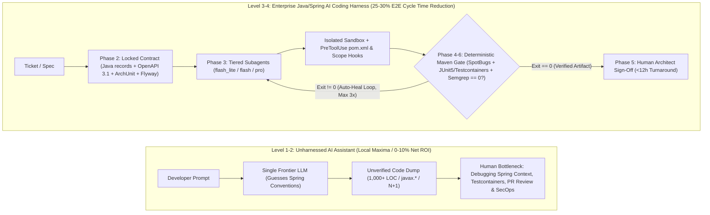
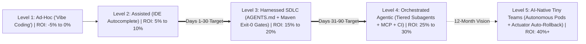
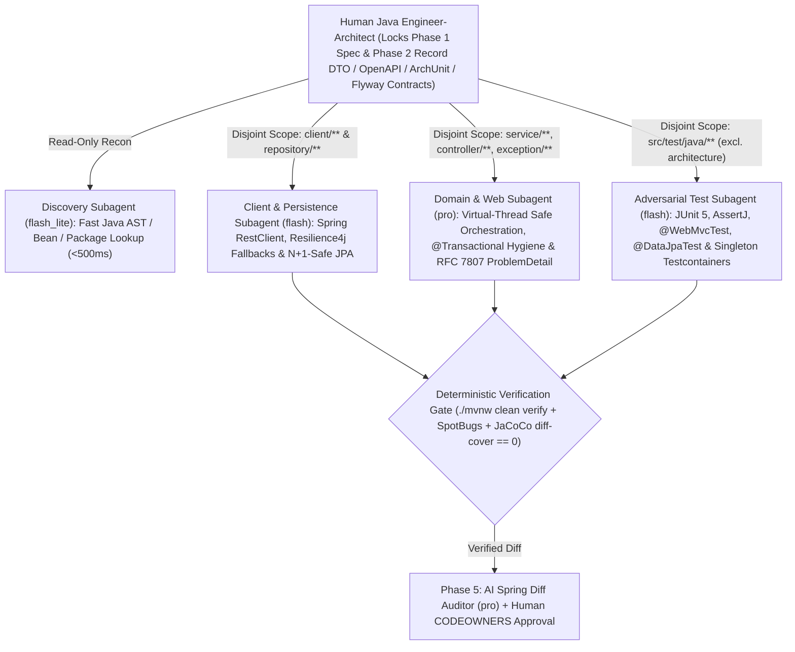
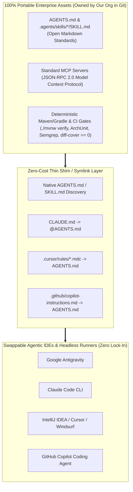

# Executive Summary & Gartner Strategy: From "Vibe Coding" to the Enterprise Java / Spring Boot AI Coding Harness

> **Document ID**: `01-EXECUTIVE-SUMMARY-AND-GARTNER-STRATEGY.md`  
> **Target Audience**: Engineering Director, VP of Engineering, CTO, CFO, Principal Java Architects  
> **Target Technology Ecosystem**: **Java 21 LTS + Spring Boot 3.x + Maven/Gradle Enterprise Microservices & Legacy Monoliths**  
> **Executive Thesis**: Unstructured AI coding tools create a local maximum—accelerating Java boilerplate generation by 30% while increasing downstream PR review, Hibernate `N+1` regressions, `@Transactional` pool exhaustion, QA, and AppSec bottlenecks by 40%+. Achieving a sustainable **25%–30% end-to-end SDLC cycle time reduction** requires transitioning from ad-hoc *AI Coding Assistants* (Gartner Levels 1–2) to a governed **Enterprise AI Coding Harness** (Gartner Levels 3–4+) powered by **Contract-First Orchestration** (Java `record` DTOs, OpenAPI 3.1, ArchUnit, Flyway), **Deterministic Verification Gates**, and **Multi-Model Tiered Routing (`flash_lite` / `flash` / `pro`)**.

---

## 1. The Director's Dilemma: The "Autocomplete Paradox" in Enterprise Java

Across enterprise Java organizations, engineering leaders face a troubling disconnect between **developer-reported AI speed** and **organizational delivery velocity**:
- Individual backend engineers report feeling **25%–40% faster** using IDE autocomplete and chat-based "vibe coding" to scaffold Spring controllers, DTOs, and JPA repositories.
- Yet **DORA Lead Time for Changes** remains flat, **PR review queues** grow longer, **30-day code churn** spikes, and Staff/Senior Java engineers spend more hours debugging subtle AI-generated regressions—such as hallucinated `javax.*` imports in Spring Boot 3, `@Transactional` annotations on `private` methods, remote HTTP calls holding HikariCP database connections open, or broken Flyway migrations—than they save writing boilerplate.

> [!IMPORTANT]
> **The Autocomplete Paradox & Gartner 2026/2027 Risk Forecast**: Optimizing a single stage of a coupled system (typing Java code in Phase 3) without automating downstream architectural, test, and security verification (Phases 4–6) simply shifts the bottleneck downstream. Gartner research warns that organizations scaling unharnessed AI coding assistants without deterministic verification gates experience a **30%–40% surge in escaped software defects and maintenance debt within 12 months**, and **over 40% of ungoverned agentic AI initiatives are canceled** due to runaway token costs and inadequate risk controls.
> - **Prompt Engineering (Fragile / Individual)**: Teaching individual developers how to phrase clever chat prompts. Unscalable, non-repeatable, and lost when the IDE chat session closes.
> - **Harness Engineering (Deterministic / Systemic)**: Wrapping AI models in version-controlled repository contracts ([`AGENTS.md`](file:///E:/agent-sdlc/java-springboot-edition/reference-harness-spring-weather-service/AGENTS.md)), lazy-loaded minimalist skills ([`SKILL.md`](file:///E:/agent-sdlc/java-springboot-edition/reference-harness-spring-weather-service/.agents/skills/spring-feature-harness/SKILL.md)), ArchUnit boundary rules, runtime security interceptors (`PreToolUse`), and binary Maven/Gradle CI exit gates (`exit 0`).

### 1.1 Unharnessed AI Assistant vs. Enterprise Java/Spring AI Coding Harness

Aligned with **Gartner’s Strategic Research on AI-Native Software Engineering**, capturing real enterprise ROI requires shifting investment from *prompting individual LLMs* to engineering the **Harness** that surrounds them:

| Architectural Dimension | Legacy Paradigm: AI Coding Assistant (Levels 1–2) | Target Paradigm: Enterprise Java/Spring AI Coding Harness (Levels 3–4+) |
| :--- | :--- | :--- |
| **Primary Unit of Work** | Ad-hoc chat prompts and line-by-line IDE completions. | Spec-driven, Contract-First work packets executed by orchestrated subagents. |
| **Context Mechanism** | Tribal rules live only in developer heads; LLM guesses Spring Boot 2 vs. 3 conventions. | Declarative repository harness ([`AGENTS.md`](file:///E:/agent-sdlc/java-springboot-edition/reference-harness-spring-weather-service/AGENTS.md)), minimalist skills ([`SKILL.md`](file:///E:/agent-sdlc/java-springboot-edition/reference-harness-spring-weather-service/.agents/skills/spring-feature-harness/SKILL.md)), and live MCP servers. |
| **Model Economics** | Single frontier model used for every trivial class lookup and boilerplate task (`$18.50+` per PR). | **Tiered Model Routing** (`flash_lite` / `flash` / `pro`) + prompt caching (`<$4.20` per PR, **-77% cost**). |
| **Quality Assurance** | Human engineer manually copies code, fixes compilation/Checkstyle errors, debugs Spring context wiring, and catches hallucinations. | Closed-loop **Deterministic Verification Gate** forces agent self-correction until `./mvnw verify`, `spotless`, `checkstyle`, `spotbugs`, `archunit`, and `semgrep` exit `0` *before* human review. |
| **Senior Engineer Leverage** | Staff/Senior engineers bogged down reviewing 1,500-line AI-generated PRs full of subtle transaction and JPA drift. | Senior engineers approve `<50-line` **Phase 2 Data & ArchUnit Contracts** upfront and review pre-verified, high-signal PRs. |

---

## 2. Gartner's 5-Stage Maturity Model for AI-Native Software Engineering

To provide leadership with an objective roadmap, we benchmark our Java engineering organization against **Gartner’s 5-Stage AI-Native Software Engineering Maturity Model**. Our immediate 90-day objective is to transition systematically from **Level 2** to **Level 4**, establishing the foundation for **Level 5**.

### 2.1 Detailed Maturity Stage Breakdown & Capability Milestones

| Maturity Level | Stage Name | Engineering Operating Mode | Governance, Tooling & Verification | Net End-to-End SDLC ROI |
| :--- | :--- | :--- | :--- | :--- |
| **Level 1** | **Ad-Hoc ("Vibe Coding")** | Developers paste Java classes into web chat or use unconfigured IDE plugins. Zero shared prompts or architectural guardrails. | **None.** High hallucination rate (`javax.*` in Boot 3), inconsistent exception handling, silent `N+1` queries, and unreviewed Maven dependencies. | **-5% to 0%** *(Downstream PR review & bug rework erase coding speed)* |
| **Level 2** | **Assisted Coding** *(Current Industry Baseline)* | Organization-wide IDE assistant licenses with basic local repo indexing. Single-model synchronous chat inside IntelliJ / VS Code. | **Manual.** Verification relies entirely on human discipline. ArchUnit boundaries, Flyway safety, and API quirks remain undocumented. | **5%–10%** *(Faster unit boilerplate; unchanged lead time to prod)* |
| **Level 3** | **Harnessed SDLC** *(30-Day Target)* | Standardized [`AGENTS.md`](file:///E:/agent-sdlc/java-springboot-edition/reference-harness-spring-weather-service/AGENTS.md) in every repo, minimalist `<100-line` [`SKILL.md`](file:///E:/agent-sdlc/java-springboot-edition/reference-harness-spring-weather-service/.agents/skills/spring-feature-harness/SKILL.md) workflows, **Contract-First** DTO/OpenAPI/ArchUnit locking, and mandatory local/CI verification loops. | **Deterministic Local + CI Harness.** Compiler (`javac`), Spotless, Checkstyle, SpotBugs, JUnit 5 + Testcontainers, JaCoCo `diff-cover >= 85%`, and `gitleaks` must exit `0` before human review. | **15%–20%** *(First-pass CI rate jumps from 62% to >90%; 50% fewer review nitpicks)* |
| **Level 4** | **Orchestrated Agentic Workflows** *(60–90 Day Target)* | Parallel subagent orchestration with tiered model routing (`flash_lite` / `flash` / `pro`), custom internal MCP servers (Jira, OpenAPI/Flyway Schemas, Sentry), and headless self-healing Maven CI runners. | **Runtime Enforcement.** `PreToolUse` blast-radius hooks block out-of-scope edits, `pom.xml` mutations, and `@Disabled`/AssertJ weakening; automated Phase 5 AI Spring anti-pattern diff audit; FinOps token attribution. | **25%–30%** *(Full E2E cycle-time compression across spec, code, test, review, and ops)* |
| **Level 5** | **AI-Native "Tiny Teams"** *(12-Month Vision)* | High-leverage pods of 2–3 Senior Java Engineer-Architects directing fleets of background agents across requirements, implementation, testing, and Actuator canary operations. | **Continuous Autonomous Governance.** SWE-Bench golden eval suites verify harness changes; automated Flagger/Argo Actuator canary rollbacks paired with autonomous RCA hotfix drafting. | **40%+** *(Structural step-change in revenue and product output per engineer)* |

---

## 3. Gartner's AI-Native "Tiny Teams" & Multi-Model Tiered Routing

### 3.1 The Shift from Feature Squads to Orchestrated "Tiny Teams" (Pragmatic Brownfield Squad Evolution)
In a traditional Level 1–2 Java organization, delivering a cross-cutting microservice or monolith feature requires coordinating a 7–9 person squad (Product Manager, Tech Lead, 3–4 Java Backend Engineers, 1 Database/Migration Specialist, 1 QA Automation Engineer), incurring massive communication and handoff overhead.

**Pragmatic Transition Without Disruptive Reorgs**: Adopting Gartner's "Tiny Teams" topology does **not** require dismantling existing 6–8 person brownfield Java squads or conducting layoffs on Day 1. Instead, an existing 6–8 person squad uses the Level 4 Harness to subdivide internally into **2–3 parallel "Mini-Pods" (2 Java engineers + a tiered subagent fleet per pod)**—multiplying feature throughput by 2x and dedicating unlocked capacity to paying down legacy Spring monolith technical debt with existing headcount.

Under **Gartner’s Level 4–5 Operating Model**, each engineer operates as a **System Orchestrator** commanding specialized subagents bounded by explicit **Phase 2 Data & ArchUnit Contracts**:

### 3.2 Multi-Model Tiered Routing: Achieving 60%–77% Token Cost Reduction

A major financial failure mode of early agentic coding tools is routing **100% of subagent turns to a frontier reasoning model (`pro`)**. When an agent uses a frontier model merely to locate Java classes, inspect `pom.xml` properties, or scaffold standard `@WebMvcTest` MockMvc boilerplate, token costs balloon to **`$15–$25+` per merged Pull Request**.

Our Enterprise AI Coding Harness enforces **Multi-Model Tiered Routing** in [`AGENTS.md`](file:///E:/agent-sdlc/java-springboot-edition/reference-harness-spring-weather-service/AGENTS.md#L35-L43) and via the enterprise LLM Gateway, matching each cognitive task to the optimal model tier:

| Model Tier | Relative Token Cost | Latency Profile | Assigned SDLC Subagent Roles (Java / Spring Boot Stack) | Typical Share of Workflow Turns |
| :--- | :--- | :--- | :--- | :--- |
| **`flash_lite`** | **1x** *(Baseline Ultra-Low Cost)* | Ultra-low (`<500ms` TTFT) | • **Codebase Reconnaissance (`research`)**: Fast read-only Java package discovery, Spring `@Component`/`@Service` bean grep, and DTO/OpenAPI inspection. • **Maven/Actuator Log Filtering**: Pre-filtering verbose Surefire/Failsafe stack traces before passing root causes to higher tiers. | **35% of turns** *(~4% of cost)* |
| **`flash`** | **~3x–5x** *(High-Efficiency Workhorse)* | Fast (`1–2s` TTFT) | • **Client & Persistence Engineer**: Implementing Spring `RestClient` adapters, Resilience4j `@CircuitBreaker` fallbacks (e.g., [`WeatherGeocodingClient.java`](file:///E:/agent-sdlc/java-springboot-edition/reference-harness-spring-weather-service/src/main/java/com/enterprise/weather/client/WeatherGeocodingClient.java)), and Spring Data JPA repositories. • **Adversarial Verification & Test Engineer**: Writing JUnit 5, AssertJ, `@WebMvcTest`, `@DataJpaTest`, and singleton Testcontainers suites in `src/test/java/` (plus Brownfield Golden Master characterization tests). • **Headless CI Self-Healing & PR Summaries**: Fixing Spotless/Checkstyle/SpotBugs issues and generating PR walkthroughs. | **50% of turns** *(~36% of cost)* |
| **`pro`** | **~15x–25x** *(Frontier Deep Reasoning)* | Deep Reasoning | • **Spec & Lead Java Architect Agent**: Phase 1 edge-case synthesis and Phase 2 Contract-First design ([`GeocodingResultRecord.java`](file:///E:/agent-sdlc/java-springboot-edition/reference-harness-spring-weather-service/src/main/java/com/enterprise/weather/dto/GeocodingResultRecord.java), OpenAPI 3.1, [`ArchitectureContractTest.java`](file:///E:/agent-sdlc/java-springboot-edition/reference-harness-spring-weather-service/src/test/java/com/enterprise/weather/architecture/ArchitectureContractTest.java), Flyway Expand DDL). • **Domain Service & Web Engineer**: Complex transactional boundaries, Java 21 virtual-thread concurrency safety, and RFC 7807 `ProblemDetail` error handling (`service/`, `controller/`, `exception/`). • **Independent PR Diff Auditor & Threat Modeler**: Phase 5 Spring anti-pattern review (`@Transactional` misuse, `N+1` queries) and Phase 6 security analysis. | **15% of turns** *(~60% of cost)* |

### 3.3 Unit Economics Comparison: Single-Model vs. Tiered Harness

| Financial Metric (Per Merged Feature PR) | Unoptimized Single-Model (`100% pro`, Uncached) | Enterprise Tiered Harness (`flash_lite` / `flash` / `pro` + Prompt Caching) | Net FinOps Impact |
| :--- | :--- | :--- | :--- |
| **Reconnaissance & Context Gathering** | `$4.20` (`pro` reading 40+ Java classes) | **`$0.18`** (`flash_lite` + SCIP Java AST index) | **-95.7%** |
| **Client/Repository Layer & JUnit/Testcontainers Generation** | `$7.80` (`pro` writing adapters & tests) | **`$1.42`** (`flash` parallel subagents) | **-81.8%** |
| **Architecture, Domain Service & Security Audit** | `$6.50` (`pro` uncached turns) | **`$2.60`** (`pro` with 75% prompt cache hit rate on `AGENTS.md` + DTOs) | **-60.0%** |
| **Total Blended LLM Cost per Merged PR** | **`$18.50`** | **`$4.20`** | **-77.3% Cost Reduction** |
| **Monthly Spend (50 Java Engineers, 1,000 PRs/mo)** | `$18,500 / mo` (`$222k / yr`) | **`$4,200 / mo` (`$50.4k / yr`)** | **`$171,600 / yr` Saved** |

---

## 4. Where the 25%–30% End-to-End Cycle Time Reduction Comes From

To satisfy executive and CFO scrutiny, we decompose the **25%–30% end-to-end Lead Time reduction** across all 7 phases of the Java/Spring SDLC (baselined against a standard 5.2-day / 125-hour microservice feature lifecycle):

| SDLC Phase | Baseline Duration (Level 1–2) | Harnessed Duration (Level 3–4) | Time Saved | Primary Java / Spring Harness Mechanism Driving the Compression |
| :--- | :--- | :--- | :--- | :--- |
| **Phase 1: Requirements & Spec** | 8.0 hrs | **5.5 hrs** | **-31%** | `flash_lite` Spring bean/package recon + `pro` Spec Agent pre-populates impacted classes, edge cases, and test matrices for PM/Lead sign-off. |
| **Phase 2: Architecture & Contracts** | 6.0 hrs | **4.0 hrs** | **-33%** | `pro` Architect Agent drafts Java `record` DTOs, OpenAPI 3.1 specs, ArchUnit rules, and Flyway Expand migrations, verifying `oasdiff` + `squawk` automatically. |
| **Phase 3: Implementation** | 36.0 hrs | **24.0 hrs** | **-33%** | Parallel subagents (`flash` Client/Repo + `pro` Service/Controller) execute simultaneously against locked Phase 2 `record` DTOs without merge conflicts. |
| **Phase 4: Testing & Verification** | 20.0 hrs | **12.0 hrs** | **-40%** | Independent `flash` Test Agent writes JUnit 5, `@WebMvcTest`, `@DataJpaTest`, and singleton Testcontainers suites concurrently; closed-loop harness self-heals until `./mvnw verify == 0`. |
| **Phase 5: Code Review & PR Triage** | 28.0 hrs | **12.0 hrs** | **-57%** | Deterministic Spotless/Checkstyle/SpotBugs/ArchUnit gates eliminate style nitpicks; `pro` Diff Auditor catches Spring anti-patterns (`@Transactional` / `N+1`) before human `CODEOWNERS` are pinged. |
| **Phase 6: Security & Compliance** | 12.0 hrs | **7.5 hrs** | **-38%** | `PreToolUse` secret blocks + automated `maven-enforcer`, `pgpverify`, `semgrep` (`p/java`, `p/spring`), and `trivy` gates clear standard PRs automatically; AppSec reviews only sensitive security paths. |
| **Phase 7: CI/CD & Release Ops** | 15.0 hrs | **11.0 hrs** | **-27%** | Automated Spring Boot Actuator readiness checks, Micrometer Prometheus canary analysis (`flash`), and Flyway Expand-safe `<60s` rollbacks accelerate production promotion. |
| **Total End-to-End Cycle Time** | **125.0 hrs (5.2 Days)** | **86.0 hrs (3.6 Days)** | **-31.2% E2E** | **1.6 Days shaved off every feature cycle while increasing First-Pass CI pass rates from 62% to >92%.** |

---

## 5. Tool-Agnostic Portability & Vendor Lock-In Insulation (`REM-05`)

A top strategic risk for any Engineering Director or CTO is **AI Vendor & IDE Lock-In**: *If we invest 90 days building a Java/Spring AI Coding Harness today, what happens if our developers use a mix of IntelliJ IDEA, VS Code, terminal agents, or if a better frontier model family emerges in 6 months?*

Our architecture is engineered to be **100% vendor-neutral and portable** across every major agentic coding surface (**Google Antigravity**, **Claude Code**, **Cursor**, **GitHub Copilot in IntelliJ/VS Code**, and **Windsurf**) and every frontier LLM provider (**Gemini**, **Claude**, **OpenAI**). We achieve zero lock-in by separating the **Open Harness Layer** from the **Swappable Agent Client Layer**:

### 5.1 Multi-Tool Portability Matrix

| Harness Component | Open Standard Used | How It Runs Across Different Agentic Tools | Switching Cost if Vendor Changes |
| :--- | :--- | :--- | :--- |
| **Repository Rules ([`AGENTS.md`](file:///E:/agent-sdlc/java-springboot-edition/reference-harness-spring-weather-service/AGENTS.md))** | Linux Foundation / Open `AGENTS.md` Markdown spec | Read natively by Antigravity, Cursor, Windsurf, and Copilot; imported into Claude Code via a 1-line `@AGENTS.md` pointer in `CLAUDE.md`. | **0 Hours** *(Single source of truth in repo root)* |
| **Domain Skills ([`SKILL.md`](file:///E:/agent-sdlc/java-springboot-edition/reference-harness-spring-weather-service/.agents/skills/spring-feature-harness/SKILL.md))** | Open Agent Skills Spec (`.agents/skills/<name>/SKILL.md` with YAML frontmatter) | Loaded on-demand by skill-aware agents or referenced as modular markdown playbooks by any IntelliJ/VS Code chat assistant. | **0 Hours** *(Plain Markdown + standard `./mvnw` CLI commands)* |
| **Enterprise Tooling (MCP)** | **Model Context Protocol (MCP)** (Open JSON-RPC 2.0 standard) | One internal MCP server (Jira, OpenAPI/Apicurio Schemas, Flyway DB introspection, Sentry) connects identically to Antigravity, Claude Code, Cursor, Windsurf, and Copilot without rewriting a single line of integration code. | **0 Hours** *(Write once, plug into any MCP client)* |
| **Deterministic Gates & Hooks** | Standard POSIX / Maven (`./mvnw`) / Gradle (`./gradlew`) CLI exit codes (`0` vs. `!= 0`) + Git hooks / CI workflows | Enforced via local `PreToolUse` / Git pre-commit hooks and GitHub Actions / GitLab CI / Jenkins pipelines. No agent can bypass Maven verification in CI regardless of which IDE generated the Java code. | **0 Hours** *(Enforced by Maven/Gradle & CI, not the IDE)* |
| **Tiered Model Routing (`flash_lite` / `flash` / `pro`)** | Logical capability tiers mapped via Enterprise LLM Gateway (LiteLLM / Vertex / Bedrock) | Workflows request abstract tiers (`flash_lite`, `flash`, `pro`) rather than hardcoded model snapshot strings, allowing instant swaps as newer models launch. | **< 15 Minutes** *(Single gateway config update)* |

---

## 6. Director Objection-Handling Playbook & Junior Developer Protocol (`REM-06`)

When presenting this transformation to the VP of Engineering, Peer Directors, Principal Java Architects, or CFO, anticipate these **7 high-stakes executive objections** and use the verified architectural responses below:

| # | Executive / Principal Architect Objection | The Underlying Risk | Our Architectural Counter-Measure & Data-Backed Answer |
| :--- | :--- | :--- | :--- |
| **1** | **The PR Flood Objection**: *"If AI writes Java boilerplate 3x faster, won't it bury our Senior/Staff Engineers under a mountain of 1,500-line, low-quality Spring PRs?"* | Senior engineer burnout; rubber-stamping broken hexagonal/layered architecture. | **4-Layer Review Shield**: 1. Seniors approve a **`<50-line` Phase 2 Contract** (Java `record` DTOs in `dto/`, OpenAPI 3.1, and `ArchitectureContractTest.java`) *before* code is written. 2. Agents cannot open a PR until local `./mvnw verify`, `spotless`, `checkstyle`, `spotbugs`, `archunit`, and `semgrep` gates exit `0`. 3. PRs exceeding **`400 LOC`** of production Java code are deterministically blocked (`pr-size-gate`). 4. An independent `pro` **Phase 5 Spring Diff Auditor** catches `[BLOCKER]` defects (`@Transactional` on private methods, `N+1` queries, missing `ProblemDetail`) before any human is pinged—cutting human PR review time by **57% (`28h -> <12h`)**. |
| **2** | **The Junior Talent Atrophy Objection**: *"If agents write the Spring services and JPA queries, how will our Junior Java Engineers ever learn concurrency, transaction management, debugging, and become Seniors?"* | Hollowing out the engineering talent pipeline; juniors pushing Spring magic they don't understand. | **The Junior Developer Socratic Apprenticeship Protocol** *(detailed in Section 6.1 below)*: Juniors are prohibited from blind "one-shot vibe prompting." They must author Phase 1 test matrices and Phase 2 Java `record` DTO / ArchUnit contracts manually, run agents in **Socratic Explain-First Mode**, and pass a mandatory **PR Code Defense Check** explaining transaction and resilience boundaries before merge. |
| **3** | **The Legacy Spring Monolith Objection**: *"A greenfield `spring-weather-service` is easy, but our core revenue Spring monolith is 10 years old with 20% JaCoCo coverage and 4,000 Checkstyle warnings. Won't an 85% coverage gate deadlock every PR?"* | Strict gates halting delivery on brownfield repositories. | **Brownfield Ratchet & Differential Coverage ([Document 02, Section 8](file:///E:/agent-sdlc/java-springboot-edition/02-SDLC-GATE-SPECIFICATIONS.md))**: We never enforce 85% *global* JaCoCo coverage on legacy repos on Day 1. We enforce **`diff-cover >= 85%` on modified/added lines/branches only** (from `target/site/jacoco/jacoco.xml`), run Checkstyle/SpotBugs on `git diff` touched files, and dispatch a **Step 0 Golden Master Characterization Subagent** (`ApprovalTests` / `MockMvc` snapshot capture) *before* any refactoring agent touches legacy classes. |
| **4** | **The Hallucinated Maven Coordinates & Prompt Injection Objection**: *"What stops an agent from adding a typosquatted/hallucinated Maven dependency ('slopsquatting') to `pom.xml` or executing a prompt injection hidden in a Jira ticket?"* | Supply-chain compromise and OWASP LLM01 data exfiltration. | **Hard Runtime Isolation ([Document 02, Phases 1, 3, 6](file:///E:/agent-sdlc/java-springboot-edition/02-SDLC-GATE-SPECIFICATIONS.md))**: • `PreToolUse` locks `pom.xml` and `build.gradle.kts` during Phase 3; new dependencies require Phase 2 human sign-off + Phase 6 `maven-enforcer-plugin`, `pgpverify-maven-plugin` PGP signature verification, and Maven Central publish age `>=30 days`. • External MCP text (Jira/GitHub/Sentry) is wrapped in `<untrusted_external_content>` tags; during tainted turns, `PreToolUse` blocks outbound `curl`/`wget` and credential reads (`~/.m2/settings.xml`, `.env`). |
| **5** | **The Flyway Database Rollback Trap Objection**: *"Phase 7 promises a `<60s` automatic Helm/K8s canary rollback, but what if the PR included a Flyway migration (`V2__*.sql`) that dropped or renamed a column?"* | Rolling back Spring Boot pods against an incompatible mutated PostgreSQL schema causes a P0 `SQLGrammarException` outage. | **Mandatory Expand-and-Contract Flyway/Liquibase Gate ([Document 02, Phases 2, 6, 7](file:///E:/agent-sdlc/java-springboot-edition/02-SDLC-GATE-SPECIFICATIONS.md))**: Phase 2 and Phase 6 run `squawk` + `./mvnw flyway:validate` to deterministically block destructive DDL (`DROP COLUMN`, `RENAME`, lock-heavy `ALTER`) in the same release as application code. All schema changes must be backwards-compatible (**Expand** first, **Contract** in a separate post-bake release). |
| **6** | **The Headcount Skepticism Objection**: *"Why do we need a dedicated AI Platform Engineer if `AGENTS.md` and `SKILL.md` are under 100 lines of Markdown?"* | Misallocating headcount to "prompt writing." | **The 5% vs. 95% Iceberg ([Document 04](file:///E:/agent-sdlc/java-springboot-edition/04-AI-PLATFORM-ENGINEER-CHARTER-AND-90-DAY-ROADMAP.md))**: Markdown is only the 5% declarative surface. The AI Platform Engineer builds and operates the **95% runtime infrastructure** (`PreToolUse` binaries, OAuth-governed MCP servers, headless CI self-healing runners with reusable Testcontainers, SCIP Java AST symbol graphs, FinOps gateway, and 30-PR SWE-Bench Golden Evals), returning **5x–15x FTE ROI**. |
| **7** | **The Copilot/Cursor Overlap & Model Drift Objection**: *"We already pay `$20–$40/user/mo` for GitHub Copilot in IntelliJ or Cursor—why build a harness? And what happens when a model vendor has an outage or silently updates weights?"* | Redundant tooling spend; workflow fragility during LLM provider outages or silent model regressions. | **Engine vs. Guardrails + Multi-Provider Failover**: Copilot/Cursor is the *IDE engine* (Level 2); the Harness is the *governance, MCP context, ArchUnit contract, and Maven CI verification layer* (Level 4) that turns raw completions into a 25%–30% E2E gain. Our Enterprise LLM Gateway provides automatic multi-provider failover across `flash_lite`/`flash`/`pro` equivalents, and our **30-PR Java Golden Eval Suite** benchmarks any new model checkpoint offline before promotion. |

### 6.1 Deep Dive: The Junior Java Developer Socratic Apprenticeship Protocol

To ensure our AI-Native SDLC **accelerates junior-to-senior progression** rather than creating passive prompt-operators, Java engineers at **L3 / Junior levels** operate under three mandatory apprenticeship guardrails enforced by the harness:

1. **Human-Authored Contracts & Edge-Case Matrices (Phases 1–2)**
   - In Junior Apprenticeship Mode, the agent is prohibited from generating the Phase 1 Test Matrix or the Phase 2 Java `record` DTOs (`dto/*`) and ArchUnit contracts from scratch.
   - The Junior Engineer must draft the Java `record` DTOs, Jakarta Bean Validation annotations, and enumerate the positive, negative, and boundary test cases themselves; the `pro` Architect Agent then acts as a **Socratic Tutor**, critiquing missing edge cases (e.g., *"What happens to the HikariCP connection pool if `WeatherGeocodingClient` times out inside a `@Transactional` method?"* or *"What if Open-Meteo returns an empty array on a multi-word borough query like 'North York Ontario'?"*) rather than handing over the answer.
2. **Socratic Root-Cause Diagnosis Before Auto-Heal (Phases 3–4)**
   - When a Maven build, ArchUnit rule, or JUnit 5 test fails for an L3 engineer, the harness pauses before running the automated repair loop and prompts the engineer: *"Review the failing Surefire stack trace above: which layer (`client/`, `service/`, or `controller/`) violated the Phase 2 contract?"*
3. **Mandatory AI Code Ownership & PR Defense Sign-Off (Phase 5)**
   - The PR template includes an **"Author Architectural Walkthrough"** section that the `PreToolUse` hook prevents AI agents from filling out. The human author must write a 3-bullet explanation in their own words detailing *why* the `@Transactional` boundary, Resilience4j fallback, or JPA fetch strategy was designed that way and *how* it behaves under partial failure before `CODEOWNERS` review is unlocked.

---

> [!TIP]
> **Next Step in This Package**: Proceed to **[`02-SDLC-GATE-SPECIFICATIONS.md`](file:///E:/agent-sdlc/java-springboot-edition/02-SDLC-GATE-SPECIFICATIONS.md)** for the exhaustive Java 21 / Spring Boot 3.x engineering specification of every gate, Maven/Gradle CLI check, brownfield JaCoCo `diff-cover` ratchet, Maven Enforcer / PGP anti-slopsquatting defense, prompt-injection taint guard, and Flyway Expand-and-Contract database rollback rule across Phases 1 through 7.
