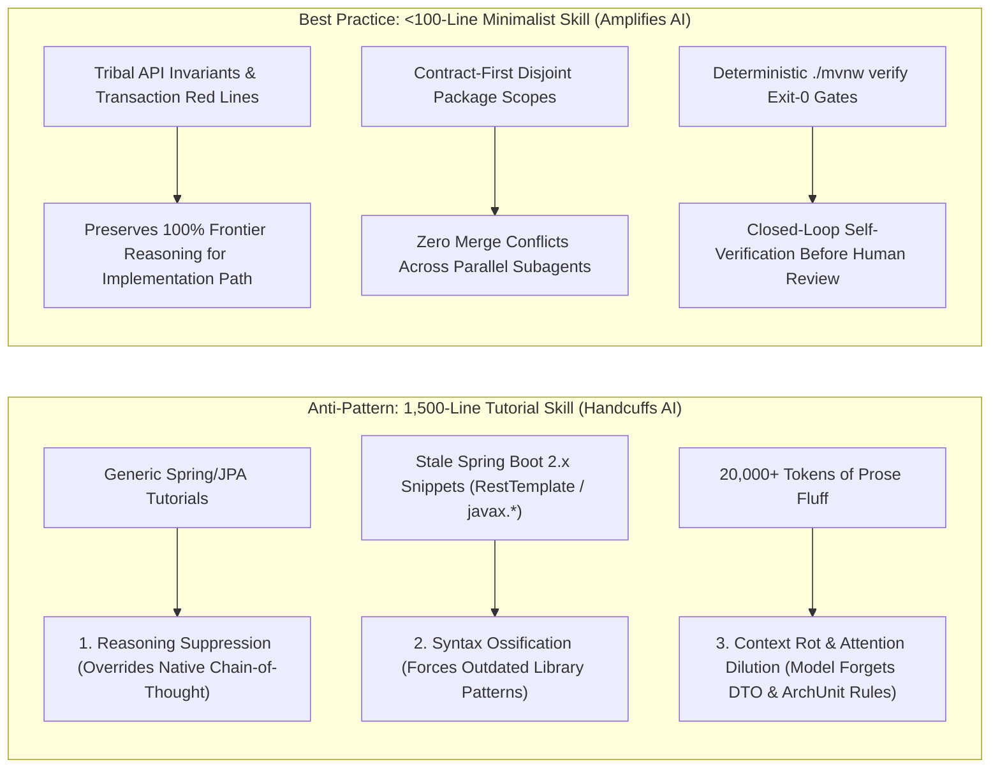
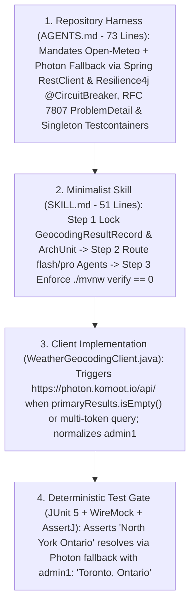
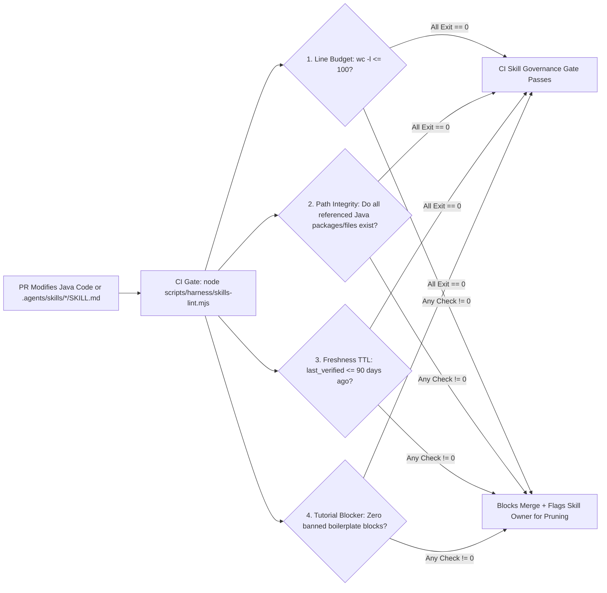

# Minimalist Harness & Skill Engineering Standards (Java 21 / Spring Boot 3.x Edition): Why Constraints Amplify Frontier AI

> **Document ID**: `03-MINIMALIST-HARNESS-AND-SKILL-STANDARDS.md`  
> **Target Audience**: Engineering Directors, Principal Java Architects, Tech Leads, AI Champions  
> **Core Question Answered**: *"If we write structured skill files (`SKILL.md`) and repository harnesses (`AGENTS.md`), won't we handcuff frontier reasoning models and limit their problem-solving capability?"*  
> **Executive Answer**: **Bad, tutorial-style skills limit AI. Minimalist, constraint-based skills (`<100 lines`) unlock AI.**

---

## 1. Answering the Industry Debate: *"Do Skills Limit AI Capability?"*

A valid concern among senior Java engineers and directors is that rigid prompt templates or bloated `SKILL.md` files can make frontier reasoning models (`pro` and `flash`) perform *worse* than an unprompted model.

Empirical evaluation across frontier models confirms that **degradation happens when teams write prescriptive Spring tutorials instead of declarative constraints**.



### 1.1 The 3 Failure Modes of Legacy "Tutorial Skills" in Enterprise Java

1. **Reasoning Suppression (Cognitive Handcuffing)**
   - Frontier models possess RL-trained chain-of-thought reasoning capable of solving complex concurrency, domain modeling, and algorithmic challenges in Java 21.
   - When a skill dictates micro-steps (*"First create a `@Service` class, then declare a private `Logger`, then write a `try/catch` block around `RestTemplate.exchange()`..."*), it overrides the model's native planning ability and forces brittle, mechanical code generation.

2. **Syntax Ossification (Stale Spring Boot 2.x Training Overrides)**
   - Frontier models are pre-trained on modern Java 21 and Spring Boot 3.x idioms (`record` DTOs, Pattern Matching for `switch`, Virtual Threads, synchronous `RestClient`, `jakarta.*` namespace, RFC 7807 `ProblemDetail`, `@ServiceConnection` Testcontainers).
   - When well-meaning engineers paste 600 lines of 2020-era Spring Boot 2.x code examples into a skill file (`javax.persistence.*`, `WebSecurityConfigurerAdapter`, `RestTemplate`, `@Data` on JPA entities), the model dutifully mimics the outdated in-context examples rather than using superior modern patterns from its weights.

3. **Context Rot & Attention Dilution ("Lost in the Middle")**
   - Every token of generic Java programming advice loaded into the system prompt competes for transformer attention with the actual repository DTOs, ArchUnit rules, Flyway schemas, and ticket edge cases.
   - Research consistently shows that bloated system prompts (`>2,000 lines`) reduce instruction-following accuracy on hard domain constraints by **30%–45%**.

---

## 2. The Golden Rule: *"Constraints & Context, Not Tutorials"*

Our engineering standard enforces a strict architectural boundary:
> **Never teach a frontier model how to write standard Java 21, Spring Boot, JPA, or SQL. Encode ONLY the 5 proprietary invariants that no model on earth can deduce from its pre-training weights alone—and keep every `SKILL.md` under 100 lines.**

### 2.1 The 5 High-Leverage Skill Pillars (Java / Spring Boot Edition)

| Pillar # | High-Leverage Skill Pillar | What Belongs in `SKILL.md` / `AGENTS.md` | What Must Be Stripped Out (Zero Fluff) | Concrete Example from [`reference-harness-spring-weather-service`](file:///E:/agent-sdlc/java-springboot-edition/reference-harness-spring-weather-service) |
| :--- | :--- | :--- | :--- | :--- |
| **Pillar 1** | **Tribal & Proprietary Domain Knowledge** | Non-obvious third-party API quirks, internal legacy edge cases, required Resilience4j fallback chains, and domain data normalization rules. | Generic explanations of `@RestController`, constructor injection, or HTTP status codes. | Open-Meteo's geocoding API returns empty (`[]`) on multi-word regional/borough queries like `"North York Ontario"`. `WeatherGeocodingClient` must fallback via Spring `RestClient` + Resilience4j `@CircuitBreaker` to OpenStreetMap Photon (`photon.komoot.io`) and normalize `admin1`. |
| **Pillar 2** | **Executable Tools, Scripts & MCP Capabilities** | Exact workspace Maven/Gradle CLI commands, custom scripts, and MCP server tool names/arguments. | Generic documentation on how Maven, Git, or JUnit 5 work. | Exact execution sequence: `./mvnw clean test-compile spotless:check checkstyle:check spotbugs:check` and `./mvnw verify`. |
| **Pillar 3** | **Hard Security, Transaction & Concurrency Red Lines** | Blast-radius boundaries, `pom.xml` write locks, `@Transactional` & virtual-thread rules, and assertion integrity guardrails. | Vague platitudes like *"Write clean, thread-safe, maintainable Java code."* | Prohibited from mutating `pom.xml` in Phase 3, wrapping remote `RestClient` calls inside `@Transactional`, using thread-pinning `synchronized` blocks around I/O, or adding `@Disabled` / weakening AssertJ `assertThat(...)`. |
| **Pillar 4** | **Outcome-Based Verification Gates** | Objective, binary **Definition of Done** criteria (commands that must exit `0` + required ArchUnit, JaCoCo, and RFC 7807 invariants). | Prescribing private helper method names or internal stream pipelines. | `./mvnw verify` (`0` failures, `0` `@Disabled`), `spotless`/`checkstyle`/`spotbugs` (`0` warnings), JaCoCo `diff-cover >= 85%`, RFC 7807 `ProblemDetail` via `@RestControllerAdvice`, and singleton `@ServiceConnection` Testcontainers. |
| **Pillar 5** | **Multi-Agent File Ownership Contracts** | Contract-First synchronization order and disjoint package ownership per model tier (`flash_lite` / `flash` / `pro`). | Allowing uncoordinated parallel agents to edit the same Java packages simultaneously. | Step 1 locks `dto/` (`GeocodingResultRecord.java`), `openapi/weather-api.yaml`, and `ArchitectureContractTest.java`. Step 2 dispatches parallel Client/Repo (`flash` -> `client/`, `repository/`), Domain/Web (`pro` -> `service/`, `controller/`, `exception/`), and Test (`flash` -> `src/test/java/`) subagents. |

### 2.2 Anti-Pattern vs. Best-Practice Comparison Matrix

| Dimension | ❌ Legacy Prescriptive Skill (Limits AI) | ✅ Enterprise Minimalist Harness Skill (Amplifies AI) |
| :--- | :--- | :--- |
| **Line Count** | 800–2,500 lines (`12,000+` tokens per turn) | **40–80 lines (`< 600` tokens per turn; hard cap at 100 lines)** |
| **Cognitive Posture** | Micromanages *how* the model writes Java loops and beans | Defines *what* DTO/ArchUnit contracts, invariants, and Maven exit gates must hold |
| **Model Compatibility** | Causes `javax.*` / Spring Boot 2.x regressions when models upgrade | Scales natively as frontier models get smarter (`pro` / next-gen) |
| **Multi-Agent Safety** | Causes merge conflicts and mismatched DTO method signatures | Enforces Contract-First `record` DTO locking + disjoint package write scopes |
| **Verification Standard** | Subjective (*"Ensure high unit test quality"*) | Deterministic (*"Run `./mvnw verify`; exit code must be `0` with `diff-cover >= 85%`"*) |

---

## 3. Real-World Case Study: Encoding the `"North York Ontario"` Geocoding Fallback in `spring-weather-service`

To see how **Tribal Domain Knowledge (Pillar 1)**, **Contract-First Synchronization (Pillar 5)**, and **Outcome-Based Verification (Pillar 4)** work together in enterprise Java, examine how a real-world regional geocoding failure mode is solved and locked into [`reference-harness-spring-weather-service`](file:///E:/agent-sdlc/java-springboot-edition/reference-harness-spring-weather-service).

### 3.1 The Real-World Failure Mode (Why Unharnessed AI Failed)
When a client queries a single-word city like `"Toronto"` or `"London"`, the primary Open-Meteo Geocoding API (`https://geocoding-api.open-meteo.com/v1/search`) returns accurate coordinates.

However, when users search for **multi-word regional queries, municipal boroughs, or city + province strings**—such as **`"North York Ontario"`**—Open-Meteo's GeoNames index returns **empty results (`[]`)** because it only indexes single-token municipality names.
- An unharnessed LLM (Level 1–2) has no way of knowing this quirk of Open-Meteo's search endpoint from pre-training weights alone. Left unguided, any agent refactoring `WeatherGeocodingClient.java` simplifies the `RestClient` call back to a single Open-Meteo request, silently breaking regional searches across Canada and the US.

### 3.2 How the Java/Spring Harness Encodes and Protects the Invariant Across 4 Layers



#### Layer 1: Repository Harness Rule in [`AGENTS.md`](file:///E:/agent-sdlc/java-springboot-edition/reference-harness-spring-weather-service/AGENTS.md#L48-L50)
Instead of writing a tutorial on Spring `RestClient`, `AGENTS.md` states the exact domain invariant in 3 lines:
> - Open-Meteo's geocoding endpoint (`https://geocoding-api.open-meteo.com/v1/search`) returns empty (`[]`) on multi-word regional/borough queries such as `"North York Ontario"`.
> - `WeatherGeocodingClient` must trigger a secondary fallback via Spring `RestClient` (and `@CircuitBreaker(name = "openMeteoGeocoding", fallbackMethod = "photonFallback")`) to OpenStreetMap Photon (`https://photon.komoot.io/api/`), normalizing `admin1` (`Name, Admin1, Country`) and deduplicating coordinates within `0.08` degrees.

#### Layer 2: Contract-First Lock in [`GeocodingResultRecord.java`](file:///E:/agent-sdlc/java-springboot-edition/reference-harness-spring-weather-service/src/main/java/com/enterprise/weather/dto/GeocodingResultRecord.java) & [`ArchitectureContractTest.java`](file:///E:/agent-sdlc/java-springboot-edition/reference-harness-spring-weather-service/src/test/java/com/enterprise/weather/architecture/ArchitectureContractTest.java)
The shared Java 21 `record` DTO locks the `@Nullable String admin1` field and formatting contract so `WeatherGeocodingClient`, `WeatherService`, `WeatherController`, and `WeatherControllerSliceTest` compile against an identical type:
```java
public record GeocodingResultRecord(
    long id,
    @NotBlank String name,
    @DecimalMin("-90.0") @DecimalMax("90.0") double latitude,
    @DecimalMin("-180.0") @DecimalMax("180.0") double longitude,
    @NotBlank String country,
    @Nullable String admin1
) {}
```

#### Layer 3: Resilient Implementation in [`WeatherGeocodingClient.java`](file:///E:/agent-sdlc/java-springboot-edition/reference-harness-spring-weather-service/src/main/java/com/enterprise/weather/client/WeatherGeocodingClient.java)
Guided by the 51-line [`SKILL.md`](file:///E:/agent-sdlc/java-springboot-edition/reference-harness-spring-weather-service/.agents/skills/spring-feature-harness/SKILL.md), the `flash` Client Subagent implements multi-token detection (`primaryResults.isEmpty() || trimmed.contains(",") || trimmed.split("\\s+").length > 1`), queries `https://photon.komoot.io/api/`, normalizes `admin1`, and guards against upstream failures with `@CircuitBreaker(name = "openMeteoGeocoding", fallbackMethod = "photonFallback")`.

#### Layer 4: Deterministic Verification Gate (`./mvnw clean test-compile spotless:check checkstyle:check spotbugs:check && ./mvnw verify`)
The independent `flash` Test Subagent locks this behavior into JUnit 5 + WireMock tests so no future agent or human refactor can regress `"North York Ontario"` without immediately failing Gate 4.

---

## 4. Production Copy-Paste Templates (Java 21 / Spring Boot 3.x)

Below are the exact production files implemented in [`reference-harness-spring-weather-service`](file:///E:/agent-sdlc/java-springboot-edition/reference-harness-spring-weather-service). Both are strictly under the `<100-line` minimalist cap.

### 4.1 Production Template 1: Repository-Level `AGENTS.md` (`73 Lines` — Cap `<= 80 Lines`)
*(Live File: [`reference-harness-spring-weather-service/AGENTS.md`](file:///E:/agent-sdlc/java-springboot-edition/reference-harness-spring-weather-service/AGENTS.md))*

````markdown
# AGENTS.md — Enterprise AI Coding Harness (Java 21 / Spring Boot 3.x)

> **Gartner Level 3–4 Reference Implementation:** Repository-level **AI Coding Harness** for `spring-weather-service`. Every AI coding agent operating in this repository must obey these architectural boundaries, tiered subagent routing policies, and deterministic Maven verification gates.

---

## 1. Service Context & Technology Stack
- **Service**: `spring-weather-service` (Enterprise Weather & Regional Geocoding Microservice)
- **Runtime & Framework**: Java 21 LTS (`spring.threads.virtual.enabled=true`), Spring Boot 3.3.x, Spring `RestClient`, Resilience4j, Spring Data JPA (Hibernate 6), Flyway, Micrometer + Prometheus Actuator
- **Quality & Verification Toolchain**: Maven Wrapper (`./mvnw`), JUnit 5, AssertJ, Mockito, Spring Slice Tests (`@WebMvcTest`, `@DataJpaTest`), Testcontainers (`@ServiceConnection`), ArchUnit, Spotless, Checkstyle, SpotBugs, JaCoCo (`diff-cover`)

### Repository Package Topology
```text
spring-weather-service/
├── AGENTS.md                                      # Repository AI Coding Harness (this file)
├── .agents/skills/spring-feature-harness/SKILL.md # Minimalist <100-line domain skill
├── pom.xml                                        # Locked in Phase 3 (PreToolUse write-lock)
├── src/main/resources/
│   ├── openapi/weather-api.yaml                   # Locked Phase 2 OpenAPI 3.1 Contract
│   └── db/migration/V*__*.sql                     # Flyway Expand-and-Contract SQL migrations
├── src/main/java/com/enterprise/weather/
│   ├── dto/                                       # Locked Phase 2 Java `record` DTOs & Validation
│   ├── client/                                    # Spring RestClient adapters & Photon fallback
│   ├── repository/                                # Spring Data JPA repositories & entities
│   ├── service/                                   # Domain orchestration & transaction boundaries
│   ├── controller/                                # REST controllers & RFC 7807 ProblemDetail advice
│   └── exception/                                 # GlobalExceptionHandler (@RestControllerAdvice)
└── src/test/java/com/enterprise/weather/
    ├── architecture/ArchitectureContractTest.java # Locked Phase 2 ArchUnit boundary rules
    └── ...                                        # Slice, Testcontainers & Golden Master suites
```

---

## 2. Multi-Model Subagent Routing & Disjoint File Ownership
| Subagent Role | Model Tier | Allowed Write Scope | Core Responsibilities |
| :--- | :--- | :--- | :--- |
| **Codebase Researcher (`research`)** | `flash_lite` | *Read-Only (`[]`)* | Fast AST symbol lookup, bean dependency scan, and DTO/OpenAPI inspection |
| **Lead Architect / Contract Planner** | `pro` | `PLAN.md`, `dto/**`, `openapi/**`, `db/migration/**`, `architecture/**` | Phase 1 Spec & Phase 2 Contract Lock (Java `record` DTOs, OpenAPI 3.1, ArchUnit, Flyway) |
| **Client & Persistence Engineer** | `flash` | `src/main/java/.../client/**`, `src/main/java/.../repository/**` | `RestClient` integrations, Resilience4j fallbacks, and N+1-safe JPA queries |
| **Domain Service & Web Engineer** | `pro` | `src/main/java/.../service/**`, `controller/**`, `exception/**` | Business orchestration, virtual-thread safety, and RFC 7807 `ProblemDetail` handlers |
| **Adversarial Test Engineer** | `flash` | `src/test/java/**` *(excl. `architecture/**`)* | JUnit 5, AssertJ, `@WebMvcTest`, `@DataJpaTest`, and singleton Testcontainers |

---

## 3. Tribal Domain Invariants & Spring Boot Engineering Standards
1. **Contract-First Synchronization**: Always update and compile Java `record` DTOs (`dto/`), `weather-api.yaml`, and `ArchitectureContractTest.java` in Phase 2 *before* spawning parallel Phase 3 subagents.
2. **Geocoding Tribal Quirk (Open-Meteo -> Photon Fallback)**:
   - Open-Meteo's geocoding endpoint (`https://geocoding-api.open-meteo.com/v1/search`) returns empty (`[]`) on multi-word regional/borough queries such as `"North York Ontario"`.
   - `WeatherGeocodingClient` must trigger a secondary fallback via Spring `RestClient` (and `@CircuitBreaker(name = "openMeteoGeocoding", fallbackMethod = "photonFallback")`) to OpenStreetMap Photon (`https://photon.komoot.io/api/`), normalizing `admin1` (`Name, Admin1, Country`) and deduplicating coordinates within `0.08` degrees.
3. **Spring Transaction & Concurrency Hygiene**:
   - Never annotate `private` methods with `@Transactional`, and **never** invoke remote `RestClient` HTTP calls inside an active `@Transactional` database context (prevents HikariCP connection pool starvation).
   - Keep virtual threads unpinned: never use `synchronized` blocks around blocking I/O; use `ReentrantLock` if synchronization is required.
4. **RFC 7807 Error Contract & Testcontainers Reuse**:
   - All REST exceptions must map to standard **RFC 7807 `ProblemDetail`** payloads via `@RestControllerAdvice`.
   - Integration tests must inherit from `AbstractIntegrationTest` (reusable singleton `@ServiceConnection` PostgreSQL/Kafka container)—never instantiate per-test containers.

---

## 4. Mandatory Deterministic Verification Gate (Must Exit `0`)
```powershell
# 1. Phase 3 Compile, Formatting, Checkstyle & SpotBugs Static Hygiene Gate
./mvnw clean test-compile spotless:check checkstyle:check spotbugs:check

# 2. Phase 4 Full Unit, Slice, ArchUnit & Testcontainers Suite + JaCoCo Verification
./mvnw verify -Dspotless.check.skip=false
```

---

## 5. Hard Guardrails & Escalation Boundaries
- ✅ **Autonomous within Sandbox**: Implementing scoped beans, adding slice/Testcontainers tests, and fixing Checkstyle/SpotBugs/ArchUnit violations.
- ⛔ **Human Sign-Off Required (Halt Immediately)**: Modifying `pom.xml` dependencies, altering `SecurityFilterChain` / OAuth2 configs, writing destructive Flyway DDL (`DROP`/`RENAME`), or adding `@Disabled` / weakening AssertJ `assertThat(...)` assertions.
````

---

### 4.2 Production Template 2: Minimalist Domain Skill `.agents/skills/spring-feature-harness/SKILL.md` (`51 Lines` — Cap `<= 100 Lines`)
*(Live File: [`reference-harness-spring-weather-service/.agents/skills/spring-feature-harness/SKILL.md`](file:///E:/agent-sdlc/java-springboot-edition/reference-harness-spring-weather-service/.agents/skills/spring-feature-harness/SKILL.md))*

````markdown
---
name: spring-feature-harness
description: Contract-First multi-agent workflow and deterministic Maven/JaCoCo verification gate for spring-weather-service (Java 21 / Spring Boot 3.x).
owner: platform-architecture-team
last_verified: 2026-10-31
---

# Spring Weather Service — Feature Harness Skill

Invoke this skill whenever implementing a REST endpoint, external client integration, database migration, or refactor in `spring-weather-service`. Enforce the 3-step **Contract Lock -> Parallel Disjoint Subagents -> Deterministic Maven Gate** loop.

---

## Step 1: Lock Phase 2 Contracts (Preventing Parallel Subagent Drift)
Before spawning implementation or test subagents, update and verify the Single Source of Truth contracts:
1. **Java `record` DTOs & Bean Validation**: Define immutable `record` payloads with `@NotBlank`/`@NotNull`/`@Valid` in `src/main/java/com/enterprise/weather/dto/` (`WeatherResponseRecord`, `DailyForecastRecord`, `GeocodingResultRecord`).
2. **OpenAPI 3.1 & Flyway Expand-Only SQL**: Update `src/main/resources/openapi/weather-api.yaml` and any additive-only Flyway migration in `src/main/resources/db/migration/V*__*.sql` (no `DROP`/`RENAME`).
3. **ArchUnit Boundary Lock**: Ensure `ArchitectureContractTest.java` locks `controller -> service -> (client | repository)` package rules.
4. **Verify Contract Compilation**: Run `./mvnw test-compile -Dtest=ArchitectureContractTest test` (`exit 0`). Lock `dto/**`, `openapi/**`, and `pom.xml` as read-only for Step 2 workers.

---

## Step 2: Parallel Tiered Subagent Dispatch (Disjoint Write Scopes)
Dispatch parallel subagents matched to the optimal model tier and strictly disjoint directory paths:

1. **Client & Persistence Subagent (`Model: "flash"`, Scope: `client/**`, `repository/**`)**
   - Implement `WeatherGeocodingClient` using Spring Boot 3.x `RestClient` and Resilience4j `@CircuitBreaker(name = "openMeteoGeocoding", fallbackMethod = "photonFallback")`.
   - **Mandatory Tribal Invariant**: When Open-Meteo returns `0` results or the query contains multiple tokens/commas (e.g., `"North York Ontario"`), fallback to OpenStreetMap Photon (`https://photon.komoot.io/api/`), normalize `admin1` (`city + state`), and deduplicate coordinates within `0.08` degrees.
   - Ensure Spring Data JPA queries use `@EntityGraph` / `JOIN FETCH` to prevent Hibernate `N+1` queries.
2. **Domain Service & Controller Subagent (`Model: "pro"`, Scope: `service/**`, `controller/**`, `exception/**`)**
   - Implement virtual-thread-safe business logic (never wrap remote `RestClient` calls inside `@Transactional` methods; avoid `synchronized` blocks).
   - Map all domain and validation failures to **RFC 7807 `ProblemDetail`** responses in `@RestControllerAdvice` (`GlobalExceptionHandler`).
3. **Adversarial Verification & Test Subagent (`Model: "flash"`, Scope: `src/test/java/**` excl. `architecture/**`)**
   - Write JUnit 5 + AssertJ + WireMock/MockRestServiceServer tests, `@WebMvcTest` controller slice tests (verifying RFC 7807 `ProblemDetail`), and `@DataJpaTest` / singleton `@ServiceConnection` Testcontainers suites extending `AbstractIntegrationTest`.
   - **Red Line**: Never add `@Disabled`, delete existing `@Test` methods, or weaken AssertJ `assertThat(...)` assertions.

---

## Step 3: Mandatory Deterministic Verification Gate (Must Exit `0`)
Execute the full Maven verification harness before returning results to the human engineer:

```powershell
./mvnw clean test-compile spotless:check checkstyle:check spotbugs:check
./mvnw verify
```

### Definition of Done Checklist:
- [ ] `spotless:check`, `checkstyle:check`, and `spotbugs:check` exit `0` with `0` warnings.
- [ ] All JUnit 5 unit, slice, ArchUnit, and Testcontainers tests pass (`0` failures, `0` `@Disabled`).
- [ ] JaCoCo coverage (`>= 85%` branch coverage on new/modified lines via `diff-cover`) exits `0`.
- [ ] Self-heal any compiler, ArchUnit, or test failure (max 3 retries) before notifying the engineer.
````

---

## 5. Pre-Commit Skill Authoring Audit Checklist

Before any Java engineer merges a new or updated `SKILL.md`, they must verify all 5 minimalist gates:
- [ ] **Zero Generic Tutorials**: Does every line encode a proprietary package path, tribal API quirk, MCP tool, transaction/resilience constraint, or Maven exit gate that a frontier model *cannot* know from pre-training weights?
- [ ] **Line Budget Compliance**: Is the file strictly **`<= 100 lines`** (`wc -l <= 100`)?
- [ ] **Contract-First Synchronization**: Does Step 1 lock shared data contracts (Java `record` DTOs in `dto/`, OpenAPI 3.1 YAML, and ArchUnit rules) before dispatching parallel worker subagents?
- [ ] **Disjoint Subagent Scopes**: Are parallel subagent package write paths mutually exclusive ($\emptyset$ overlap) and paired with explicit model tiers (`flash_lite`, `flash`, `pro`)?
- [ ] **Deterministic Binary Exit Gate**: Does the final step execute exact Maven/Gradle CLI verification commands (`./mvnw clean test-compile spotless:check checkstyle:check spotbugs:check` and `./mvnw verify`) that must exit `0`?

---

## 6. Skill Lifecycle, Pruning & Staleness Governance (`REM-07`)

> [!WARNING]
> **Preventing "Harness Rot" Over Time**: Without automated lifecycle governance, a minimalist 51-line `SKILL.md` inevitably balloons into a 600-line junk drawer as 20 different Java engineers append one-off rules—or worse, a skill continues referencing `com.enterprise.weather.client.LegacyWeatherClient` six months after the class was refactored, actively causing agents to hallucinate broken imports.

### 6.0 Progressive Context Disclosure (Zero-Token Lazy Loading)
How does a large enterprise Java monorepo scale to **30+ domain skills** without blowing up the LLM context window?
- **Root `AGENTS.md` (Always Loaded, `~550 Tokens`)**: Contains only global microservice/monorepo topology, model routing tiers, and the universal `exit 0` `./mvnw` build/test commands.
- **Domain `SKILL.md` Files (Lazy-Loaded On-Demand, `0` Baseline Tokens)**: Agent runtimes index only the 4-line YAML frontmatter (`name`, `description`, `owner`, `last_verified`) at startup. The 51-line body of `.agents/skills/<domain>/SKILL.md` is injected into context **only when the active task matches that domain**—keeping context token overhead near zero regardless of how many skills exist in the repository.

To guarantee that our `AGENTS.md` and `SKILL.md` files remain ultra-sharp, accurate, and `<100 lines` indefinitely, we enforce **Automated Skill Hygiene (`skills-lint`) in CI** paired with a **90-Day Staleness TTL**:



### 6.1 The 4 Deterministic Rules Enforced by `skills-lint` in CI

```powershell
# Executed on every PR in CI and via weekly scheduled hygiene cron
node scripts/harness/skills-lint.mjs --max-lines 100 --ttl-days 90
```

| Governance Rule | What `skills-lint` Validates Deterministically | Action When Violated (`Exit 1`) |
| :--- | :--- | :--- |
| **1. Hard Line-Count Cap (`<= 100 Lines`)** | Runs line-count validation (`wc -l <= 100` for every `SKILL.md`; `<= 120` for root `AGENTS.md`). | Blocks PR merge; enforces the **1-In, 1-Out Pruning Rule** (to add a new constraint when near the cap, an obsolete rule must be codified into an ArchUnit test or Checkstyle rule and removed from Markdown). |
| **2. Referential Package & Maven Goal Integrity** | Extracts every backticked file/package path (`src/main/java/...`, `src/test/java/...`) and Maven plugin goal referenced inside `AGENTS.md` and `SKILL.md`, verifying via `fs.existsSync()` and `pom.xml` inspection that every path still exists. | If a developer renames `WeatherGeocodingClient.java` without updating `SKILL.md`, CI immediately fails on that PR—eliminating stale class hallucinations at the root. |
| **3. 90-Day Freshness TTL (`last_verified`)** | Parses YAML frontmatter (`owner` and `last_verified: YYYY-MM-DD`). Flags any skill whose `last_verified` date is older than **90 days** or that hasn't been exercised in the monthly SWE-Bench Golden Eval run. | Opens an automated hygiene ticket assigned to `owner` to either re-verify against the latest frontier model or archive the skill. |
| **4. Model-Upgrade Obsolescence Pruning (ArchUnit Migration)** | Whenever the Enterprise LLM Gateway upgrades a model tier (e.g., next-gen `pro` or `flash`), the AI Platform Engineer runs the **Abbreviated Ablation Benchmark** on the 30-PR Java Golden Eval Suite: testing whether removing specific rules from `SKILL.md` maintains a `100%` pass rate. | Any prompt instruction that the new model now handles natively (or that has been codified into an `ArchRule` in `ArchitectureContractTest.java`) is deleted from `SKILL.md`, keeping token footprint minimal. |

---

> [!TIP]
> **Next Step in This Package**: Proceed to **[`04-AI-PLATFORM-ENGINEER-CHARTER-AND-90-DAY-ROADMAP.md`](file:///E:/agent-sdlc/java-springboot-edition/04-AI-PLATFORM-ENGINEER-CHARTER-AND-90-DAY-ROADMAP.md)** to see why `.md` files are only **5% of the harness**, what makes up the **95% Java/Spring runtime infrastructure**, how to size the **AI Platform Engineer** role, and how to deliver the **30-Minute Executive Presentation & Live Demo** to the Engineering Director.
