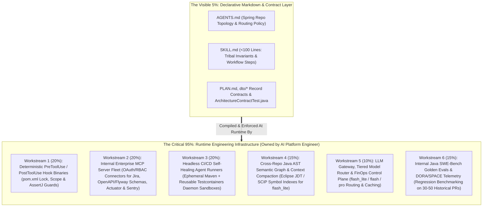
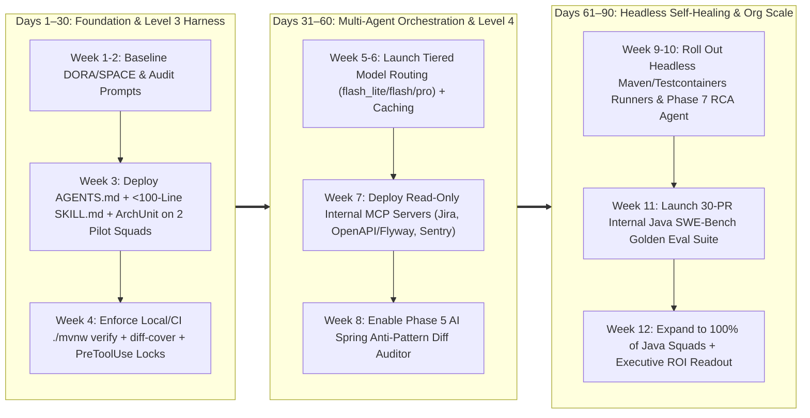

# AI Platform Engineer Role Charter, 95% Runtime Infrastructure & 90-Day Rollout Roadmap (Java 21 / Spring Boot 3.x Edition)

> **Document ID**: `04-AI-PLATFORM-ENGINEER-CHARTER-AND-90-DAY-ROADMAP.md`  
> **Target Audience**: Engineering Director, VP of Engineering, HR / Technical Talent Partners, Platform Engineering Leads  
> **Core Question Answered**: *"If `AGENTS.md` and `SKILL.md` are under 100 lines of Markdown, why do we need a dedicated AI SDLC / Platform Engineering role? Can it really be a full-time job?"*  
> **Executive Answer**: **Markdown files are only the visible 5% of the harness (the declarative config layer). The other 95% is deterministic runtime infrastructure—lifecycle hooks, enterprise MCP servers, headless self-healing Maven/Testcontainers CI runners, Java AST context indexing, LLM FinOps gateways, and SWE-Bench evaluation pipelines.**

---

## 1. The Iceberg Architecture: 5% Declarative Markdown vs. 95% Runtime Infrastructure

Treating an Enterprise AI Coding Harness as "just writing a few `.md` files" is equivalent to claiming Kubernetes is "just writing a 40-line `deployment.yaml` file." Without the underlying control plane, container runtime, admission controllers, and observability stack, a YAML file does nothing.

Similarly, LLMs treat Markdown instructions as **probabilistic suggestions**. Turning those suggestions into **deterministic enterprise guarantees** for a Java 21 / Spring Boot 3.x organization requires the **95% Runtime Infrastructure Layer**:

---

## 2. Deep Dive: The 6 Full-Time AI Platform Engineering Workstreams (Java / Spring Boot Ecosystem)

Below is the concrete engineering breakdown of what the **AI SDLC / Platform Engineer** builds, operates, and maintains every week in a Java / Spring Boot organization.

### Workstream 1: Deterministic `PreToolUse` & `PostToolUse` Lifecycle Hooks (20% Allocation)
Prompting an agent *"Please do not edit files outside `client/`, do not modify `pom.xml`, and do not `@Disabled` failing JUnit tests"* fails in ~8%–12% of autonomous multi-turn sessions when an agent gets stuck in a debugging loop.
- **`PreToolUse` Interceptors (Hard Prevention)**: High-speed binaries/scripts that intercept every agent tool call (`edit_file`, `write_file`, `run_command`) *before* execution:
  - **Package-Scope & Build Manifest Lock (`REM-02`)**: Verifies the target file path matches the subagent's assigned work packet allowlist in `.agents/work-packets.json`. Blocks Phase 3 workers from mutating locked Phase 2 contracts (`dto/**`, `openapi/**`, `ArchitectureContractTest.java`) or build manifests (`pom.xml`, `build.gradle.kts`, `gradle/libs.versions.toml`).
  - **Command Blast-Radius & Taint Firewall (`REM-02` / `REM-03`)**: Blocks destructive shell commands (`rm -rf`, `git push --force`, `mvn deploy`), enforces an outbound network egress allowlist (blocking `curl`/`wget` and `~/.m2/settings.xml` reads during tainted turns), and blocks production JDBC connection strings.
  - **Java Assertion Integrity Guard**: Parses `*Test.java` and `*IT.java` AST diffs in real time (via JavaParser / Tree-sitter Java) and blocks any edit that adds `@Disabled`, deletes `@Test` methods, or weakens AssertJ `assertThat(...)` matchers.
- **`PostToolUse` Accelerators (Zero-Turn Feedback)**: Automatically runs incremental `./mvnw spotless:apply -DspotlessFiles=<file>` and fast single-class compilation/Checkstyle verification immediately after every `edit_file` call, appending compiler diagnostics directly to the tool output so the agent fixes syntax errors without burning an extra reasoning turn.

### Workstream 2: Internal Enterprise MCP (Model Context Protocol) Servers & Input Airlock (20% Allocation)
Out-of-the-box coding agents cannot see private corporate context. The AI Platform Engineer builds, secures, and maintains internal **MCP Servers** with OAuth2/RBAC authentication, rate limiting, PII scrubbing, a **tool-less `flash_lite` Indirect Prompt Injection Sanitization Airlock (`<untrusted_external_content>`)**, and audit logging:
- **Requirements & ADR MCP**: Pulls structured acceptance criteria from Jira/Linear and architectural standards from Confluence ADRs.
- **Live Schema, OpenAPI & Flyway Registry MCP**: Gives Phase 2 Architect Agents read-only introspection into staging PostgreSQL `information_schema` & `flyway_schema_history` tables, Confluent/Apicurio Avro & OpenAPI 3.1 registries, and shared internal Spring Boot starter BOMs.
- **Observability, Actuator & Incident MCP**: Connects Phase 7 RCA Agents to Sentry Java stack traces, Micrometer/Prometheus `/actuator/prometheus` histograms (`http_server_requests_seconds`, `hikaricp_connections_pending`), and Kubernetes pod logs—scrubbing customer PII before logs ever enter an LLM context window.

### Workstream 3: Headless CI/CD Self-Healing Agent Runners & Testcontainers Sandboxes (20% Allocation)
Interactive IDE usage is only half of a Level 4 AI-Native SDLC. The AI Platform Engineer builds containerized, event-driven background agent runners triggered by GitHub Actions / GitLab CI / Jenkins webhooks:
- **Pre-Warmed Maven & Testcontainers Cloud/Daemon Runners**: Configures ephemeral sandbox containers with pre-mounted local `.m2/repository` caches and reusable singleton Testcontainers daemons so `./mvnw verify` runs in seconds rather than minutes.
- **Autonomous CI Repair Runner**: When a developer's PR fails CI due to a Spotless formatting discrepancy, Checkstyle warning, or minor DTO mapping error, an ephemeral sandbox spins up a `flash` agent, repairs the issue, verifies `./mvnw clean verify == 0`, and pushes a signed fixup commit in `<90 seconds`.
- **Scheduled Codebase Hygiene & Migration Agents**: Nightly/weekly background agents (`CronExpression` workflows) that automatically migrate legacy Spring Boot 2.x patterns (`RestTemplate` -> `RestClient`, JUnit 4 -> JUnit 5), patch transitive Maven CVEs in `<dependencyManagement>`, and generate **Step 0 Golden Master characterization tests** on legacy monolith modules.

### Workstream 4: Cross-Repo Java AST Context Indexing & Semantic Compaction (15% Allocation)
In a multi-repository Java microservice architecture or a 1,000,000+ LOC multi-module Maven monorepo, agents fail if they have to `grep` raw text across thousands of `.java` files.
- Builds and maintains **Eclipse JDT / SCIP / Tree-sitter Java AST Symbol Graphs** so a `flash_lite` discovery subagent can resolve cross-module Spring bean injections, Feign/`RestClient` callers, and Kafka event consumers in `<500ms`.
- Implements automated **Context Compaction Pipelines** that strip method bodies and pass only the exact 50 lines of relevant Java `record` DTOs, interface signatures, and ArchUnit rules into `pro` reasoning turns, preventing Context Rot.

### Workstream 5: LLM Gateway, Tiered Model Routing & FinOps Governance (10% Allocation)
- Operates the centralized Enterprise LLM Gateway enforcing **Multi-Model Tiered Routing** (`flash_lite` for bean/package recon -> `flash` for `client/`/`repository/` and JUnit/Testcontainers -> `pro` for architecture, `service/`/`controller/`, and security review), cutting average PR token costs from **`$18.50` to `<$4.20` (-77%)**.
- Configures **Prefix & Prompt Caching** for static repository harnesses (`AGENTS.md`, `SKILL.md`, shared DTO/OpenAPI contracts), reducing input token spend by up to 75%.
- Enforces per-squad token budgets, circuit-breakers for runaway agent loops, and Zero-Data-Retention (ZDR) compliance across model providers.

### Workstream 6: Internal Java SWE-Bench Golden Evals & DORA/SPACE Telemetry (15% Allocation)
How does the Engineering Director know whether upgrading a model version or editing a core `SKILL.md` improved or broke Java engineering velocity?
- The AI Platform Engineer curates an internal **Java Golden Benchmark Suite** of **30–50 real historical PRs** from the company's own Spring Boot repositories (including multi-layer tasks like the [`reference-harness-spring-weather-service`](file:///E:/agent-sdlc/java-springboot-edition/reference-harness-spring-weather-service) Open-Meteo -> Photon Resilience4j fallback).
- Every change to hooks, skills, ArchUnit templates, or model routing is automatically benchmarked offline against the Golden Suite—measuring **Pass@1 Rate**, **Token Cost (`$`)**, **Wall-Clock Duration**, and **JaCoCo `diff-cover` / PITest Mutation Score** before rollout.

---

## 3. Organizational Sizing & Headcount ROI Calculator

Should the AI SDLC / Platform Engineer be a dedicated full-time hire or a part-time rotation? Use this org-sizing calculator based on total Java engineering headcount:

| Organization Size | Recommended Staffing Topology | Annual Fully-Loaded Platform Cost | Annual Engineering Capacity Unlocked (at 25% E2E Gain) | Net ROI Multiple |
| :--- | :--- | :--- | :--- | :--- |
| **Small Org / Startup** *(1–15 Engineers)* | **0.25 – 0.5 FTE (Embedded Staff/Senior Java Champion)** • Focuses on `AGENTS.md`, `<100-line` `SKILL.md` files, ArchUnit rules, local `PreToolUse` scripts, and Maven CI exit gates. | `~$50k – $90k` *(Allocated time)* | **+2.5 to +3.75 Effective Engineers** *(Worth `~$450k – $675k`)* | **~6x – 8x ROI** |
| **Mid-Sized Growth Org** *(20–80 Engineers)* | **1.0 Full-Time Senior AI Platform Engineer** • Owns the full 95% Runtime Infrastructure across all Java squads, internal MCP servers, FinOps gateway, and Golden Evals. | `~$200k – $240k` *(1 FTE)* | **+5 to +20 Effective Engineers** *(Worth `~$900k – $3.6M` + `$150k+` FinOps token savings)* | **~5x – 15x ROI** |
| **Enterprise / Scale Org** *(100–300+ Engineers)* | **Dedicated AI Developer Productivity Pod (2–4 FTEs)** • Lead AI Java Architect + Runtime/MCP Engineer + Headless CI/Eval Engineer. | `~$450k – $850k` *(2–4 FTEs)* | **+25 to +75 Effective Engineers** *(Worth `$4.5M – $13.5M+` in delivery capacity)* | **10x – 18x+ ROI** |

> [!IMPORTANT]
> **The Breakeven Math for the CFO**: Even in a modest **20-engineer Java organization**, if 1 Full-Time AI Platform Engineer unlocks a conservative **20%–25% end-to-end delivery improvement**, that single hire generates the equivalent output of **4 to 5 additional full-time Senior Java Engineers**—paying for their own headcount **4x to 5x over** in Year 1 while simultaneously slashing raw LLM API bills by 60%–77%.

---

## 4. Concrete 30-60-90 Day Enterprise Rollout Roadmap (Java / Spring Boot)

### 4.1 Detailed 30-60-90 Day Milestone Execution Table

| Phase & Window | Target Gartner Level | Concrete Java / Spring Boot Engineering Deliverables | Measurable Exit Gate Criteria |
| :--- | :--- | :--- | :--- |
| **Phase 1: Foundation & Deterministic Harness** *(Days 1–30)* | **Level 2 -> Level 3** *(Harnessed SDLC)* | 1. Instrument baseline DORA, SPACE, and PR token cost telemetry across 2 pilot Java squads (1 modern Spring Boot 3.x microservice, 1 legacy brownfield Spring monolith). 2. Deploy standardized [`AGENTS.md`](file:///E:/agent-sdlc/java-springboot-edition/reference-harness-spring-weather-service/AGENTS.md) (`73 lines`) and `<100-line` [`SKILL.md`](file:///E:/agent-sdlc/java-springboot-edition/reference-harness-spring-weather-service/.agents/skills/spring-feature-harness/SKILL.md) (`51 lines`) modeled on [`reference-harness-spring-weather-service`](file:///E:/agent-sdlc/java-springboot-edition/reference-harness-spring-weather-service). 3. Mandate **Phase 2 Contract-First** locking (Java `record` DTOs, OpenAPI 3.1, [`ArchitectureContractTest.java`](file:///E:/agent-sdlc/java-springboot-edition/reference-harness-spring-weather-service/src/test/java/com/enterprise/weather/architecture/ArchitectureContractTest.java), Flyway `squawk`) before parallel coding. 4. Deploy `PreToolUse` hooks (`pom.xml` lock + Java Assertion Integrity Guard + Secret Blocker) and mandatory local/CI `exit 0` gates (`./mvnw verify` + JaCoCo `diff-cover >= 85%`). | • **100%** of pilot repos protected by `AGENTS.md`, ArchUnit, and `PreToolUse` hooks. • Pilot First-Pass CI build rate increases from **~62% to >85%**. • Zero `@Disabled` test-weakening or secret-leak incidents. |
| **Phase 2: Tiered Orchestration & MCP Ecosystem** *(Days 31–60)* | **Level 3 -> Level 4** *(Orchestrated Agentic)* | 1. Configure Enterprise LLM Gateway for **Multi-Model Tiered Routing** (`flash_lite` / `flash` / `pro`) with prompt caching. 2. Stand up 3 core read-only **Internal MCP Servers** with `<untrusted_external_content>` airlocks: Issue Tracker (Jira), Schema Registry (OpenAPI/Flyway/PostgreSQL), and Error Tracking (Sentry/Actuator). 3. Activate **Phase 5 Independent Spring Diff Auditor (`pro`)** to catch `[BLOCKER]` anti-patterns (`@Transactional` misuse, `N+1` queries, missing RFC 7807 `ProblemDetail`) before human `CODEOWNERS` are notified. | • Blended LLM token cost per merged PR drops by **>= 60%** (`<$5.00/PR`). • Human PR review turnaround time drops by **>= 40%**. • `>80%` weekly active adoption among pilot Java engineers. |
| **Phase 3: Headless Self-Healing & Org-Wide Scale** *(Days 61–90)* | **Level 4+ at Scale** *(Enterprise Standard)* | 1. Deploy **Headless CI Self-Healing Runners** (`flash`) with reusable Testcontainers daemons for automatic Spotless/Checkstyle/SpotBugs/test repair in CI. 2. Deploy **Phase 7 Post-Rollback Incident RCA Agent (`pro`)** integrated with Flagger/Argo Rollouts `/actuator/prometheus` canary gates. 3. Build the **30-PR Internal Java Golden Eval Suite** to regression-test future skill and model upgrades. 4. Onboard remaining Java squads via internal playbooks and office hours. | • Verified **25%–30% E2E Lead Time reduction** across onboarded squads. • **>92%** First-Pass CI pass rate. • Executive DORA + SPACE + FinOps audit delivered to VP/Director. |

---

## 5. Balanced Executive Scorecard: DORA + SPACE + FinOps Telemetry

To ensure our AI-Native SDLC delivers **true business velocity rather than high-speed technical debt**, the AI Platform Engineer publishes a monthly **Balanced Executive Scorecard** tracking 8 interdependent KPIs across 4 dimensions:

| Dimension | Metric Name | Measurement Formula / Source | Baseline (Level 1–2 Ad-Hoc) | 90-Day Target (Level 4 Harness) | Guardrail Counter-Metric (Prevents Gaming) |
| :--- | :--- | :--- | :--- | :--- | :--- |
| **1. Delivery Velocity (DORA)** | **End-to-End Lead Time for Changes** | Timestamp from `Ticket In-Progress` (Phase 1) to `100% Prod Promotion` (Phase 7) | 5.2 Days (125 hrs) | **3.5 – 3.8 Days (-27% to -32%)** | Paired with **Change Failure Rate (`<5%`)** so speed never sacrifices stability. |
| **2. Review Flow (SPACE)** | **Human PR Review Turnaround Time** | Median hours from `PR Ready for Review` to `CODEOWNERS Approval` | 28.0 Hours | **< 12.0 Hours (-57%)** | Paired with **PR Size Cap (`<400 LOC`)** and **Zero Spring `[BLOCKER]` escapes**. |
| **3. Harness Reliability** | **First-Pass CI Pass Rate** | `%` of PR commits pushed from local workstation/sandbox that pass all Maven CI gates on Run #1 | 62% | **> 92%** | Paired with **Java Assertion Integrity Guard** (blocks passing CI by adding `@Disabled`). |
| **4. Code Durability** | **30-Day AI Code Survival Rate** | `%` of AI-authored Java lines merged to `main` that remain un-reverted and un-rewritten 30 days later | ~65% *(High vibe-coding churn)* | **> 88%** | Proves Phase 2 Contract-First DTO + ArchUnit architecture produces durable code. |
| **5. Production Stability (DORA)** | **Change Failure Rate (CFR) & MTTR** | `%` of deployments triggering Actuator canary rollback or P0/P1 incident; Mean Time to Recovery | 8%–12% CFR / 4.5h MTTR | **< 5% CFR / < 45m MTTR** | Phase 7 `<60s` deterministic Helm/K8s rollback (Flyway Expand-safe) + `pro` RCA PR. |
| **6. Security Posture** | **Pre-Commit Secret, Enforcer & High-SAST Intercept Rate** | `%` of secrets, slopsquatted POM dependencies, and High/Critical Semgrep findings blocked locally before push | < 20% *(Caught late in CI/Prod)* | **100% Local Intercept** | **0** AI-introduced P0/P1 vulnerabilities or unapproved Maven dependencies. |
| **7. Developer Experience (SPACE)** | **Cognitive Load & Harness CSAT** | Bi-weekly pulse survey: *"The AI harness reduces toil on Spring boilerplate, slice tests, and PR nitpicks"* | 3.1 / 5.0 | **>= 4.4 / 5.0** | Tracks **Harness Retry Rate** (alerts Platform Engineer if a skill causes >2 retries). |
| **8. Unit Economics (FinOps)** | **Blended LLM Token Cost per Merged PR** | Total LLM API spend (`flash_lite` + `flash` + `pro` + cache hits) divided by total merged PRs | `$18.50 / PR` | **< `$4.20 / PR` (-77%)** | Paired with **Golden Eval Pass@1 Rate** to ensure cost routing never degrades quality. |

---

## 6. Executive Decision Checklist (Immediate Next Steps)

To initiate the 90-Day Java / Spring Boot Rollout this week:
- [ ] **Approve the 7-Phase SDLC Gate Standard ([Document 02](file:///E:/agent-sdlc/java-springboot-edition/02-SDLC-GATE-SPECIFICATIONS.md))** as our engineering baseline for AI-assisted Java development.
- [ ] **Select 2 Pilot Squads** (1 modern Spring Boot 3.x microservice squad + 1 brownfield Spring monolith squad) for the Day 1–30 Foundation rollout, using [`reference-harness-spring-weather-service`](file:///E:/agent-sdlc/java-springboot-edition/reference-harness-spring-weather-service) as the reference blueprint.
- [ ] **Designate the AI SDLC / Platform Engineering Owner** (0.5 FTE Staff Java Champion or 1.0 FTE Senior Platform Engineer per Section 3) to stand up the `PreToolUse` hooks, ArchUnit & JaCoCo `diff-cover` templates, tiered model routing, and baseline telemetry dashboard.

---

## 7. 30-Minute Engineering Director Presentation Script & 7-Slide Talk Track (`REM-08`)

Use this turnkey, minute-by-minute run of show (`00:00–30:00`) when presenting this package to the Engineering Director, VP of Engineering, or Java Architecture Review Board.

### 7.1 Minute-by-Minute Run of Show (`00:00 – 30:00`)

| Time Window | Slide / Segment | Artifact Displayed on Screen | Core Executive Message & Talk Track |
| :--- | :--- | :--- | :--- |
| **`00:00 – 04:00`** *(4 Mins)* | **Slide 1: The Autocomplete Paradox & Gartner Maturity Model** | [`01-EXECUTIVE-SUMMARY-AND-GARTNER-STRATEGY.md`](file:///E:/agent-sdlc/java-springboot-edition/01-EXECUTIVE-SUMMARY-AND-GARTNER-STRATEGY.md) *(Sections 1–2)* | *"Right now, we are at Gartner Level 2: developers generate Spring boilerplate 30% faster with IDE assistants, but downstream PR review queues, `N+1` queries, and `@Transactional` bugs absorb the gains—yielding only 5%–10% net ROI. To unlock a real **25%–30% end-to-end cycle time reduction**, we must shift from unharnessed 'vibe coding' to a governed **Level 3–4 Enterprise AI Coding Harness**."* |
| **`04:00 – 08:00`** *(4 Mins)* | **Slide 2: Multi-Model Tiered Routing & FinOps Economics** | [`01-EXECUTIVE-SUMMARY-AND-GARTNER-STRATEGY.md`](file:///E:/agent-sdlc/java-springboot-edition/01-EXECUTIVE-SUMMARY-AND-GARTNER-STRATEGY.md) *(Section 3)* | *"Routing every task to a frontier `pro` model costs `$18.50` per PR. By enforcing **Tiered Model Routing**—`flash_lite` for `<500ms` Java package/bean recon, `flash` for `RestClient`/JPA adapters and JUnit/Testcontainers suites, and `pro` strictly for Phase 2 Contracts, complex `@Transactional` services, and security audits—plus prompt caching, we cut blended LLM spend by **77% to `$4.20` per PR**, saving `$171k/year` at a 50-engineer scale."* |
| **`08:00 – 14:00`** *(6 Mins)* | **Slide 3: The 7-Phase Governed SDLC & Binary Maven Gates** | [`02-SDLC-GATE-SPECIFICATIONS.md`](file:///E:/agent-sdlc/java-springboot-edition/02-SDLC-GATE-SPECIFICATIONS.md) *(Sections 1–3 & 8)* | *"In our 7-Phase SDLC, agents never merge PRs, mutate `pom.xml` in Phase 3, waive security findings, or touch production. Humans approve a **`<50-line` Phase 2 Contract** upfront (Java `record` DTOs, OpenAPI 3.1, ArchUnit, Flyway Expand SQL), then parallel subagents iterate inside a sandbox until `spotless`, `checkstyle`, `spotbugs`, JUnit 5, Testcontainers, `diff-cover >= 85%`, `semgrep` (`p/java`, `p/spring`), and `squawk` all exit `0`. For our 10-year-old Spring monoliths, we use a **Step 0 Golden Master Characterization Subagent** and JaCoCo `diff-cover >= 85%` so legacy debt never deadlocks delivery."* |
| **`14:00 – 18:00`** *(4 Mins)* | **Slide 4: Why Minimalist Skills (`<100 Lines`) Amplify Frontier AI** | [`03-MINIMALIST-HARNESS-AND-SKILL-STANDARDS.md`](file:///E:/agent-sdlc/java-springboot-edition/03-MINIMALIST-HARNESS-AND-SKILL-STANDARDS.md) *(Sections 1–2 & 6)* | *"Do skills limit AI? Only when teams write 1,500-line generic Spring Boot 2.x tutorials that cause Context Rot and Syntax Ossification (`javax.*` / `RestTemplate`). Our standard caps skills at **`<=100 lines` (`skills-lint`)** and encodes **Constraints & Context, Not Tutorials**: tribal API quirks, Resilience4j fallbacks, RFC 7807 `ProblemDetail`, disjoint package scopes, and binary `./mvnw verify` gates."* |
| **`18:00 – 22:00`** *(4 Mins)* | **Slide 5: Live Reference Harness Demo (`spring-weather-service`)** | Live Terminal + [`AGENTS.md`](file:///E:/agent-sdlc/java-springboot-edition/reference-harness-spring-weather-service/AGENTS.md) + [`SKILL.md`](file:///E:/agent-sdlc/java-springboot-edition/reference-harness-spring-weather-service/.agents/skills/spring-feature-harness/SKILL.md) + [`WeatherGeocodingClient.java`](file:///E:/agent-sdlc/java-springboot-edition/reference-harness-spring-weather-service/src/main/java/com/enterprise/weather/client/WeatherGeocodingClient.java) | **Live Demo Cue**: 1. Inspect [`reference-harness-spring-weather-service/.agents/skills/spring-feature-harness/SKILL.md`](file:///E:/agent-sdlc/java-springboot-edition/reference-harness-spring-weather-service/.agents/skills/spring-feature-harness/SKILL.md) (**51 lines**) and [`AGENTS.md`](file:///E:/agent-sdlc/java-springboot-edition/reference-harness-spring-weather-service/AGENTS.md) (**73 lines**). 2. Show the locked Phase 2 [`GeocodingResultRecord.java`](file:///E:/agent-sdlc/java-springboot-edition/reference-harness-spring-weather-service/src/main/java/com/enterprise/weather/dto/GeocodingResultRecord.java) and [`ArchitectureContractTest.java`](file:///E:/agent-sdlc/java-springboot-edition/reference-harness-spring-weather-service/src/test/java/com/enterprise/weather/architecture/ArchitectureContractTest.java). 3. Show [`WeatherGeocodingClient.java`](file:///E:/agent-sdlc/java-springboot-edition/reference-harness-spring-weather-service/src/main/java/com/enterprise/weather/client/WeatherGeocodingClient.java) implementing the `"North York Ontario"` Resilience4j `@CircuitBreaker` + Photon API fallback via Spring `RestClient`. |
| **`22:00 – 26:00`** *(4 Mins)* | **Slide 6: The 5% Markdown vs. 95% Runtime Infrastructure & Role Charter** | [`04-AI-PLATFORM-ENGINEER-CHARTER-AND-90-DAY-ROADMAP.md`](file:///E:/agent-sdlc/java-springboot-edition/04-AI-PLATFORM-ENGINEER-CHARTER-AND-90-DAY-ROADMAP.md) *(Sections 1–3)* | *"Writing `.md` files is only 5% of the harness. The other 95% is deterministic runtime engineering: `PreToolUse` hooks blocking `@Disabled` and `pom.xml` slopsquatting, `<untrusted_external_content>` taint guards, OAuth-governed MCP servers, headless self-healing Maven/Testcontainers runners, and a 30-PR Java SWE-Bench Golden Eval suite. At 20–80 engineers, 1 FTE AI Platform Engineer unlocks 5–20 effective engineers (**5x–15x ROI**)."* |
| **`26:00 – 30:00`** *(4 Mins)* | **Slide 7: 30-60-90 Day Rollout, DORA/SPACE Scorecard & Day-1 Ask** | [`04-AI-PLATFORM-ENGINEER-CHARTER-AND-90-DAY-ROADMAP.md`](file:///E:/agent-sdlc/java-springboot-edition/04-AI-PLATFORM-ENGINEER-CHARTER-AND-90-DAY-ROADMAP.md) *(Sections 4–6)* | *"We don't ask for a blind org-wide mandate. We ask for a **30-Day Phase 1 Pilot across 2 Java squads** (1 Spring Boot 3.x microservice, 1 legacy Spring monolith module), measured against our 8-metric DORA + SPACE + FinOps scorecard. Once we prove `>85%` first-pass CI rates and `-40%` PR review turnaround at Day 30, we scale to Level 4 in Days 31–90."* |

---

### 7.2 Day-1 Pilot Authorization Sign-Off Block

| Decision Item | Proposed Pilot Scope (Days 1–30) | Executive Sponsor / Owner | Sign-Off Status |
| :--- | :--- | :--- | :--- |
| **1. Pilot Squad Selection** | **Squad A** (Spring Boot 3.x Microservice) + **Squad B** (Legacy Spring Monolith Module) | Engineering Director | `[ ] Approved` |
| **2. AI Platform Engineering Charter** | Allocate **0.5 FTE Staff Java Champion** (Days 1–30) -> Convert to **1.0 FTE AI Platform Engineer** upon hitting Day-30 exit criteria | Engineering Director + VP Eng | `[ ] Approved` |
| **3. Mandatory Harness Gate Policy** | Enforce Phase 2 Contract Lock (`record` DTOs + ArchUnit) + Phase 3–4 `./mvnw verify` & `diff-cover >= 85%` Gates + Phase 6 Enforcer/PGP/Semgrep Gates on Pilot Repos | Principal Java Architect + AppSec Lead | `[ ] Approved` |
| **4. Day-30 Executive Check-In** | Review DORA Lead Time, PR Review Turnaround, First-Pass CI Rate, and Blended Cost/PR (`<$4.20` target) | Engineering Director | `[ ] Scheduled` |
