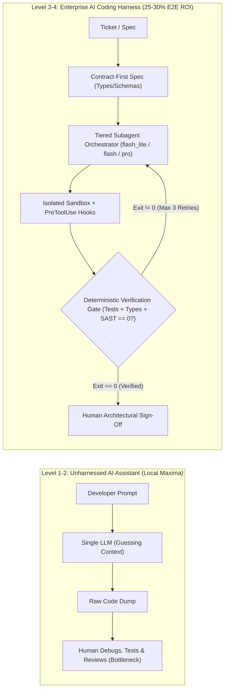
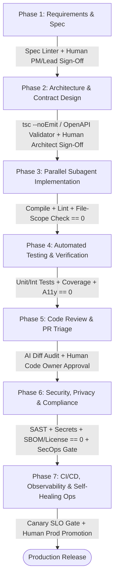
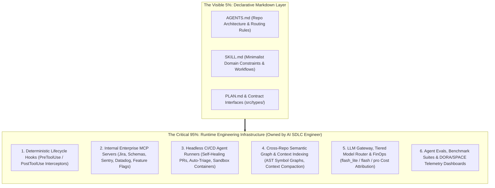

# Enterprise AI-Native SDLC & Coding Harness: Master Architectural Blueprint (`00-PLANNER-BLUEPRINT.md`)

> **Document Role**: Master Architectural Blueprint & Specification (Stage 1 of 3: Planner -> Documentor -> Verifier)  
> **Target Audience**: Engineering Director, VP of Engineering, Principal Architects, and Platform Engineering Leadership  
> **Strategic Objective**: Transition engineering from ad-hoc "AI Code Assistants" (Level 1–2 autocomplete / vibe coding) to a governed, high-velocity **Enterprise AI-Native SDLC & Coding Harness** (Level 3–4+) delivering a **25%–30% end-to-end cycle time reduction** without compromising security, architecture, or production stability.

---

## 1. Executive Strategic Thesis & Gartner Alignment

### 1.1 The "Autocomplete Paradox" vs. The AI Coding Harness
Most enterprise AI adoption stalls at **Local Maxima**: developers use IDE autocomplete or chat assistants ("vibe coding") to generate code 30% faster, only to create a **40%+ bottleneck downstream** in PR review, QA regressions, architectural drift, and security triage. Faster typing without deterministic verification simply manufactures technical debt at machine speed.

Aligned with **Gartner’s Strategic Research on AI-Native Software Engineering**, sustainable **25%–30% end-to-end SDLC productivity gains** require shifting investment from *unconstrained code generation* to a **Governed AI Coding Harness**:
- **AI Coding Assistant (Legacy Paradigm)**: Human prompts an LLM in a chat window -> LLM guesses repo conventions -> Human manually copies code, debugs hallucinations, runs tests, and fixes lint errors.
- **Enterprise AI Coding Harness (Target Paradigm)**: An autonomous or semi-autonomous multi-agent system wrapped in **declarative repository contracts (`AGENTS.md`)**, **minimalist domain skills (`SKILL.md`)**, **Model Context Protocol (MCP) tool servers**, **runtime security hooks (`PreToolUse`/`PostToolUse`)**, and **deterministic verification gates** that force the agent to self-correct in a closed loop until all compilers, tests, and security scans exit `0` *before* a human engineer is ever interrupted.

---

### 1.2 Gartner 5-Stage Maturity Model for AI-Native Software Engineering

| Maturity Level | Stage Name | Engineering Operating Mode | Governance & Verification | Typical E2E SDLC ROI |
| :--- | :--- | :--- | :--- | :--- |
| **Level 1** | **Ad-Hoc ("Vibe Coding")** | Individual developers use copy-paste chat or unconfigured IDE autocomplete. Zero shared context. | None. High hallucination rate; PR bloat; inconsistent patterns. | **0% to -5%** (Downstream PR review debt offsets coding speed) |
| **Level 2** | **Assisted Coding** | Licensed IDE assistants with basic repo indexing. Single-model synchronous chat. | Manual human testing and review. Rules exist only in developer heads. | **5%–10%** (Faster boilerplate, unchanged lead time to production) |
| **Level 3** | **Harnessed SDLC** *(Immediate 30-Day Target)* | Standardized `AGENTS.md` harness, minimalist `SKILL.md` workflows, Contract-First development, and mandatory local/CI verification loops. | Automated compiler, unit test, linter, and SAST gates must exit `0` before human review. | **15%–20%** (High first-pass PR quality; 50% fewer review nitpicks) |
| **Level 4** | **Orchestrated Agentic Workflows** *(60–90 Day Target)* | Multi-agent orchestration with tiered model routing (`flash_lite` / `flash` / `pro`), custom internal MCP servers, and headless CI self-healing agents. | Runtime `PreToolUse` blast-radius hooks, FinOps token budgets, and automated PR triage gates. | **25%–30%** (End-to-end cycle time compression across requirements, code, test, and ops) |
| **Level 5** | **AI-Native Tiny Teams** *(Long-Term Vision)* | Small pods of Senior Engineer-Architects directing fleets of background agents across the entire lifecycle. | Continuous agent evaluation (DORA + SPACE telemetry), autonomous canary rollbacks, and self-healing ops. | **40%+** (Structural step-change in engineering leverage per headcount) |

---

## 2. The "Minimalist, High-Leverage Skills" Philosophy
### Addressing the Director Question: *"Do Skills Limit AI?"*

A critical architectural concern raised by senior engineering leaders is: **"If we write rigid skill files (`SKILL.md`), won't we handcuff frontier reasoning models and limit their problem-solving capabilities?"**

**The Answer: *Bad* skills limit AI. *Minimalist, constraint-based* skills unlock AI.**

### 2.1 Why Traditional "Tutorial Skills" Degrade Frontier Models
When teams treat `SKILL.md` or `AGENTS.md` as a 2,000-line textbook, three failure modes occur:
1. **Reasoning Suppression (Handcuffing)**: Step-by-step micro-instructions on *how to think* or *how to write standard React/Python* override the frontier model's native chain-of-thought reasoning, forcing it down brittle, suboptimal paths.
2. **Context Rot & Attention Dilution**: Stuffing system prompts with generic coding tutorials consumes valuable context tokens and degrades recall of actual repository code and business requirements.
3. **Syntax Ossification**: Hardcoding generic framework snippets into skills causes agents to write outdated patterns when libraries upgrade.

### 2.2 The Golden Rule: *"Constraints & Context, Not Tutorials"*
Frontier models (`pro` and `flash` tiers) already know how to write React, TypeScript, Rust, Python, and SQL. Skills must **never** teach standard programming. Instead, enterprise skills must be **ultra-concise (<100 lines)** and encode **only the 5 things a frontier model cannot deduce from weights alone**:

| # | High-Leverage Skill Pillar | What It Encodes | Concrete Reference Example (`weather-app` Harness) |
| :--- | :--- | :--- | :--- |
| **1** | **Tribal & Proprietary Domain Knowledge** | Non-obvious API quirks, internal SDK conventions, legacy data edge cases, and fallback topologies. | Open-Meteo's geocoding API fails on multi-word regional/borough queries like `"North York Ontario"`. The skill mandates falling back to the OpenStreetMap Photon API (`photon.komoot.io`) and formatting labels with `admin1`. No LLM knows this business requirement a priori. |
| **2** | **Executable Tool & Script Capabilities** | Custom MCP server tools, deterministic CLI scripts, and environment-specific commands. | Exact workspace invocation commands (`npm test`, `npm run build` in `e:\Jev\weather-app`) and custom MCP tool schemas for querying internal telemetry or schemas. |
| **3** | **Hard Security & Compliance Red Lines** | Blast-radius boundaries, prohibited dependencies, secret handling rules, and mandatory human escalation triggers. | Agents are **prohibited** from introducing paid/keyed third-party APIs, modifying core build toolchains, or deleting failing test assertions to force a green build without human sign-off. |
| **4** | **Outcome-Based Verification Gates** | The objective **Definition of Done** (what must exit `0`), leaving the implementation path open to the model's reasoning. | Requires `vitest` (`0` failed tests), `tsc` (`0` type errors), and `vite build` (`0` bundle errors), plus ARIA keyboard accessibility (`role="combobox"`, `ArrowDown`/`Enter`/`Escape`), without dictating internal hook variable names. |
| **5** | **Multi-Agent File Ownership Contracts** | Contract-First synchronization and strict file-scope isolation so parallel subagents never overwrite each other. | Step 1 locks `src/types/weather.ts` (Single Source of Truth). Step 2 dispatches parallel subagents with disjoint write scopes: Data Agent (`src/services/`), UI Agent (`src/components/`), and Test Agent (`src/__tests__/`). |

### 2.3 Anti-Pattern vs. Best-Practice Comparison Matrix

| Dimension | ❌ Anti-Pattern: Prescriptive Tutorial Skill (Limits AI) | ✅ Best Practice: Minimalist Harness Skill (Amplifies AI) |
| :--- | :--- | :--- |
| **Length & Token Footprint** | 800–2,500 lines of prose, examples, and generic style guides. | 40–80 lines of dense constraints, file paths, contracts, and exit gates. |
| **Instruction Style** | *"First think about X, then create a useState hook named Y, then write a for-loop..."* | *"Lock shared interfaces in `src/types/weather.ts`, then satisfy these acceptance and ARIA criteria."* |
| **Knowledge Type** | Public knowledge the LLM already knows (e.g., "How React `useEffect` works"). | Proprietary/tribal invariants (e.g., "Open-Meteo drops multi-token queries; fallback to Photon API"). |
| **Multi-Agent Safety** | Uncoordinated parallel agents editing the same files, causing merge/type drift. | Contract-First interface locking + strict directory ownership per subagent tier. |
| **Verification** | Subjective (*"Make sure the code is clean, bug-free, and well-tested"*). | Deterministic (*"Run `npm test && npm run build`; self-heal until exit code is `0`"*). |

---

## 3. Comprehensive 7-Phase SDLC Gate Specification (Core Architecture)

To move from "vibe coding" to an auditable enterprise engineering system, every phase of the Software Development Life Cycle (SDLC) is governed by a **5-Part Gate Contract**:
1. **Entry Criteria**: Required artifacts and context preconditions before any agent is invoked.
2. **AI Mode & Tiered Agent Routing**: Autonomy level (`Autonomous`, `Assisted`, or `Prohibited`), model tier assignment (`flash_lite`, `flash`, `pro`), and file ownership boundaries.
3. **Deterministic Verification Gate (The Harness)**: Automated, non-negotiable binary checks (exit code `0`) executed in a sandbox before any human is notified.
4. **Mandatory Human Sign-Off Gate**: Explicit high-leverage decisions owned by a named human role (Engineer, Architect, PM, SecOps).
5. **Failure & Escalation Protocol**: Deterministic circuit-breakers when an agent fails verification $N$ times or encounters ambiguity.

---

### Phase 1: Requirements, Specification & Planning

| Gate Dimension | Production Specification |
| :--- | :--- |
| **1. Entry Criteria** | • Raw product request, Jira/Linear ticket, or incident report. • Access to repository `AGENTS.md` architecture topology and product domain glossary via MCP. • Historical context or customer telemetry metrics (if applicable). |
| **2. AI Mode & Agent Role** | • **AI Mode**: **Assisted (Human-in-the-Loop Co-Design)**. • **Discovery Subagent (`research` / `flash_lite`)**: Rapid, read-only codebase reconnaissance to identify impacted modules, existing types, and third-party API constraints. • **Spec & Planning Agent (`pro`)**: Synthesizes findings into a structured Technical PRD / Implementation Plan (`PLAN.md`), enumerating edge cases, non-functional requirements (latency, a11y, fallback behavior), and explicit non-goals. |
| **3. Deterministic Verification Gate (The Harness)** | **Spec Completeness Linter (`spec-lint` / JSON Schema Validator — Exit `0`)**: • Verifies the generated plan contains mandatory sections: `Problem Statement`, `Impacted Files`, `Data Contract Changes`, `Edge Cases & Fallbacks`, `Test Cases (Positive/Negative/Zero/Error)`, and `Security/Blast-Radius Assessment`. • Verifies all referenced file paths in `Impacted Files` actually exist in the repo (or are explicitly marked `[NEW]`). • Rejects vague acceptance criteria (e.g., flags words like *"etc."*, *"handle appropriately"*, *"fast"* without numeric SLAs). |
| **4. Mandatory Human Sign-Off Gate** | **Owner: Product Manager & Tech Lead** • Approves business logic, scope boundaries, UX trade-offs, and explicit **Non-Goals**. • Confirms whether external APIs, paid services, or schema migrations are authorized. • *Rule*: Zero implementation tokens (`Phase 3`) may be spent until the Spec Gate is signed off. |
| **5. Failure & Escalation Protocol** | • **Ambiguity Trigger**: If requirements containunderspecified business rules or conflicting constraints, the `pro` planner agent is **prohibited from guessing**; it must invoke structured clarification questions (`ask_question`) and halt. • **Scope Circuit-Breaker**: If codebase reconnaissance reveals >15 impacted files across >2 bounded contexts, the agent automatically halts and proposes decomposing the ticket into smaller phased tracks. |

---

### Phase 2: Architecture & Contract Design (Contract-First Gate)

| Gate Dimension | Production Specification |
| :--- | :--- |
| **1. Entry Criteria** | • Human-approved Technical Spec (`PLAN.md`) from Phase 1. • Clean working tree on an isolated feature branch or git worktree. |
| **2. AI Mode & Agent Role** | • **AI Mode**: **Assisted / Supervised Autonomous**. • **Lead Architect Agent (`pro`)**: Designs system boundaries, state transitions, and **locks the Single Source of Truth data contracts** before any implementation code is written. • **Contract Artifacts Modified**: TypeScript interface files (e.g., `src/types/weather.ts`), OpenAPI/Swagger specs, GraphQL schemas, Protobuf definitions, or database migration DDL files. • **Subagent Work Packet Definition**: Generates disjoint file-ownership manifests for Phase 3 subagents so no two parallel agents edit the same file. |
| **3. Deterministic Verification Gate (The Harness)** | **Contract & Schema Integrity Gate (Exit `0`)**: • `tsc --noEmit` (TypeScript type-checker verifies contract syntax and backwards compatibility). • `openapi-generator validate` / `buf lint` / `prisma validate` (for API/DB schemas). • **Breaking-Change Detector (`oasdiff` / `ts-api-extractor`)**: Flags any backwards-incompatible contract change across service boundaries. • **Ownership Disjointness Check**: Validates that the planned subagent work packets have zero overlapping write paths. |
| **4. Mandatory Human Sign-Off Gate** | **Owner: Senior / Principal Engineer or Staff Architect** • Reviews and approves the **Contract Diff** (often <50 lines of types/schemas) rather than waiting to review 1,500 lines of generated implementation code. • Approves any cross-service breaking changes, database index/migration strategies, or new third-party dependencies. |
| **5. Failure & Escalation Protocol** | • **Contract Conflict**: If a proposed contract breaks existing consumers outside the ticket's blast radius, the agent halts and outputs an Impact Graph showing downstream callers. • **Max Retries**: Up to **2 automatic self-correction attempts** on schema/type compilation errors before escalating to the human architect. |

---

### Phase 3: Implementation & Subagent Orchestration

| Gate Dimension | Production Specification |
| :--- | :--- |
| **1. Entry Criteria** | • Locked and type-checked Contract files from Phase 2 (e.g., `src/types/weather.ts` marked read-only for worker subagents). • Disjoint Subagent Work Packets with explicit file-write allowlists. • Relevant domain `SKILL.md` loaded into subagent context. |
| **2. AI Mode & Agent Role** | • **AI Mode**: **Autonomous (Sandboxed Execution with Tiered Subagent Routing)**. • **Orchestrator Agent (`pro` or `flash`)**: Dispatches parallel worker subagents in isolated scopes and synthesizes their outputs:   1. **Codebase Lookup / Helper Agent (`flash_lite`)**: Fast read-only symbol/reference lookups.   2. **Service / Data Layer Subagent (`flash`)**: Implements API clients, data mappers, caching, and resilience fallbacks (e.g., `src/services/weatherApi.ts` with Open-Meteo + Photon fallback).   3. **Complex UI / Domain Logic Subagent (`pro`)**: Implements intricate stateful UI, accessibility (`ARIA` combobox/listbox, keyboard nav), concurrency, or complex algorithms (e.g., `src/components/`). • **Strict File Ownership Lock**: Subagents are blocked by `PreToolUse` file-path hooks from modifying contract files (`src/types/*`), test files (`src/__tests__/*`), or build configs (`package.json`, `vite.config.ts`) unless explicitly assigned. |
| **3. Deterministic Verification Gate (The Harness)** | **Build, Type & Static Hygiene Gate (Exit `0`)**: • **Strict Compilation**: `npm run build` / `tsc --noEmit` / `cargo check` / `go build ./...` must exit `0`. • **Linter & Formatter**: `eslint --max-warnings=0`, `prettier --check`, `ruff check` (auto-run via `PostToolUse` hook on every file edit). • **Dependency & Forbidden API Check**: Verifies no unauthorized packages were added to `package.json`/`pyproject.toml` and no banned patterns (`eval`, hardcoded keys, `any` type casts, `ts-ignore`) were introduced. • **Bundle Size Budget**: Verifies production bundle delta does not exceed threshold (e.g., `< +15 KB` gzipped). |
| **4. Mandatory Human Sign-Off Gate** | **Owner: None during inner loop (Zero Human Interruption)**. • Humans are **not** interrupted during Phase 3 implementation as long as subagents remain within their sandbox and pass Phase 3 & Phase 4 gates. • Human escalation occurs **only** if the Failure Protocol is triggered. |
| **5. Failure & Escalation Protocol** | • **Closed-Loop Self-Healing (Max 3 Retries)**: If compilation, type-checking, or linting fails, the stderr output is fed back into the responsible subagent for automatic repair (up to 3 iterations). • **Contract Insufficiency Escalation**: If a worker subagent discovers the Phase 2 contract in `src/types/` is missing a required field, it **must not** edit the contract unilaterally; it messages the Orchestrator to halt and request a Phase 2 Contract Amendment. • **Circuit-Breaker Halt**: After 3 consecutive failed build/lint attempts, the agent reverts uncommitted working changes, logs the diagnostic trace, and escalates to the developer. |

---

### Phase 4: Automated Testing & Verification

| Gate Dimension | Production Specification |
| :--- | :--- |
| **1. Entry Criteria** | • Phase 2 Locked Contracts + Phase 3 compiled implementation code. • Test scenarios defined in Phase 1 Spec (Positive, Negative, Boundary/Zero, Network Error/Fallback). |
| **2. AI Mode & Agent Role** | • **AI Mode**: **Autonomous (Adversarial Verification Subagent)**. • **Verification & Test Engineer Subagent (`flash`)**: Operates as an independent agent separated from the implementation subagents (preventing an agent from writing tautological tests that merely mirror its own bugs). • Writes unit, component, integration, and accessibility tests (e.g., `src/__tests__/` using Vitest + React Testing Library) directly against the **Phase 2 Contract** and **Phase 1 Acceptance Criteria**. |
| **3. Deterministic Verification Gate (The Harness)** | **Comprehensive Test & Quality Gate (Exit `0`)**: • **Full Test Suite Execution**: `npm test -- --run` (Vitest / Jest / Pytest) — **100% pass rate (`0` failures, `0` skipped tests)**. • **Code Coverage Enforcement**: Line & branch coverage on modified/new files must meet or exceed threshold (e.g., `>= 85%` branch coverage on business/service logic). • **Accessibility (a11y) Verification**: Automated `axe-core` / ARIA role assertions and keyboard interaction tests (`ArrowUp`, `ArrowDown`, `Enter`, `Escape`). • **Assertion Integrity Check (`PreToolUse` / Diff Guard)**: Deterministically blocks any agent edit that deletes existing test cases, weakens assertions (e.g., changing `toEqual(expected)` to `toBeDefined()`), or adds `.skip` / `.only`. |
| **4. Mandatory Human Sign-Off Gate** | **Owner: Feature Engineer (Pre-PR Check)** • Reviews the generated test suite summary to confirm tests validate meaningful business invariants (e.g., verifying multi-word `"North York Ontario"` triggers the Photon fallback) rather than superficial mock tautologies. |
| **5. Failure & Escalation Protocol** | • **Test Failure Triage Loop (Max 3 Retries)**: If a test fails, the Orchestrator determines whether the bug is in the *implementation* (`src/services/` or `src/components/`) or the *test mock setup* (`src/__tests__/`), and dispatches the targeted subagent to fix the code. • **Red-Line Violation**: If an agent attempts to modify or delete an existing regression test to make the suite pass, the `PreToolUse` hook immediately blocks the edit and flags a **Guardrail Violation** to the human engineer. |

---

### Phase 5: Code Review & PR Triage

| Gate Dimension | Production Specification |
| :--- | :--- |
| **1. Entry Criteria** | • All Phase 3 & Phase 4 Harness Gates have exited `0` locally and in CI. • Pull Request opened with structured AI Telemetry Metadata (models used, token cost, harness retry count, test coverage delta). |
| **2. AI Mode & Agent Role** | • **AI Mode**: **Assisted (Automated First-Pass Triage + Human Final Authority)**. • **PR Diff Reviewer Agent (`pro`)**: Performs an independent, context-aware architectural, logic, and performance review of the PR diff against `AGENTS.md`, `PLAN.md`, and `SKILL.md` before human reviewers are pinged. • **PR Summary & Walkthrough Generator (`flash`)**: Generates an executive diff walkthrough, architectural diagram of changes, and reviewer focus checklist. |
| **3. Deterministic Verification Gate (The Harness)** | **PR Readiness & Hygiene Gate (Exit `0`)**: • **PR Size & Complexity Gate**: Warns or blocks if PR exceeds reviewable cognitive thresholds (e.g., `> 400 LOC` production code excluding tests/types) unless split into stacked PRs. • **Zero Unresolved AI High-Severity Findings**: The `pro` Review Agent classifies findings into `[BLOCKER]`, `[WARNING]`, and `[NIT]`. Any `[BLOCKER]` (e.g., race condition, memory leak, missing error boundary, contract drift) automatically routes the PR back to Phase 3 for autonomous fixing *before* requesting human review. • **Git Hygiene**: Conventional commit formatting, linked ticket ID, and clean rebase against `main`. |
| **4. Mandatory Human Sign-Off Gate** | **Owner: Designated Human Code Owner (`CODEOWNERS`)** • **Non-Negotiable Rule**: An AI agent can **never** approve or merge its own (or another agent's) Pull Request. • Human reviewer focuses 100% of their cognitive energy on **architecture, domain readability, maintainability, and subtle business edge cases**—because syntax, formatting, types, and unit tests are already guaranteed by Phases 3–4. |
| **5. Failure & Escalation Protocol** | • **Review Bounce Loop**: If the AI Reviewer (or Human Reviewer) leaves actionable review comments, a headless background agent can be triggered (`/address-comments`) to implement fixes and re-run Phase 3–4 gates (capped at **2 automated PR revision cycles**). • **Ping-Pong Circuit Breaker**: If an agent fails to resolve a human review comment on the first automated attempt, it halts and asks the human author to take over manually. |

---

### Phase 6: Security, Privacy & Compliance Gate

| Gate Dimension | Production Specification |
| :--- | :--- |
| **1. Entry Criteria** | • PR has passed Phase 3–5 functional and architectural verification. • Full dependency lockfile (`package-lock.json`, `Cargo.lock`, `poetry.lock`) and container/IaC manifests available. |
| **2. AI Mode & Agent Role** | • **AI Mode**: **Assisted Audit / Prohibited from Autonomous Waiver**. • **Security & Threat Modeling Agent (`pro`)**: Analyzes code diffs for OWASP Top 10 vulnerabilities, SSRF/XSS/SQLi vectors, IAM privilege escalation, PII data leakage in logs, and insecure cryptographic patterns. • **Prohibited Action**: AI agents are strictly **prohibited** from granting security waivers, modifying `.snyk`/`.trivyignore` allowlists, or altering IAM/authentication policies without explicit SecOps human approval. |
| **3. Deterministic Verification Gate (The Harness)** | **Zero-Trust Security & Compliance Gate (Exit `0`)**: • **Secret Scanning**: `gitleaks` / `trufflehog` (run both in `PreToolUse` local commit hooks and CI) — `0` hardcoded secrets, tokens, or private keys. • **SAST (Static Application Security Testing)**: `semgrep --config=p/ci --error` / `CodeQL` — `0` High/Critical findings. • **SCA & License Compliance**: `npm audit --audit-level=high` / `trivy fs` / `fossa` — `0` known exploitable CVEs and `0` copyleft/prohibited licenses (e.g., AGPL in proprietary code). • **AI Provenance & Audit Log**: Cryptographic attestation of which parts of the commit were AI-generated vs. human-authored, persisted for SOC2 / ISO-27001 / EU AI Act compliance. |
| **4. Mandatory Human Sign-Off Gate** | **Owner: AppSec Engineer / Security Champion (Risk-Tiered)** • **Standard Changes (Low Risk)**: Automatically cleared if all deterministic Security Harness checks exit `0` and no sensitive paths (`auth/`, `crypto/`, `iam/`, `billing/`, `infra/`) were touched. • **Sensitive Path Changes (High Risk)**: Mandatory human AppSec sign-off required via path-based `CODEOWNERS` whenever authentication, permissions, payment flows, PII handling, or Terraform/K8s manifests are modified. |
| **5. Failure & Escalation Protocol** | • **Secret Leak Quarantine**: If `gitleaks` detects a credential at any stage, the harness immediately blocks the commit/push, revokes the sandbox session, and alerts the engineer to rotate the key. • **Vulnerability Remediation**: For non-breaking dependency CVEs or simple SAST findings, a `flash` agent may propose a patched PR; if the fix requires architectural auth changes, it escalates immediately to AppSec + Senior Engineer. |

---

### Phase 7: CI/CD Deployment, Observability & Self-Healing Ops

| Gate Dimension | Production Specification |
| :--- | :--- |
| **1. Entry Criteria** | • Merged PR on `main` with human `CODEOWNERS` approval, green CI pipeline, and signed SBOM/provenance artifact. • Production SLOs, error budgets, and canary rollback thresholds defined in observability platform (Datadog / Prometheus / Sentry). |
| **2. AI Mode & Agent Role** | • **AI Mode**: **Prohibited from Direct Unsupervised Production Mutation; Assisted in Canary Analysis & Incident Triage**. • **Release & Canary Analyst Agent (`flash`)**: Monitors deployment telemetry, compares canary vs. baseline metrics (error rates, p95/p99 latency, log anomalies), and summarizes release health. • **Incident RCA & Hotfix Agent (`pro`)**: Upon production alert or rollback, correlates stack traces (`Sentry`) with recent git commits via MCP, identifies the root-cause commit, and drafts a verified revert or hotfix PR (which still must pass Phases 3–6). |
| **3. Deterministic Verification Gate (The Harness)** | **Release & Runtime Health Gate (Exit `0`)**: • **E2E Smoke & Synthetic Checks**: Headless Playwright/Cypress smoke suite against staging/canary environment exits `0`. • **Canary SLO Gate (Automated Flagger / Argo Rollouts Check)**: During 5% -> 25% -> 100% progressive rollout, error rate (`5xx < 0.1%`), latency (`p99 < threshold`), and client crash-free rate (`> 99.9%`) must hold over the bake window. • **IaC Drift & Policy Check**: `opa eval` (Open Policy Agent) / `tfsec` exits `0` on deployment manifests. |
| **4. Mandatory Human Sign-Off Gate** | **Owner: Release Owner / On-Call SRE** • Approves final promotion from Canary/Staging to 100% Production (for Tier-1 services) or owns the deployment window. • Approves execution of any AI-drafted hotfix PR or database remediation script during an incident. |
| **5. Failure & Escalation Protocol** | • **Automated Deterministic Rollback**: If Canary SLO metrics breach thresholds during rollout, the CI/CD orchestrator (Argo/Spinnaker) **deterministically rolls back** traffic within 60 seconds—without waiting for an LLM to reason about it. • **Post-Rollback Agentic Triage**: Immediately after deterministic rollback, the `pro` Incident RCA Agent is triggered automatically in the background to assemble a root-cause packet and open a candidate fix PR for the on-call engineer. |

---

### Master 7-Phase SDLC Gate Summary Matrix

| Phase | Primary AI Mode | Model Tier Routing | Key Deterministic Harness Gate (Exit `0`) | Mandatory Human Sign-Off Owner | Max Auto-Retries |
| :--- | :--- | :--- | :--- | :--- | :--- |
| **1. Requirements & Planning** | Assisted | `flash_lite` (Recon) + `pro` (Spec) | `spec-lint` Schema & Path Existence Validator | PM + Tech Lead | Halts on Ambiguity |
| **2. Architecture & Contracts** | Assisted | `pro` (Contract Designer) | `tsc --noEmit`, `oasdiff`, Disjoint File Scope Check | Staff / Senior Architect | 2 Retries |
| **3. Implementation** | Autonomous | `flash_lite` / `flash` (Data) / `pro` (UI/Core) | `npm run build`, `tsc`, `eslint --max-warnings=0`, Bundle Check | None (Sandboxed Inner Loop) | 3 Retries |
| **4. Testing & Verification** | Autonomous | `flash` (Independent Test Agent) | `npm test` (100% pass), Coverage `>=85%`, `axe-core` a11y, Diff Guard | Feature Engineer | 3 Retries |
| **5. Code Review & Triage** | Assisted | `pro` (Diff Auditor) + `flash` (Summary) | Zero `[BLOCKER]` AI findings, PR size `<400 LOC`, Git hygiene | Human `CODEOWNERS` | 2 PR Cycles |
| **6. Security & Compliance** | Assisted Audit | `pro` (Threat Model / SAST Triage) | `gitleaks`, `semgrep`, `trivy`/`npm audit`, SBOM Provenance | AppSec (for Sensitive Paths) | 0 on Secrets (Immediate Halt) |
| **7. CI/CD & Self-Healing Ops** | Assisted Ops | `flash` (Canary Monitor) + `pro` (RCA) | Playwright E2E Smoke, OPA Policy, Canary SLO Bake Gate | Release Engineer / On-Call SRE | Deterministic Auto-Rollback |

---

## 4. The Full-Time AI SDLC / Platform Engineer Role & The "5% vs. 95%" Architecture

### 4.1 Why `.md` Files Are Only 5% of the AI Coding Harness
A common executive misconception is that setting up an AI-Native SDLC is a one-time task of writing a few `AGENTS.md` and `SKILL.md` markdown files.

In reality, **markdown files are only 5% of the harness** (the declarative configuration layer). Without the **other 95%—the runtime enforcement, tooling, and telemetry infrastructure**—markdown instructions degrade within weeks as APIs evolve, repositories scale, and agents bypass soft prompt suggestions.

### 4.2 Deep Breakdown of the 95% Runtime Infrastructure

1. **Deterministic Lifecycle Hooks (`PreToolUse` / `PostToolUse` Interceptors — 20%)**
   - LLMs treat prompt instructions as probabilistic suggestions; hooks enforce **deterministic hard boundaries**.
   - `PreToolUse` Hooks: Intercept every shell command and file edit before execution. Block destructive commands (`rm -rf`, `git push --force`, production DB connections), prevent edits outside the subagent's assigned file scope, and block modifications to existing test assertions or security configs.
   - `PostToolUse` Hooks: Automatically run fast incremental formatters (`prettier`), linters (`eslint`), and type checks (`tsc`) after file writes, feeding compiler diagnostics back to the agent immediately without wasting an extra reasoning turn.

2. **Internal Enterprise MCP (Model Context Protocol) Servers (20%)**
   - Agents are only as capable as the tools they can invoke safely. The AI SDLC Engineer builds and maintains read/write-governed MCP servers connecting agents to:
     - **Design & Ticket Context**: Jira/Linear issues, Confluence ADRs, and Figma/Stitch design tokens.
     - **Live System Schemas**: Read-only staging database schemas, OpenAPI registries, and internal GraphQL federated graphs.
     - **Production Observability**: Sentry stack traces, Datadog metrics, and PagerDuty incident timelines for Phase 7 RCA.

3. **Headless CI/CD Background Agent Runners & Ephemeral Sandboxes (20%)**
   - Moving beyond interactive IDE chat to event-driven, containerized background agents triggered by GitHub/GitLab webhooks:
     - **Self-Healing CI Agent**: When a PR fails due to a minor lint, type, or snapshot mismatch in CI, a headless `flash` agent spins up in an ephemeral container, fixes the issue, verifies `exit 0`, and pushes a fixup commit.
     - **Continuous Hygiene Agents**: Scheduled cron agents that prune dead feature flags, upgrade minor dependencies with full test verification, and backfill missing unit tests on legacy modules.

4. **Cross-Repo Context Engineering & Semantic Graph Indexing (15%)**
   - In enterprise polyrepos or large monorepos, dumping raw files into context fails.
   - The AI SDLC Engineer maintains AST-based symbol graphs (SCIP / LSIF / Tree-sitter indexes) and curated context-compaction pipelines so subagents retrieve the exact 50 lines of cross-service interface definitions they need in `<500ms` using `flash_lite`.

5. **LLM Gateway, Tiered Model Routing & FinOps Governance (10%)**
   - Routing every task to a frontier `pro` model destroys unit economics (`$50+` per PR). Routing everything to a small model degrades complex architecture.
   - Enforces dynamic model tiering (`flash_lite` for file search -> `flash` for data services & tests -> `pro` for architecture, complex UI, and security review), prompt caching (reducing input token costs by up to 75%), per-team token budgets, and zero-data-retention (ZDR) enterprise endpoints.

6. **Agent Evaluation Harnesses ("Evals") & DORA/SPACE Telemetry (15%)**
   - Every time a new model version drops or a core `SKILL.md` is updated, how do we know it didn't regress coding quality?
   - The AI SDLC Engineer maintains an internal **SWE-Bench-style Golden Task Suite** (25–50 real historical PRs from the company's repos) to benchmark pass rates, latency, and token cost before rolling out harness updates to 50+ engineers.

---

### 4.3 Charter & Responsibilities of the Full-Time AI SDLC / Platform Engineer

| Responsibility Pillar | Key Deliverables Owned | Success KPIs |
| :--- | :--- | :--- |
| **Harness Architecture & Standards** | Standardized `AGENTS.md` templates, curated `SKILL.md` library, and `PreToolUse`/`PostToolUse` hook binaries across all repositories. | **100%** of Tier-1 repos equipped with deterministic verification gates. |
| **MCP & Tooling Ecosystem** | Internal MCP servers (Tickets, Docs, DB Schemas, Observability) with OAuth/RBAC and audit logging. | **< 2 min** context-gathering latency per feature spec. |
| **Subagent Orchestration & FinOps** | Multi-model routing policies (`flash_lite` / `flash` / `pro`), LLM gateway caching, and token cost per merged PR. | **60%–70%** reduction in average token cost per feature via tiered routing. |
| **Quality, Security & Governance** | Automated PR review agents, SAST/secret gate integration, AI code provenance tracking, and golden eval suites. | **> 85%** First-Pass CI Harness Pass Rate; **0** AI-introduced P0/P1 security incidents. |
| **Developer Enablement** | Training squads on Contract-First workflows, pairing with tech leads to encode tribal knowledge into skills. | **> 80%** weekly active adoption of harnessed workflows; **+25%–30%** cycle time improvement. |

---

## 5. Concrete Reference Implementation Case Study: `e:\Jev\weather-app`

To prove this architecture is not theoretical slideware, our workspace contains a working **Gartner Level 3–4 Reference Implementation** in `e:\Jev\weather-app`. The Documentor must highlight how this concrete codebase demonstrates every pillar of our blueprint:

1. **Repository-Level Coding Harness (`e:\Jev\weather-app\AGENTS.md`)**:
   - Defines the exact tech stack (React 18, TypeScript 5, Vite 5, Tailwind CSS 3, Vitest) and architecture directory contract.
   - Establishes the **Multi-Model Subagent Routing Policy**:
     - `research` (`flash_lite`): Fast read-only file discovery and interface inspection.
     - `Service & Config Engineer` (`flash`): Updating `src/types/`, `src/services/`, and configs.
     - `UI/UX Component Engineer` (`pro`): Complex React state, ARIA combobox/listbox keyboard navigation, and glassmorphic Tailwind styling.
     - `Verification & Test Engineer` (`flash`): Writing Vitest + React Testing Library suites in `src/__tests__/`.
2. **Minimalist, High-Leverage Skill (`e:\Jev\weather-app\.agents\skills\weather-feature-harness\SKILL.md`)**:
   - **47 lines total**—zero React tutorials, 100% high-leverage constraints and workflow orchestration.
   - **Tribal Domain Knowledge Encoded**: Explicitly captures the non-obvious geocoding failure mode where Open-Meteo's search API fails on multi-word regional/borough queries (such as `"North York Ontario"`), mandating a deterministic fallback to the OpenStreetMap Photon API (`https://photon.komoot.io/api/`) and `admin1` province/state label formatting.
   - **Contract-First Synchronization**: Enforces locking `src/types/weather.ts` (`WeatherData`, `DailyForecast`, `GeocodingResult`) in Step 1 *before* spawning parallel API (`flash`), UI (`pro`), and Test (`flash`) subagents in Step 2.
   - **Deterministic Verification Gate**: Step 3 requires executing `npm test` (Vitest) and `npm run build` (`tsc` + `vite build`) until both exit `0` (`0` test failures, `0` type errors) before returning results to the human engineer.

---

## 6. 30-60-90 Day Enterprise Rollout Roadmap & ROI Telemetry Framework

### 6.1 Phased Implementation Plan

| Phase | Timeline | Target Maturity | Key Engineering Milestones | Exit Deliverable |
| :--- | :--- | :--- | :--- | :--- |
| **Phase 1: Foundation & Harness Standardization** | **Days 1–30** | **Level 2 -> Level 3** (Harnessed SDLC) | • Establish `AGENTS.md` and Contract-First conventions across 2 pilot squads. • Audit and prune bloated prompts into minimalist `<100-line` `SKILL.md` files encoding tribal knowledge. • Enforce local & CI deterministic verification gates (`test` + `typecheck` + `lint` + `gitleaks` == `0`). • Baseline current DORA & PR cycle-time metrics. | Pilot squads operating with `AGENTS.md` + `PreToolUse`/`PostToolUse` hooks; baseline telemetry dashboard live. |
| **Phase 2: Multi-Agent Orchestration & MCP Tooling** | **Days 31–60** | **Level 3 -> Level 4** (Agentic Workflows) | • Deploy tiered subagent model routing (`flash_lite` / `flash` / `pro`) via LLM Gateway with FinOps cost attribution. • Launch internal read-only MCP servers for Jira/Linear, OpenAPI/DB schemas, and Sentry error traces. • Roll out automated Phase 5 AI PR Triage & Diff Review before human `CODEOWNERS` review. | 50% reduction in human PR review turnaround time; 60% reduction in token cost per feature via model tiering. |
| **Phase 3: Headless CI Self-Healing & Org Scale** | **Days 61–90** | **Level 4+ at Scale** (Enterprise Standard) | • Deploy headless background CI agents for automated lint/type/test self-healing and dependency patching. • Launch internal Golden Eval Benchmark Suite (30 real historical PRs) for regression-testing skills and models. • Expand harness across all engineering squads with executive ROI readout. | Verified **25%–30% end-to-end SDLC cycle-time reduction** presented to VP/Director with full DORA + FinOps audit. |

### 6.2 Executive Telemetry Framework (DORA + SPACE + Agentic KPIs)

To prove the **25%–30% productivity improvement** to the Engineering Director and CFO, we track a balanced scorecard that pairs **Velocity** with **Quality & Stability** (preventing the "faster garbage" anti-pattern):

| Metric Category | Specific KPI | Baseline (Level 1–2 Ad-Hoc) | Target (Level 3–4 Harnessed) | Why It Matters to the Director |
| :--- | :--- | :--- | :--- | :--- |
| **Velocity (DORA)** | **Lead Time for Changes** (Ticket In-Progress -> Prod) | 5.2 Days | **3.5 – 3.8 Days (-27% to -32%)** | Measures true end-to-end business delivery speed, not just typing speed. |
| **Velocity (SPACE)** | **PR Review Turnaround Time** (PR Open -> Merge) | 28 Hours | **< 12 Hours (-57%)** | Phase 3–5 harness guarantees code compiles, passes tests, and is pre-audited before a human looks at it. |
| **Quality (Harness)** | **First-Pass CI Build & Test Rate** | 62% | **> 92%** | Local deterministic harness forces agents to self-heal before pushing to CI. |
| **Durability (AI Quality)** | **30-Day AI Code Survival Rate** (% of merged lines not reverted/rewritten within 30 days) | ~65% (High churn from vibe coding) | **> 88%** | Proves Contract-First design produces maintainable architecture rather than throwaway code. |
| **Stability (DORA)** | **Change Failure Rate (CFR)** | 8%–12% | **< 5%** | Proves faster velocity is not increasing production incidents. |
| **Economics (FinOps)** | **Blended LLM Cost per Merged PR** | $18.50 (Uncached single-model `pro`) | **< $4.20 (-77%)** | Achieved via `flash_lite`/`flash`/`pro` tiered subagent routing + prompt caching. |

---

## 7. Instructions & File Manifest for Stage 2 (The Documentor Subagent)

To give the user a cohesive, deeply impressive **Director Presentation Package** in `e:\Jev\ai-sdlc-director-package\`, the **Documentor Subagent** must generate the following production-ready documents based on this blueprint:

1. **`01-EXECUTIVE-SUMMARY-DECK.md`**:
   - A punchy, slide-by-slide executive presentation / narrative brief designed for a 30-minute meeting with the Engineering Director.
   - Covers the Problem ("Vibe Coding" Local Maxima), the Solution (Gartner 5-Stage AI Coding Harness), the 25%–30% ROI thesis, the "Why Minimalist Skills Don't Limit AI" slide, the 7-Phase Gate summary, the Full-Time AI SDLC Engineer role justification, and the 30-60-90 Day Ask.
2. **`02-SDLC-GATE-ARCHITECTURE.md`**:
   - The deep technical reference manual detailing the **7-Phase SDLC Gate Specification** (Entry Criteria, AI Mode & Model Tier Routing, Deterministic Verification Gates, Mandatory Human Sign-Offs, and Failure/Escalation Protocols), complete with Mermaid architecture diagrams, `PreToolUse`/`PostToolUse` hook specifications, and FinOps routing matrices.
3. **`03-SKILLS-AND-HARNESS-GUIDE.md`**:
   - The engineering playbook answering *"Do skills limit AI?"* ("Constraints & Context, Not Tutorials"), featuring the 5 High-Leverage Skill Pillars, anti-pattern vs. best-practice examples, and a full annotated walkthrough of the `e:\Jev\weather-app` reference implementation (`AGENTS.md`, `SKILL.md`, Contract-First `src/types/weather.ts`, and the Open-Meteo -> Photon geocoding fallback).
4. **`04-ROLE-CHARTER-AND-90-DAY-ROADMAP.md`**:
   - The organizational proposal and job charter for the **Full-Time AI SDLC / Platform Engineer**, breaking down the "5% Markdown vs. 95% Runtime Infrastructure" model, the 30-60-90 Day execution plan, and the DORA + SPACE + FinOps executive measurement dashboard.
5. **`README.md`**:
   - The master index and navigation guide for the `e:\Jev\ai-sdlc-director-package\` directory, including a quick-start guide for presenting the package to leadership.
