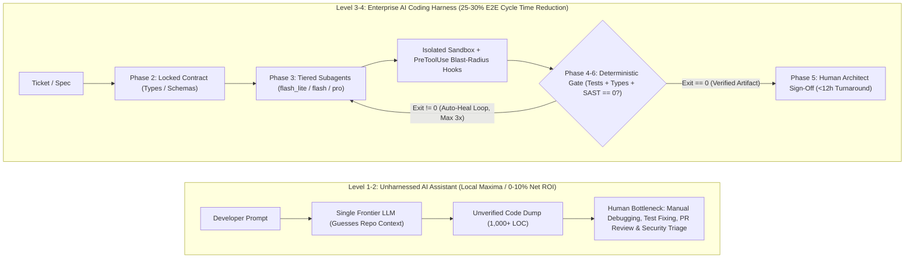
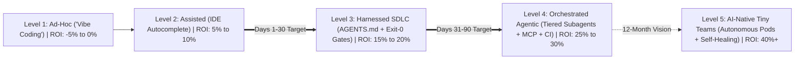
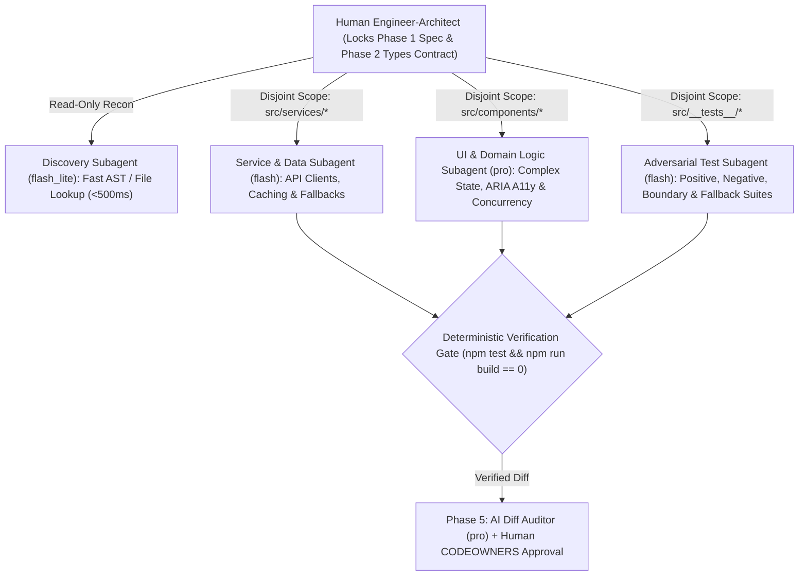
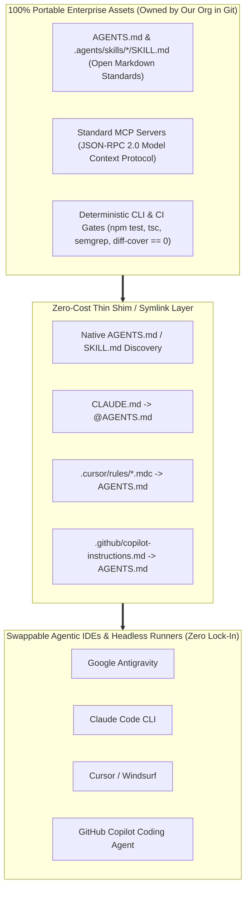

# Executive Summary & Gartner Strategy: From "Vibe Coding" to the Enterprise AI Coding Harness

> **Document ID**: `01-EXECUTIVE-SUMMARY-AND-GARTNER-STRATEGY.md`  
> **Target Audience**: Engineering Director, VP of Engineering, CTO, CFO  
> **Executive Thesis**: Unstructured AI coding tools create a local maximum—accelerating code generation by 30% while increasing downstream PR review, QA, and security bottlenecks by 40%+. Achieving a sustainable **25%–30% end-to-end SDLC cycle time reduction** requires transitioning from ad-hoc *AI Coding Assistants* (Gartner Levels 1–2) to a governed **Enterprise AI Coding Harness** (Gartner Levels 3–4+) powered by **Contract-First Orchestration**, **Deterministic Verification Gates**, and **Multi-Model Tiered Routing (`flash_lite` / `flash` / `pro`)**.

---

## 1. The Director's Dilemma: The "Autocomplete Paradox"

Across the software industry, engineering leaders face a troubling disconnect between **developer-reported AI speed** and **organizational delivery velocity**:
- Individual developers report feeling **25%–40% faster** using IDE autocomplete and chat-based "vibe coding."
- Yet **DORA Lead Time for Changes** remains flat, **PR review queues** grow longer, **30-day code churn** spikes, and senior engineers spend more hours debugging subtle AI-generated regressions than they save writing boilerplate.

> [!IMPORTANT]
> **The Autocomplete Paradox & Gartner 2026/2027 Risk Forecast**: Optimizing a single stage of a coupled system (typing code in Phase 3) without automating downstream verification (Phases 4–6) simply shifts the bottleneck downstream. Gartner research warns that organizations scaling unharnessed AI coding assistants without deterministic verification gates experience a **30%–40% surge in escaped software defects and maintenance debt within 12 months**, and **over 40% of ungoverned agentic AI initiatives are canceled** due to runaway token costs and inadequate risk controls.
> - **Prompt Engineering (Fragile / Individual)**: Teaching individual developers how to phrase clever chat prompts. Unscalable, non-repeatable, and lost when the chat session closes.
> - **Harness Engineering (Deterministic / Systemic)**: Wrapping AI models in version-controlled repository contracts (`AGENTS.md`), lazy-loaded minimalist skills (`SKILL.md`), runtime security interceptors (`PreToolUse`), and binary CI exit gates (`exit 0`).

### 1.1 Unharnessed AI Assistant vs. Enterprise AI Coding Harness

Aligned with **Gartner’s Strategic Research on AI-Native Software Engineering**, capturing real enterprise ROI requires shifting investment from *prompting individual LLMs* to engineering the **Harness** that surrounds them:

| Architectural Dimension | Legacy Paradigm: AI Coding Assistant (Levels 1–2) | Target Paradigm: Enterprise AI Coding Harness (Levels 3–4+) |
| :--- | :--- | :--- |
| **Primary Unit of Work** | Ad-hoc chat prompts and line-by-line IDE completions. | Spec-driven, Contract-First work packets executed by orchestrated subagents. |
| **Context Mechanism** | Tribal rules live only in developer heads; LLM guesses repo conventions. | Declarative repository harness ([`AGENTS.md`](file:///e:/Jev/weather-app/AGENTS.md)), minimalist skills ([`SKILL.md`](file:///e:/Jev/weather-app/.agents/skills/weather-feature-harness/SKILL.md)), and live MCP servers. |
| **Model Economics** | Single frontier model used for every trivial lookup and boilerplate task (`$18.50+` per PR). | **Tiered Model Routing** (`flash_lite` / `flash` / `pro`) + prompt caching (`<$4.20` per PR, **-77% cost**). |
| **Quality Assurance** | Human engineer manually copies code, runs tests, fixes broken types, and catches hallucinations. | Closed-loop **Deterministic Verification Gate** forces agent self-correction until `test`, `build`, `lint`, and `SAST` exit `0` *before* human review. |
| **Senior Engineer Leverage** | Senior engineers bogged down reviewing 1,500-line AI-generated PRs full of subtle drift. | Senior engineers approve `<50-line` **Phase 2 Data Contracts** upfront and review pre-verified, high-signal PRs. |

---

## 2. Gartner's 5-Stage Maturity Model for AI-Native Software Engineering

To provide leadership with an objective roadmap, we benchmark our engineering organization against **Gartner’s 5-Stage AI-Native Software Engineering Maturity Model**. Our immediate 90-day objective is to transition systematically from **Level 2** to **Level 4**, establishing the foundation for **Level 5**.

### 2.1 Detailed Maturity Stage Breakdown & Capability Milestones

| Maturity Level | Stage Name | Engineering Operating Mode | Governance, Tooling & Verification | Net End-to-End SDLC ROI |
| :--- | :--- | :--- | :--- | :--- |
| **Level 1** | **Ad-Hoc ("Vibe Coding")** | Developers paste code into web chat or use unconfigured IDE plugins. Zero shared prompts or architectural guardrails. | **None.** High hallucination rate, inconsistent error handling, silent regressions, and unreviewed third-party dependencies. | **-5% to 0%** *(Downstream PR review & bug rework erase coding speed)* |
| **Level 2** | **Assisted Coding** *(Current Industry Baseline)* | Organization-wide IDE assistant licenses with basic local repo indexing. Single-model synchronous chat inside the editor. | **Manual.** Verification relies entirely on human discipline. Architectural standards and API quirks remain undocumented. | **5%–10%** *(Faster unit boilerplate; unchanged lead time to prod)* |
| **Level 3** | **Harnessed SDLC** *(30-Day Target)* | Standardized [`AGENTS.md`](file:///e:/Jev/weather-app/AGENTS.md) in every repo, minimalist `<100-line` [`SKILL.md`](file:///e:/Jev/weather-app/.agents/skills/weather-feature-harness/SKILL.md) workflows, **Contract-First** interface locking, and mandatory local/CI verification loops. | **Deterministic Local + CI Harness.** Compiler (`tsc`), test suite (`vitest`), linter (`eslint`), and secret scan (`gitleaks`) must exit `0` before human review. | **15%–20%** *(First-pass CI rate jumps from 62% to >90%; 50% fewer review nitpicks)* |
| **Level 4** | **Orchestrated Agentic Workflows** *(60–90 Day Target)* | Parallel subagent orchestration with tiered model routing (`flash_lite` / `flash` / `pro`), custom internal MCP servers (Jira, Schemas, Sentry), and headless self-healing CI runners. | **Runtime Enforcement.** `PreToolUse` blast-radius hooks block out-of-scope edits and test weakening; automated Phase 5 AI PR diff audit; FinOps token attribution. | **25%–30%** *(Full E2E cycle-time compression across spec, code, test, review, and ops)* |
| **Level 5** | **AI-Native "Tiny Teams"** *(12-Month Vision)* | High-leverage pods of 2–3 Senior Engineer-Architects directing fleets of background agents across requirements, implementation, testing, and canary operations. | **Continuous Autonomous Governance.** SWE-Bench golden eval suites verify harness changes; automated canary rollbacks paired with autonomous RCA hotfix drafting. | **40%+** *(Structural step-change in revenue and product output per engineer)* |

---

## 3. Gartner's AI-Native "Tiny Teams" & Multi-Model Tiered Routing

### 3.1 The Shift from Feature Squads to Orchestrated "Tiny Teams" (Pragmatic Brownfield Squad Evolution)
In a traditional Level 1–2 organization, delivering a cross-cutting feature requires coordinating a 7–9 person squad (Product Manager, Tech Lead, 2 Backend Engineers, 2 Frontend Engineers, 1 QA Automation Engineer), incurring massive communication and handoff overhead.

**Pragmatic Transition Without Disruptive Reorgs**: Adopting Gartner's "Tiny Teams" topology does **not** require dismantling existing 6–8 person brownfield squads or conducting layoffs on Day 1. Instead, an existing 6–8 person squad uses the Level 4 Harness to subdivide internally into **2–3 parallel "Mini-Pods" (2 engineers + a tiered subagent fleet per pod)**—multiplying feature throughput by 2x and dedicating unlocked capacity to paying down legacy technical debt with existing headcount.

Under **Gartner’s Level 4–5 Operating Model**, each engineer operates as a **System Orchestrator** commanding specialized subagents bounded by explicit **Phase 2 Data Contracts**:

### 3.2 Multi-Model Tiered Routing: Achieving 60%–77% Token Cost Reduction

A major financial failure mode of early agentic coding tools is routing **100% of subagent turns to a frontier reasoning model (`pro`)**. When an agent uses a frontier model merely to locate files, format JSON, or scaffold standard unit test mocks, token costs balloon to **`$15–$25+` per merged Pull Request**.

Our Enterprise AI Coding Harness enforces **Multi-Model Tiered Routing** in [`AGENTS.md`](file:///e:/Jev/weather-app/AGENTS.md#L31-L41) and via the enterprise LLM Gateway, matching each cognitive task to the optimal model tier:

| Model Tier | Relative Token Cost | Latency Profile | Assigned SDLC Subagent Roles | Typical Share of Workflow Turns |
| :--- | :--- | :--- | :--- | :--- |
| **`flash_lite`** | **1x** *(Baseline Ultra-Low Cost)* | Ultra-low (`<500ms` TTFT) | • **Codebase Reconnaissance (`research`)**: Fast read-only file discovery, symbol grep, directory traversal, and interface inspection. • **Log & Telemetry Filtering**: Pre-filtering large CI logs before passing relevant stack traces to higher tiers. | **35% of turns** *(~4% of cost)* |
| **`flash`** | **~3x–5x** *(High-Efficiency Workhorse)* | Fast (`1–2s` TTFT) | • **Service & Data Layer Engineer**: Implementing REST/GraphQL clients, data mappers, and documented API fallbacks (e.g., [`src/services/weatherApi.ts`](file:///e:/Jev/weather-app/src/services/weatherApi.ts)). • **Adversarial Verification & Test Engineer**: Writing comprehensive unit/integration tests in [`src/__tests__/`](file:///e:/Jev/weather-app/AGENTS.md#L27) against locked contracts. • **Headless CI Self-Healing & PR Summaries**: Fixing lint/type errors and generating PR walkthroughs. | **50% of turns** *(~36% of cost)* |
| **`pro`** | **~15x–25x** *(Frontier Deep Reasoning)* | Deep Reasoning | • **Spec & Lead Architect Agent**: Phase 1 edge-case synthesis and Phase 2 Contract-First design ([`src/types/weather.ts`](file:///e:/Jev/weather-app/src/types/weather.ts)). • **Complex UI / Core Domain Engineer**: Intricate state machines, concurrency, and full WAI-ARIA keyboard navigation (`src/components/`). • **Independent PR Diff Auditor & Threat Modeler**: Phase 5 logic/race-condition review and Phase 6 security analysis. | **15% of turns** *(~60% of cost)* |

### 3.3 Unit Economics Comparison: Single-Model vs. Tiered Harness

| Financial Metric (Per Merged Feature PR) | Unoptimized Single-Model (`100% pro`, Uncached) | Enterprise Tiered Harness (`flash_lite` / `flash` / `pro` + Prompt Caching) | Net FinOps Impact |
| :--- | :--- | :--- | :--- |
| **Reconnaissance & Context Gathering** | `$4.20` (`pro` reading 40+ files) | **`$0.18`** (`flash_lite` + AST index) | **-95.7%** |
| **Service Layer & Test Suite Generation** | `$7.80` (`pro` writing services & tests) | **`$1.42`** (`flash` parallel subagents) | **-81.8%** |
| **Architecture, Complex UI & Security Audit** | `$6.50` (`pro` uncached turns) | **`$2.60`** (`pro` with 75% prompt cache hit rate) | **-60.0%** |
| **Total Blended LLM Cost per Merged PR** | **`$18.50`** | **`$4.20`** | **-77.3% Cost Reduction** |
| **Monthly Spend (50 Engineers, 1,000 PRs/mo)** | `$18,500 / mo` (`$222k / yr`) | **`$4,200 / mo` (`$50.4k / yr`)** | **`$171,600 / yr` Saved** |

---

## 4. Where the 25%–30% End-to-End Cycle Time Reduction Comes From

To satisfy executive and CFO scrutiny, we decompose the **25%–30% end-to-end Lead Time reduction** across all 7 phases of the SDLC (baselined against a standard 5.2-day / 125-hour feature lifecycle):

| SDLC Phase | Baseline Duration (Level 1–2) | Harnessed Duration (Level 3–4) | Time Saved | Primary Harness Mechanism Driving the Compression |
| :--- | :--- | :--- | :--- | :--- |
| **Phase 1: Requirements & Spec** | 8.0 hrs | **5.5 hrs** | **-31%** | `flash_lite` codebase recon + `pro` Spec Agent pre-populates impacted files, edge cases, and test matrices for PM/Lead sign-off. |
| **Phase 2: Architecture & Contracts** | 6.0 hrs | **4.0 hrs** | **-33%** | `pro` Architect Agent drafts TypeScript/OpenAPI contracts and verifies `oasdiff` backwards compatibility automatically. |
| **Phase 3: Implementation** | 36.0 hrs | **24.0 hrs** | **-33%** | Parallel subagents (`flash` Data + `pro` UI) execute simultaneously against locked Phase 2 contracts without merge conflicts. |
| **Phase 4: Testing & Verification** | 20.0 hrs | **12.0 hrs** | **-40%** | Independent `flash` Test Agent writes unit/integration/a11y suites concurrently; closed-loop harness self-heals until `exit 0`. |
| **Phase 5: Code Review & PR Triage** | 28.0 hrs | **12.0 hrs** | **-57%** | Deterministic gates eliminate syntax/lint/test nitpicks; `pro` Diff Auditor catches blockers before human `CODEOWNERS` are pinged. |
| **Phase 6: Security & Compliance** | 12.0 hrs | **7.5 hrs** | **-38%** | `PreToolUse` secret blocks + automated `semgrep`/`trivy` gates clear standard PRs automatically; AppSec reviews only high-risk paths. |
| **Phase 7: CI/CD & Release Ops** | 15.0 hrs | **11.0 hrs** | **-27%** | Automated E2E smoke suites, OPA policy validation, and `flash` canary telemetry analysis accelerate safe production promotion. |
| **Total End-to-End Cycle Time** | **125.0 hrs (5.2 Days)** | **86.0 hrs (3.6 Days)** | **-31.2% E2E** | **1.6 Days shaved off every feature cycle while increasing First-Pass CI pass rates from 62% to >92%.** |

---

## 5. Tool-Agnostic Portability & Vendor Lock-In Insulation (`REM-05`)

A top strategic risk for any Engineering Director or CTO is **AI Vendor & IDE Lock-In**: *If we invest 90 days building an AI Coding Harness today, what happens if a better IDE, agent runner, or frontier model family emerges in 6 months?*

Our architecture is engineered to be **100% vendor-neutral and portable** across every major agentic coding surface (**Google Antigravity**, **Claude Code**, **Cursor**, **GitHub Copilot**, and **Windsurf**) and every frontier LLM provider (**Gemini**, **Claude**, **OpenAI**). We achieve zero lock-in by separating the **Open Harness Layer** from the **Swappable Agent Client Layer**:

### 5.1 Multi-Tool Portability Matrix

| Harness Component | Open Standard Used | How It Runs Across Different Agentic Tools | Switching Cost if Vendor Changes |
| :--- | :--- | :--- | :--- |
| **Repository Rules ([`AGENTS.md`](file:///e:/Jev/weather-app/AGENTS.md))** | Linux Foundation / Open `AGENTS.md` Markdown spec | Read natively by Antigravity, Cursor, Windsurf, and Copilot; imported into Claude Code via a 1-line `@AGENTS.md` pointer in `CLAUDE.md`. | **0 Hours** *(Single source of truth in repo root)* |
| **Domain Skills ([`SKILL.md`](file:///e:/Jev/weather-app/.agents/skills/weather-feature-harness/SKILL.md))** | Open Agent Skills Spec (`.agents/skills/<name>/SKILL.md` with YAML frontmatter) | Loaded on-demand by skill-aware agents or referenced as modular markdown playbooks by any IDE chat assistant. | **0 Hours** *(Plain Markdown + standard CLI commands)* |
| **Enterprise Tooling (MCP)** | **Model Context Protocol (MCP)** (Open JSON-RPC 2.0 standard) | One internal MCP server (Jira, OpenAPI Schemas, Sentry) connects identically to Antigravity, Claude Code, Cursor, Windsurf, and Copilot without rewriting a single line of integration code. | **0 Hours** *(Write once, plug into any MCP client)* |
| **Deterministic Gates & Hooks** | Standard POSIX / Node / Python CLI exit codes (`0` vs. `!= 0`) + Git hooks / CI workflows | Enforced via local `PreToolUse` / `husky` git hooks and GitHub Actions / GitLab CI pipelines. No agent can bypass CI regardless of which IDE generated the code. | **0 Hours** *(Enforced by Git & CI, not the IDE)* |
| **Tiered Model Routing (`flash_lite` / `flash` / `pro`)** | Logical capability tiers mapped via Enterprise LLM Gateway (LiteLLM / Vertex / Bedrock) | Workflows request abstract tiers (`flash_lite`, `flash`, `pro`) rather than hardcoded model snapshot strings, allowing instant swaps as newer models launch. | **< 15 Minutes** *(Single gateway config update)* |

---

## 6. Director Objection-Handling Playbook & Junior Developer Protocol (`REM-06`)

When presenting this transformation to the VP of Engineering, Peer Directors, Staff Architects, or CFO, anticipate these **6 high-stakes executive objections** and use the verified architectural responses below:

| # | Executive / Staff Engineer Objection | The Underlying Risk | Our Architectural Counter-Measure & Data-Backed Answer |
| :--- | :--- | :--- | :--- |
| **1** | **The PR Flood Objection**: *"If AI writes code 3x faster, won't it bury our Senior Engineers under a mountain of 1,500-line, low-quality PRs?"* | Senior engineer burnout; rubber-stamping broken architecture. | **4-Layer Review Shield**: 1. Seniors approve a **`<50-line` Phase 2 Data Contract** (`src/types/`) *before* code is written. 2. Agents cannot open a PR until local `test`, `build`, `lint`, and `SAST` gates exit `0`. 3. PRs exceeding **`400 LOC`** of production code are deterministically blocked (`pr-size-gate`). 4. An independent `pro` **Phase 5 Diff Auditor** catches `[BLOCKER]` defects before any human is pinged—cutting human PR review time by **57% (`28h -> <12h`)**. |
| **2** | **The Junior Talent Atrophy Objection**: *"If agents write the implementation code, how will our Junior Engineers ever learn debugging, system design, and become Seniors?"* | Hollowing out the engineering talent pipeline; juniors pushing code they don't understand. | **The Junior Developer Socratic Apprenticeship Protocol** *(detailed in Section 6.1 below)*: Juniors are prohibited from blind "one-shot vibe prompting." They must author Phase 1 test matrices and Phase 2 TypeScript contracts manually, run agents in **Socratic Explain-First Mode**, and pass a mandatory **PR Code Defense Check** before merge. |
| **3** | **The Legacy Monolith Objection**: *"A greenfield `weather-app` is easy, but our core revenue monolith is 8 years old with 22% test coverage. Won't an 85% coverage gate deadlock every PR?"* | Strict gates halting delivery on brownfield repositories. | **Brownfield Ratchet & Differential Coverage ([Document 02, Section 4](file:///e:/Jev/ai-sdlc-director-package/02-SDLC-GATE-SPECIFICATIONS.md))**: We never enforce 85% *global* coverage on legacy repos on Day 1. We enforce **`diff-cover >= 85%` on modified/added lines only**, and dispatch a **Golden Master Characterization Test Subagent** to snapshot legacy behavior *before* any refactoring agent touches old code. |
| **4** | **The Hallucinated Package & Prompt Injection Objection**: *"What stops an agent from installing a malware-laced hallucinated npm package ('slopsquatting') or executing a prompt injection hidden in a Jira ticket?"* | Supply-chain compromise and OWASP LLM01 data exfiltration. | **Hard Runtime Isolation ([Document 02, Phases 1, 3, 6](file:///e:/Jev/ai-sdlc-director-package/02-SDLC-GATE-SPECIFICATIONS.md))**: • `PreToolUse` locks `package.json` during Phase 3; new packages require Phase 2 human sign-off + Phase 6 `socket-cli` provenance/age checks (`>30 days`, zero install scripts). • External MCP text (Jira/GitHub/Sentry) is wrapped in `<untrusted_external_content>` tags; during tainted turns, `PreToolUse` blocks outbound `curl`/`wget` and secret access. |
| **5** | **The Database Rollback Trap Objection**: *"Phase 7 promises a `<60s` automatic canary rollback, but what if the PR included a database migration that dropped or renamed a column?"* | Rolling back application containers against an incompatible mutated DB schema causes a P0 outage. | **Mandatory Expand-and-Contract DB Gate ([Document 02, Phases 2, 6, 7](file:///e:/Jev/ai-sdlc-director-package/02-SDLC-GATE-SPECIFICATIONS.md))**: Phase 6 runs `squawk` / `atlas migrate lint` to deterministically block destructive DDL (`DROP COLUMN`, `RENAME`, lock-heavy `ALTER`) in the same release as application code. All schema changes must be backwards-compatible (**Expand** first, **Contract** in a separate post-bake release). |
| **6** | **The Headcount Skepticism Objection**: *"Why do we need a dedicated AI Platform Engineer if `AGENTS.md` and `SKILL.md` are under 100 lines of Markdown?"* | Misallocating headcount to "prompt writing." | **The 5% vs. 95% Iceberg ([Document 04](file:///e:/Jev/ai-sdlc-director-package/04-AI-PLATFORM-ENGINEER-CHARTER-AND-90-DAY-ROADMAP.md))**: Markdown is only the 5% declarative surface. The AI Platform Engineer builds and operates the **95% runtime infrastructure** (`PreToolUse` binaries, OAuth-governed MCP servers, headless CI self-healing runners, AST symbol graphs, FinOps gateway, and 30-PR SWE-Bench Golden Evals), returning **5x–15x FTE ROI**. |
| **7** | **The Copilot/Cursor Overlap & Model Drift Objection**: *"We already pay `$20–$40/user/mo` for Copilot or Cursor—why build a harness? And what happens when a model vendor has an outage or silently updates weights?"* | Redundant tooling spend; workflow fragility during LLM provider outages or silent model regressions. | **Engine vs. Guardrails + Multi-Provider Failover**: Copilot/Cursor is the *IDE engine* (Level 2); the Harness is the *governance, MCP context, and CI verification layer* (Level 4) that turns raw completions into a 25%–30% E2E gain. Our Enterprise LLM Gateway provides automatic multi-provider failover across `flash_lite`/`flash`/`pro` equivalents, and our **30-PR SWE-Bench Golden Eval Suite** benchmarks any new model checkpoint offline before promotion. |

### 6.1 Deep Dive: The Junior Developer Socratic Apprenticeship Protocol

To ensure our AI-Native SDLC **accelerates junior-to-senior progression** rather than creating passive prompt-operators, engineers at **L3 / Junior levels** operate under three mandatory apprenticeship guardrails enforced by the harness:

1. **Human-Authored Contracts & Edge-Case Matrices (Phases 1–2)**
   - In Junior Apprenticeship Mode, the agent is prohibited from generating the Phase 1 Test Matrix or the Phase 2 Data Contract (`src/types/*`) from scratch.
   - The Junior Engineer must draft the TypeScript interfaces and enumerate the positive, negative, and boundary test cases themselves; the `pro` Architect Agent then acts as a **Socratic Tutor**, critiquing missing edge cases (e.g., *"What happens if the geocoding API returns an empty array on a multi-word borough query?"*) rather than handing over the answer.
2. **Socratic Root-Cause Diagnosis Before Auto-Heal (Phases 3–4)**
   - When a build or test fails for an L3 engineer, the harness pauses before running the automated repair loop and prompts the engineer: *"Review the failing stack trace above: which layer (`src/services/` vs. `src/components/`) violated the Phase 2 contract?"*
3. **Mandatory AI Code Ownership & PR Defense Sign-Off (Phase 5)**
   - The PR template includes an **"Author Architectural Walkthrough"** section that the `PreToolUse` hook prevents AI agents from filling out. The human author must write a 3-bullet explanation in their own words detailing *why* the state transition or fallback logic was designed that way and *how* it behaves under failure before `CODEOWNERS` review is unlocked.

---

> [!TIP]
> **Next Step in This Package**: Proceed to **[`02-SDLC-GATE-SPECIFICATIONS.md`](file:///e:/Jev/ai-sdlc-director-package/02-SDLC-GATE-SPECIFICATIONS.md)** for the exhaustive engineering specification of every gate, CLI check, brownfield ratchet, supply-chain defense, prompt-injection taint guard, and database rollback rule across Phases 1 through 7.
