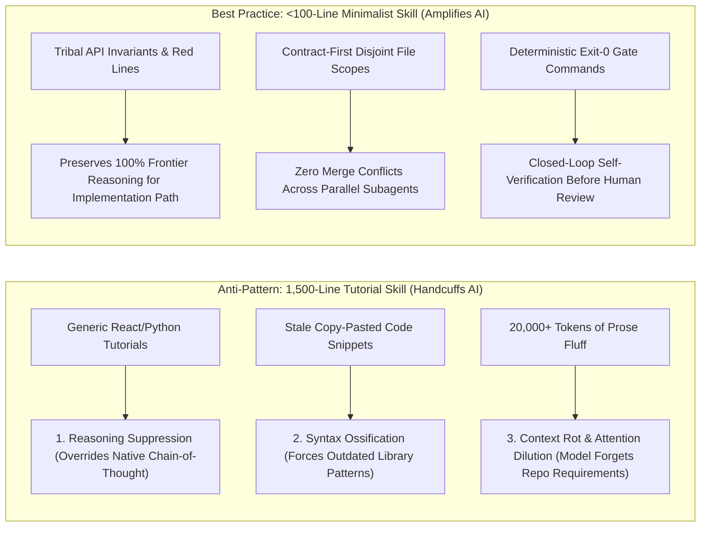
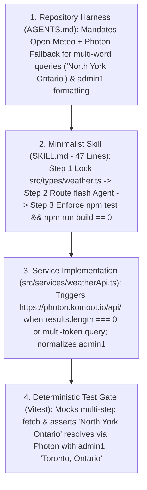
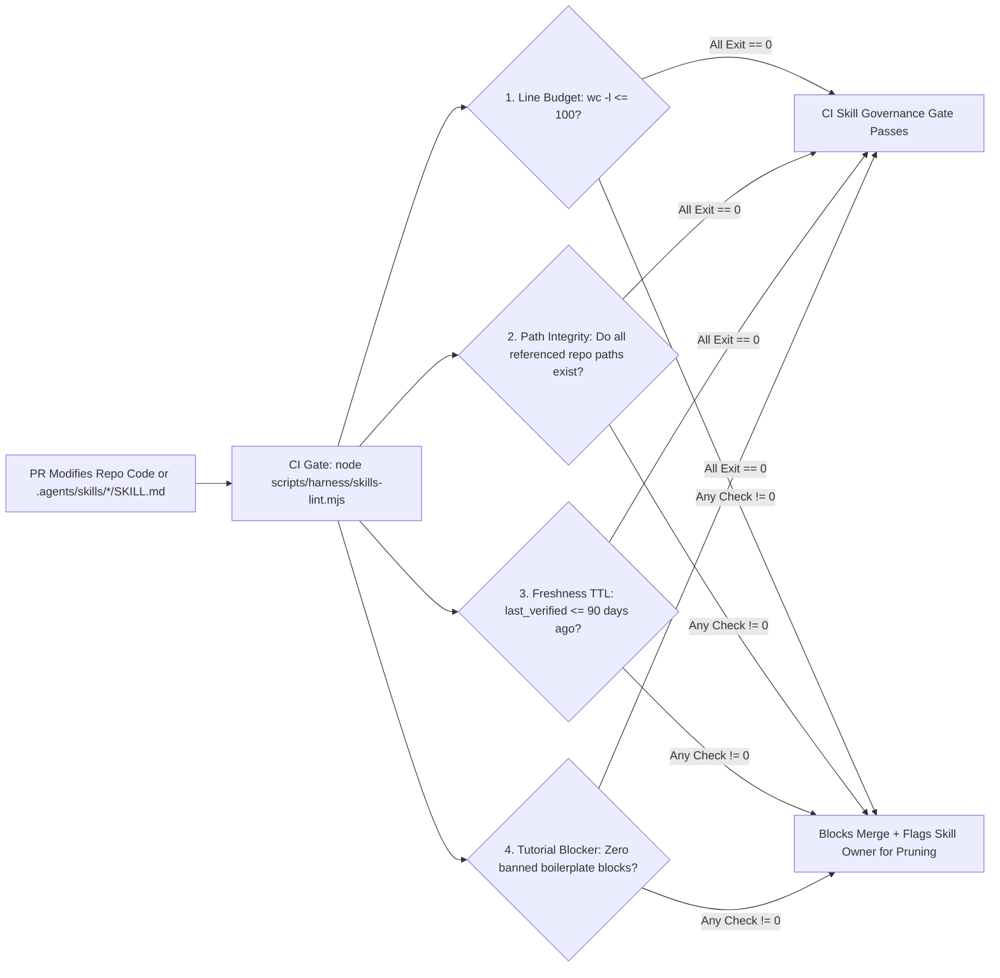

# Minimalist Harness & Skill Engineering Standards: Why Constraints Amplify Frontier AI

> **Document ID**: `03-MINIMALIST-HARNESS-AND-SKILL-STANDARDS.md`  
> **Target Audience**: Engineering Directors, Principal Architects, Tech Leads, AI Champions  
> **Core Question Answered**: *"If we write structured skill files (`SKILL.md`) and repository harnesses (`AGENTS.md`), won't we handcuff frontier reasoning models and limit their problem-solving capability?"*  
> **Executive Answer**: **Bad, tutorial-style skills limit AI. Minimalist, constraint-based skills (`<100 lines`) unlock AI.**

---

## 1. Answering the Industry Debate: *"Do Skills Limit AI Capability?"*

A valid concern among senior engineers and directors is that rigid prompt templates or bloated `SKILL.md` files can make frontier reasoning models (`pro` and `flash`) perform *worse* than an unprompted model.

Empirical evaluation across frontier models confirms that **degradation happens when teams write prescriptive tutorials instead of declarative constraints**.



### 1.1 The 3 Failure Modes of Legacy "Tutorial Skills"

1. **Reasoning Suppression (Cognitive Handcuffing)**
   - Frontier models possess RL-trained chain-of-thought reasoning capable of solving novel algorithmic and UI state challenges.
   - When a skill dictates micro-steps (*"First create a state variable named `isLoading`, then write a `try/catch` block around `fetch`, then map over the array using index..."*), it overrides the model's native planning ability and forces brittle, mechanical code generation.

2. **Syntax Ossification (Stale Training Overrides)**
   - Frontier models are pre-trained on modern library idioms (React 18/19 hooks, TypeScript 5.4+, Vite 5, Tailwind v3/v4).
   - When well-meaning engineers paste 500 lines of 2022-era code examples into a skill file, the model dutifully mimics the outdated in-context examples rather than using superior modern patterns from its weights.

3. **Context Rot & Attention Dilution ("Lost in the Middle")**
   - Every token of generic programming advice loaded into the system prompt competes for transformer attention with the actual repository code, TypeScript contracts, and ticket edge cases.
   - Research consistently shows that bloated system prompts (`>2,000 lines`) reduce instruction-following accuracy on hard domain constraints by **30%–45%**.

---

## 2. The Golden Rule: *"Constraints & Context, Not Tutorials"*

Our engineering standard enforces a strict architectural boundary:
> **Never teach a frontier model how to write standard React, TypeScript, Python, SQL, or Go. Encode ONLY the 5 proprietary invariants that no model on earth can deduce from its pre-training weights alone—and keep every `SKILL.md` under 100 lines.**

### 2.1 The 5 High-Leverage Skill Pillars

| Pillar # | High-Leverage Skill Pillar | What Belongs in `SKILL.md` / `AGENTS.md` | What Must Be Stripped Out (Zero Fluff) | Concrete Example from [`e:/Jev/weather-app`](file:///e:/Jev/weather-app) |
| :--- | :--- | :--- | :--- | :--- |
| **Pillar 1** | **Tribal & Proprietary Domain Knowledge** | Non-obvious third-party API quirks, internal legacy edge cases, required fallback chains, and domain data normalization rules. | Generic explanations of REST APIs, `async/await`, or HTTP status codes. | Open-Meteo's geocoding API fails on multi-word regional/borough queries like `"North York Ontario"`. Agents must fallback to OpenStreetMap Photon (`photon.komoot.io`) and normalize `admin1` labels. |
| **Pillar 2** | **Executable Tools, Scripts & MCP Capabilities** | Exact workspace CLI commands, custom scripts, and MCP server tool names/arguments. | Generic documentation on how `npm`, `git`, or `pytest` work. | Exact execution sequence in `e:\Jev\weather-app`: `npm test` (`vitest run`) and `npm run build` (`tsc && vite build`). |
| **Pillar 3** | **Hard Security & Compliance Red Lines** | Blast-radius boundaries, banned APIs/packages, assertion integrity rules, and mandatory human escalation triggers. | Vague platitudes like *"Write secure, maintainable, clean code."* | Prohibited from adding paid/keyed third-party APIs, modifying core build toolchains, or deleting failing test assertions to force a green build. |
| **Pillar 4** | **Outcome-Based Verification Gates** | Objective, binary **Definition of Done** criteria (commands that must exit `0` + required accessibility/SLO invariants). | Prescribing internal helper function names or private component state structure. | Vitest suite (`0` failures), `tsc` (`0` errors), `vite build` (`0` errors), plus WAI-ARIA `role="combobox"`, `role="listbox"`, and keyboard navigation (`ArrowDown`/`Enter`/`Escape`). |
| **Pillar 5** | **Multi-Agent File Ownership Contracts** | Contract-First synchronization order and disjoint directory ownership per model tier (`flash_lite` / `flash` / `pro`). | Allowing uncoordinated parallel agents to edit the same files simultaneously. | Step 1 locks [`src/types/weather.ts`](file:///e:/Jev/weather-app/src/types/weather.ts). Step 2 dispatches parallel API (`flash` -> `src/services/`), UI (`pro` -> `src/components/`), and Test (`flash` -> `src/__tests__/`) subagents. |

### 2.2 Anti-Pattern vs. Best-Practice Comparison Matrix

| Dimension | ❌ Legacy Prescriptive Skill (Limits AI) | ✅ Enterprise Minimalist Harness Skill (Amplifies AI) |
| :--- | :--- | :--- |
| **Line Count** | 800–2,500 lines (`12,000+` tokens per turn) | **40–80 lines (`< 600` tokens per turn; hard cap at 100 lines)** |
| **Cognitive Posture** | Micromanages *how* the model thinks and codes | Defines *what* contracts, invariants, and exit gates must hold |
| **Model Compatibility** | Breaks or becomes obsolete with every new model upgrade | Scales natively as frontier models get smarter (`pro` / next-gen) |
| **Multi-Agent Safety** | Causes merge conflicts and mismatched TypeScript interfaces | Enforces Contract-First locking + disjoint file write scopes |
| **Verification Standard** | Subjective (*"Ensure high test quality"*) | Deterministic (*"Run `npm test && npm run build`; exit code must be `0`"*) |

---

## 3. Real-World Case Study: Encoding the `"North York Ontario"` Geocoding Fallback in `weather-app`

To see how **Tribal Domain Knowledge (Pillar 1)**, **Contract-First Synchronization (Pillar 5)**, and **Outcome-Based Verification (Pillar 4)** work together in production, examine how a real-world production bug was permanently solved and locked into [`e:/Jev/weather-app`](file:///e:/Jev/weather-app).

### 3.1 The Real-World Failure Mode (Why Unharnessed AI Failed)
When a user searched for a single-word city like `"Toronto"` or `"London"`, the primary Open-Meteo Geocoding API (`https://geocoding-api.open-meteo.com/v1/search`) returned accurate coordinates.

However, when users searched for **multi-word regional queries, municipal boroughs, or city + province strings**—such as **`"North York Ontario"`**—Open-Meteo's GeoNames index returned **zero results (`[]`)** because it only indexes formal single-token municipality names.
- An unharnessed LLM (Level 1–2) has no way of knowing this quirk of Open-Meteo's search endpoint from pre-training weights alone. Left unguided, any agent refactoring `weatherApi.ts` would simplify the fetch call back to a naive Open-Meteo request, silently breaking regional searches.

### 3.2 How the Harness Encodes and Protects the Invariant Across 4 Layers



#### Layer 1: Repository Harness Rule in [`e:/Jev/weather-app/AGENTS.md`](file:///e:/Jev/weather-app/AGENTS.md#L46-L48)
Instead of writing a tutorial on `fetch()`, `AGENTS.md` states the exact domain invariant in 3 lines:
> - **Primary Geocoding**: Open-Meteo Geocoding API (`https://geocoding-api.open-meteo.com/v1/search`)
> - **Fallback / Borough & Regional Geocoding**: OpenStreetMap Photon API (`https://photon.komoot.io/api/`) for multi-word regional queries (e.g., `"North York Ontario"`) and municipal boroughs/districts.
> - Always format location labels with `admin1` (province/state) when available (`Name, Admin1, Country`).

#### Layer 2: Contract-First Lock in [`e:/Jev/weather-app/src/types/weather.ts`](file:///e:/Jev/weather-app/src/types/weather.ts#L24-L31)
The shared `GeocodingResult` interface locks the optional `admin1?: string` field so both the Photon mapper in `weatherApi.ts` and the dropdown renderer in `SearchBar.tsx` agree on the exact shape:
```typescript
export interface GeocodingResult {
  id: number;
  name: string;
  latitude: number;
  longitude: number;
  country: string;
  admin1?: string;
}
```

#### Layer 3: Resilient Implementation in [`e:/Jev/weather-app/src/services/weatherApi.ts`](file:///e:/Jev/weather-app/src/services/weatherApi.ts#L144-L187)
Guided by the 47-line [`SKILL.md`](file:///e:/Jev/weather-app/.agents/skills/weather-feature-harness/SKILL.md), the `flash` Service Subagent implements the multi-token detection (`results.length === 0 || trimmed.includes(',') || trimmed.split(/\s+/).length > 1`), queries `https://photon.komoot.io/api/`, normalizes `admin1` from `props.city` and `props.state`, and deduplicates coordinates within `0.08` degrees.

#### Layer 4: Deterministic Verification Gate (`npm test && npm run build`)
The independent `flash` Test Subagent locks this behavior into `src/__tests__/` so no future agent or human refactor can regress `"North York Ontario"` without immediately failing Gate 4 (`vitest run`).

---

## 4. Production Copy-Paste Templates

Use the two production templates below to bootstrap any enterprise repository to **Gartner Level 3–4** in under 30 minutes.

### 4.1 Template 1: Repository-Level `AGENTS.md` (`<80 Lines`)

````markdown
# AGENTS.md — Enterprise AI Coding Harness

> **Governance Mandate**: Any AI agent operating in this repository must obey these architectural boundaries, tiered model routing rules, and deterministic verification gates.

## 1. Repository Architecture & Source of Truth
- **Service Name**: `<service-name>`
- **Tech Stack**: `<e.g., React 18, TypeScript 5, Vite 5, Tailwind CSS 3, Vitest>`
- **Directory Ownership & Contracts**:
  - `src/types/` — **Single Source of Truth Data Contracts** (Lock in Phase 2 before parallel implementation)
  - `src/services/` — External API clients, caching, and resilience fallbacks
  - `src/components/` — Accessible UI components & state machines
  - `src/__tests__/` — Unit, integration, and accessibility test suites

## 2. Multi-Model Subagent Routing Policy
| Subagent Role | Model Tier | Allowed Write Scope | Responsibilities |
| :--- | :--- | :--- | :--- |
| **Codebase Researcher (`research`)** | `flash_lite` | *Read-Only (`[]`)* | Fast file discovery, AST symbol lookup, and interface inspection |
| **Lead Architect / Spec Planner** | `pro` | `PLAN.md`, `src/types/**` | Phase 1 edge-case spec & Phase 2 Contract-First locking |
| **Service & Data Engineer** | `flash` | `src/services/**` | API clients, data mappers, and retry/fallback logic |
| **UI / Core Domain Engineer** | `pro` | `src/components/**` | Complex stateful logic, concurrency, and WAI-ARIA keyboard a11y |
| **Verification & Test Engineer** | `flash` | `src/__tests__/**` | Independent unit/integration tests against Phase 2 contracts |

## 3. Tribal Domain Invariants & Coding Standards
1. **Contract-First Synchronization**: Never spawn parallel implementation subagents until shared interfaces in `src/types/` are updated and pass `npx tsc --noEmit`.
2. **Domain Resilience Quirks**:
   - `<Document non-obvious API quirk #1, e.g., Open-Meteo multi-word query fallback to Photon API>`
   - `<Document internal auth/pagination/idempotency invariant #2>`
3. **Accessibility & UX**: All interactive controls must support full keyboard navigation (`ArrowUp`, `ArrowDown`, `Enter`, `Escape`) and valid WAI-ARIA roles.

## 4. Mandatory Deterministic Verification Gate (Must Exit `0`)
No task is complete until all commands below exit `0` with zero warnings or errors:
```powershell
npm test          # 100% pass rate, 0 skipped tests, >= 85% branch coverage
npm run build     # Strict tsc type-check + production bundle verification
```

## 5. Hard Guardrails & Escalation Boundaries
- ✅ **Autonomous**: Implementing scoped features, adding tests, fixing lint/type errors, and refactoring within assigned directories.
- ⛔ **Human Sign-Off Required (Halt Immediately)**: Adding paid/keyed external dependencies, modifying `auth/` or `infra/` configs, changing build toolchains, or weakening/deleting existing test assertions.
````

---

### 4.2 Template 2: Minimalist Domain Skill `.agents/skills/<skill-name>/SKILL.md` (`<60 Lines`)

````markdown
---
name: <domain>-feature-harness
description: Contract-First multi-agent workflow and deterministic verification gate for <repo/domain>.
owner: <squad-or-tech-lead-handle>
last_verified: 2026-10-31
---

# <Domain> Feature Harness Skill

Invoke this skill whenever implementing a feature, API integration, or refactor in `<repo-name>`. Enforce the 3-step **Contract -> Parallel Subagents -> Verification Gate** loop.

---

## Step 1: Lock Phase 2 Data Contracts (Preventing Subagent Drift)
1. Inspect and update shared interfaces in `src/types/<domain>.ts` first.
2. Run `npx tsc --noEmit` to validate contract syntax.
3. Pass the exact locked interface definitions into the prompt of every Step 2 subagent; worker subagents are **prohibited** from modifying `src/types/` during Step 2.

---

## Step 2: Parallel Tiered Subagent Dispatch (Disjoint Write Scopes)
Spawn parallel subagents matched to the optimal model tier and isolated file scope:

1. **Service / Data Subagent (`Model: "flash"`, Scope: `src/services/**`)**
   - Implement API/data logic and mandatory domain fallbacks:
     - `<Invariant 1: e.g., Fallback to Photon API (https://photon.komoot.io/api/) when Open-Meteo returns 0 results or query has multiple words like "North York Ontario">`.
2. **UI / Core Logic Subagent (`Model: "pro"`, Scope: `src/components/**`)**
   - Implement stateful components, error boundaries, and full WAI-ARIA keyboard navigation (`role="combobox"`, `role="listbox"`, `ArrowUp`/`ArrowDown`/`Enter`/`Escape`).
3. **Adversarial Test Subagent (`Model: "flash"`, Scope: `src/__tests__/**`)**
   - Write comprehensive tests against the Step 1 Contract covering positive, negative, boundary/zero, and network fallback states.
   - **Red Line**: Never delete or weaken existing `expect(...)` assertions or add `.skip`.

---

## Step 3: Mandatory Deterministic Verification Gate (Exit `0`)
Before returning results to the human engineer, execute the verification harness:

```powershell
npm test
npm run build
```

### Definition of Done Checklist:
- [ ] Full test suite passes (`0` failed, `0` skipped).
- [ ] Strict TypeScript compilation (`tsc`) reports `0` errors.
- [ ] Production bundler (`vite build`) exits `0`.
- [ ] Self-heal any failure (up to 3 retries) before notifying the user.
````

---

## 5. Pre-Commit Skill Authoring Audit Checklist

Before any engineer merges a new or updated `SKILL.md`, they must verify all 5 minimalist gates:
- [ ] **Zero Generic Tutorials**: Does every line encode a proprietary repo path, tribal API quirk, MCP tool, or exit gate that a frontier model *cannot* know from pre-training weights?
- [ ] **Line Budget Compliance**: Is the file strictly **`<= 100 lines`** (`wc -l <= 100`)?
- [ ] **Contract-First Synchronization**: Does Step 1 lock shared data contracts (`src/types/*` or schemas) before dispatching parallel worker subagents?
- [ ] **Disjoint Subagent Scopes**: Are parallel subagent write paths mutually exclusive ($\emptyset$ overlap) and paired with explicit model tiers (`flash_lite`, `flash`, `pro`)?
- [ ] **Deterministic Binary Exit Gate**: Does the final step execute exact CLI verification commands (`npm test`, `npm run build`) that must exit `0`?

---

## 6. Skill Lifecycle, Pruning & Staleness Governance (`REM-07`)

> [!WARNING]
> **Preventing "Harness Rot" Over Time**: Without automated lifecycle governance, a minimalist 50-line `SKILL.md` inevitably balloons into a 600-line junk drawer as 20 different engineers append one-off rules—or worse, a skill continues referencing `src/services/oldClient.ts` six months after the file was renamed, actively causing agents to hallucinate broken imports.

### 6.0 Progressive Context Disclosure (Zero-Token Lazy Loading)
How does a large enterprise monorepo scale to **30+ domain skills** without blowing up the LLM context window?
- **Root `AGENTS.md` (Always Loaded, `~500 Tokens`)**: Contains only global repository architecture, model routing tiers, and the universal `exit 0` build/test commands.
- **Domain `SKILL.md` Files (Lazy-Loaded On-Demand, `0` Baseline Tokens)**: Agent runtimes index only the 3-line YAML frontmatter (`name`, `description`) at startup. The 50-line body of `.agents/skills/<domain>/SKILL.md` is injected into context **only when the active task matches that domain**—keeping context token overhead near zero regardless of how many skills exist in the repository.

To guarantee that our `AGENTS.md` and `SKILL.md` files remain ultra-sharp, accurate, and `<100 lines` indefinitely, we enforce **Automated Skill Hygiene (`skills-lint` / `skill-lint.mjs`) in CI** paired with a **90-Day Staleness TTL**:



### 6.1 The 4 Deterministic Rules Enforced by `skills-lint` in CI

```powershell
# Executed on every PR in CI and via weekly scheduled hygiene cron
node scripts/harness/skills-lint.mjs --max-lines 100 --ttl-days 90
```

| Governance Rule | What `skills-lint` Validates Deterministically | Action When Violated (`Exit 1`) |
| :--- | :--- | :--- |
| **1. Hard Line-Count Cap (`<= 100 Lines`)** | Runs line-count validation (`wc -l <= 100` for every `SKILL.md`; `<= 120` for root `AGENTS.md`). | Blocks PR merge; enforces the **1-In, 1-Out Pruning Rule** (to add a new constraint when near the cap, an obsolete or automated rule must be moved into a deterministic linter/hook and removed from Markdown). |
| **2. Referential Path & Command Integrity** | Extracts every backticked file path (`src/...`, `scripts/...`) and `npm run <script>` target referenced inside `AGENTS.md` and `SKILL.md`, verifying via `fs.existsSync()` and `package.json` inspection that every path and script still exists. | If a developer renames `src/services/weatherApi.ts` without updating `SKILL.md`, CI immediately fails on that PR—eliminating stale path hallucinations at the root. |
| **3. 90-Day Freshness TTL (`last_verified`)** | Parses YAML frontmatter (`owner` and `last_verified: YYYY-MM-DD`). Flags any skill whose `last_verified` date is older than **90 days** or that hasn't been exercised in the monthly SWE-Bench Golden Eval run. | Opens an automated hygiene ticket assigned to `owner` to either re-verify against the latest frontier model or archive the skill. |
| **4. Model-Upgrade Obsolescence Pruning** | Whenever the Enterprise LLM Gateway upgrades a model tier (e.g., next-gen `pro` or `flash`), the AI Platform Engineer runs the **Abbreviated Ablation Benchmark** on the 30-PR Golden Eval Suite: testing whether removing specific rules from `SKILL.md` maintains a `100%` pass rate. | Any prompt instruction that the new model now handles natively (or that has been codified into an ESLint/`PreToolUse` rule) is deleted from `SKILL.md`, keeping token footprint minimal. |

---

> [!TIP]
> **Next Step in This Package**: Proceed to **[`04-AI-PLATFORM-ENGINEER-CHARTER-AND-90-DAY-ROADMAP.md`](file:///e:/Jev/ai-sdlc-director-package/04-AI-PLATFORM-ENGINEER-CHARTER-AND-90-DAY-ROADMAP.md)** to see why `.md` files are only **5% of the harness**, what makes up the **95% runtime infrastructure**, how to size the **AI Platform Engineer** role, and how to deliver the **30-Minute Executive Presentation & Live Demo** to the Engineering Director.
